# Case Study of Locating Performance Bottlenecks in LLM Training

## Common Performance Issue Scenarios

When you migrate an LLM from other devices to Ascend devices and train it on Ascend devices, performance issues may occur. These issues mainly fall into two categories: insufficient out-of-the-box performance and performance degradation after long-running training.

- **Out-of-the-box performance optimization**: When you use a model on the Ascend platform and find that the performance is poor, you optimize the performance directly.
- **Performance degradation during long-running training**: During training, unpredictable factors, such as improper adjustment of algorithm parameters, cause some performance degradation. You need to identify the cause of the degradation and resolve it.

**Figure 1** Scenario overview

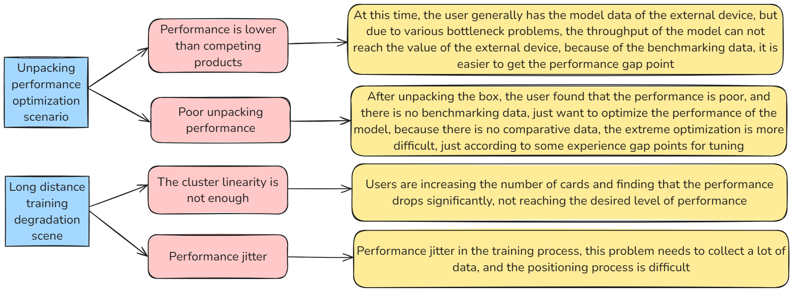

## Methods for Locating Issues

### Process for Locating Performance Issues

The basic performance tuning process for LLM training is as follows:

**Figure 1** Basic performance tuning process

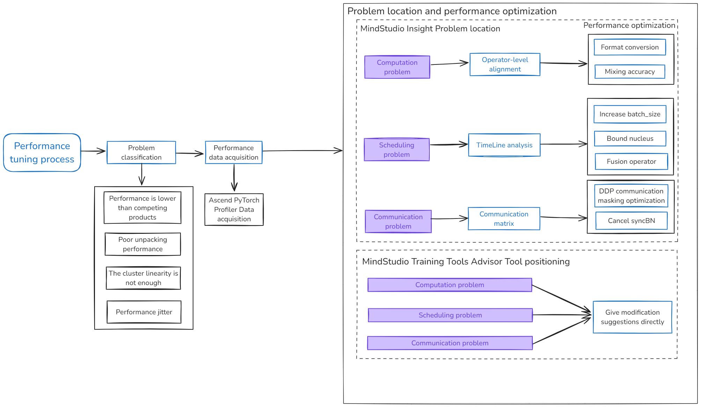

The first step in performance tuning is to identify the issue clearly, and then perform targeted optimization.

1. Collect performance data. You can use the APIs provided by Ascend PyTorch Profiler to collect and parse data.
2. Use the MindStudio Insight visualization tool to localize performance issues. The localization results usually fall into three directions: compute, scheduling, and communication.
3. Use the [advisor expert suggestion tool](https://atomgit.com/Ascend/msprof-analyze/blob/master/docs/en/user_guide/advisor_instruct.md) to help locate issues. The advisor tool uses a built-in case set to automatically analyze performance data and output performance tuning suggestions.
4. Tune specific issues using the corresponding tuning methods. After each tuning, **rerun the training**, **collect performance data**, and use the MindStudio Insight visualization tool to check whether the tuning method takes effect. Repeat this process until the performance issue is resolved.

### Collecting Performance Data with Ascend PyTorch Profiler<a name="case_of_troubleshooting_performance_bottleneck_in_llm_training01"></a>

Ascend PyTorch Profiler is a set of APIs for collecting performance data during LLM training under the Ascend PyTorch framework. It can collect and parse raw performance data from the framework side, the CANN side, and the device side.

For details about Ascend PyTorch Profiler, see [Ascend PyTorch Profiler](https://atomgit.com/Ascend/pytorch/blob/master/docs/en/developer_notes/ascend_pytorch_profiler_user_guide.md).

Add the following example code to the training script, such as a `train_*.py` file, to configure performance data collection parameters, and then start training.

```python
import torch
import torch_npu

# Prerequisite configuration parameters for Profiler collection and parsing
experimental_config = torch_npu.profiler._ExperimentalConfig(
    export_type=torch_npu.profiler.ExportType.Text,
    profiler_level=torch_npu.profiler.ProfilerLevel.Level1,
    msprof_tx=False,
    aic_metrics=torch_npu.profiler.AiCMetrics.PipeUtilization,
    l2_cache=False,
    op_attr=False,
    data_simplification=False,
    record_op_args=False,
    gc_detect_threshold=None
)
# Number of LLM training steps
steps = 7
with torch_npu.profiler.profile(
        activities=[
            torch_npu.profiler.ProfilerActivity.CPU,
            torch_npu.profiler.ProfilerActivity.NPU
        ],
        schedule=torch_npu.profiler.schedule(wait=0, warmup=0, active=2, repeat=2, skip_first=1),
        on_trace_ready=torch_npu.profiler.tensorboard_trace_handler("./result"),
        record_shapes=False,
        profile_memory=True,
        with_stack=False,
        with_modules=False,
        with_flops=False,
        experimental_config=experimental_config) as prof:
    for step in range(steps):
        # Model training
        train_one_step(step, steps, train_loader, model, optimizer, criterion)
        # Call the step method to collect and parse data
        prof.step()
```

The structure of the generated files is as follows:

```text
└── localhost.localdomain_139247_20240628101435_ascend_pt
    ├── profiler_info.json
    ├── profiler_metadata.json
    ├── ASCEND_PROFILER_OUTPUT
    │   ├── communication.json
    │   ├── communication_matrix.json
    │   ├── kernel_details.csv
    │   ├── memory_record.csv
    │   ├── npu_module_mem.csv
    │   ├── operator_details.csv
    │   ├── operator_memory.csv
    │   ├── step_trace_time.csv
    │   ├── op_statistic.csv
    │   ├── api_statistic.csv
    │   └── trace_view.json
    ├── FRAMEWORK
    └── PROF_000001_20230628101435646_FKFLNPEPPRRCFCBA
          ├── analyze
          ├── device_*
          ├── host
          ├── mindstudio_profiler_log
          └── mindstudio_profiler_output
```

### Localizing Issues with MindStudio Insight

MindStudio Insight provides a wealth of tuning analysis methods. It visually presents real hardware and software runtime data, analyzes performance data from multiple dimensions to locate performance bottlenecks, and supports cluster performance analysis at the scale of hundreds or thousands of devices or more.

Follow the [MindStudio Insight Tool User Guide](https://atomgit.com/Ascend/msinsight/blob/master/docs/en/user_guide/overview.md), specifically "Basic Operations > [Importing Data](https://atomgit.com/Ascend/msinsight/blob/master/docs/en/user_guide/basic_operations.md#importing-data)", to import the performance data collected by [Collecting Performance Data with Ascend PyTorch Profiler](#collecting-performance-data-with-ascend-pytorch-profiler) into MindStudio Insight. Then analyze the performance data by performing the following steps.

#### Viewing Overall Data on the Summary Page

You can view the details of each module on the Summary page. For details, see the [MindStudio Insight Tool User Guide](https://atomgit.com/Ascend/msinsight/blob/master/docs/en/user_guide/overview.md), "System Tuning > [Summary](https://atomgit.com/Ascend/msinsight/blob/master/docs/en/user_guide/system_tuning.md#summary)".

1. The "Parallel Strategy Analysis" module provides analysis perspectives for different parallel strategies, such as PP, TP, CP, DP, and EP.

   1. Select a parallel strategy by clicking its check box, and use the box annotations to identify parallel groups.
   2. When you select a different "Data Type", the corresponding heat map appears. Use the heat map to find the communication domains with performance issues. The redder the color, the worse the performance.

   **Figure 1** Parallel strategy analysis

   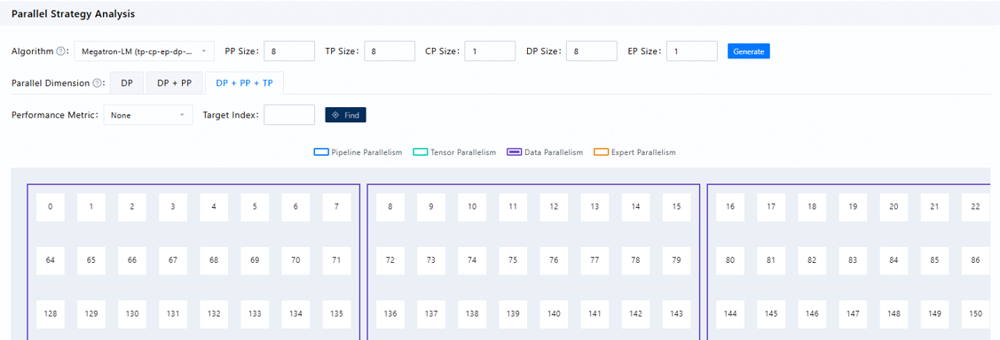

2. The compute/communication summary section shows the proportion of compute, communication, and idle time of each device in the selected communication domain and provides expert suggestions, as shown in the following figure.

   **Figure 2** Compute/communication summary

   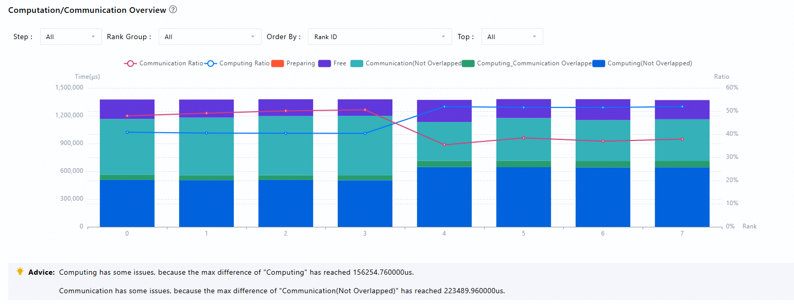

   The data metrics in the legend are described as follows:

   **Table 1** Data metrics

   | Data Metric | Description |
   | --- | --- |
   | Total compute time | Sum of the kernel time on Ascend devices. |
   | Pure compute time | Pure compute time = total compute time – communication time (overlapped). |
   | Communication time (overlapped) | Overlapped communication duration, that is, the duration during which compute and communication run at the same time. |
   | Communication time (not overlapped) | Non-overlapped communication duration, that is, the pure communication duration. |
   | Idle time | Duration during which neither compute nor communication is performed. |

Different metric patterns indicate different performance issues:

- **Compute issues**: These usually appear as an excessively large difference between the maximum and minimum proportions of total compute time in a communication domain. If the compute time of some compute devices clearly exceeds the normal range, those devices are likely carrying an overly heavy compute task. For example, the amount of data to process is too large, or the model computation is too complex. It is also possible that the performance of the devices themselves is limited.
- **Scheduling issues**: These usually appear as an excessively large difference between the maximum and minimum proportions of idle time in a communication domain. If the idle time of compute devices is too long, the delivery from the host side to the device side is abnormal, which also adversely affects cluster performance.
- **Communication issues**: If the communication time (not overlapped) is too long, coordination between compute and communication is problematic. The communication mode may have room for optimization, or the network bandwidth may be unstable, which prevents communication from working well with compute.

#### Compute Issues

When the data metrics indicate compute issues, you can view the operator data of the abnormal devices directly and compare it with that of normal devices. In this case, use the inter-device performance comparison function of MindStudio Insight. Following the instructions in the [MindStudio Insight Tool User Guide](https://atomgit.com/Ascend/msinsight/blob/master/docs/en/user_guide/overview.md), set two devices to comparison mode and view the results on the operator page. Take the compute issue in the following figure as an example. When the number of operators is the same, the average duration of MatMul operators increases significantly, which causes the compute time difference between the two devices.

**Figure 3** Compute operator type

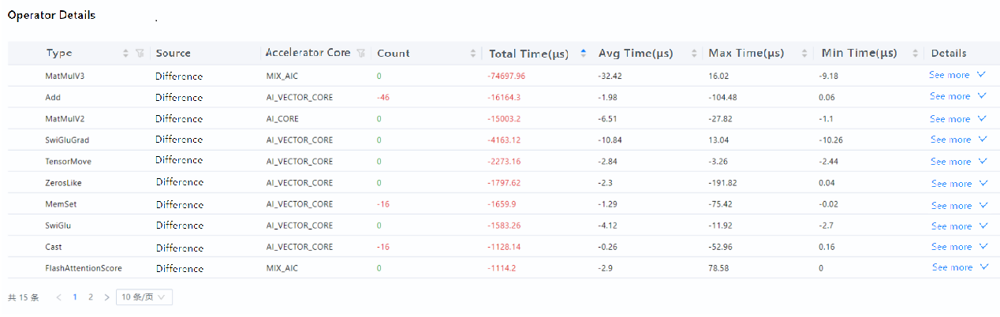

Experience shows that MatMul operators are likely to degrade under specific shapes. You can switch the grouping method to "Compute Operator Name and Input Shape" and sort by total duration to further identify the shapes under which MatMul operators degrade the most. After you locate the operator issue, contact the relevant operator developers to further confirm the cause of the issue.

**Figure 4** Compute operator name and input shape

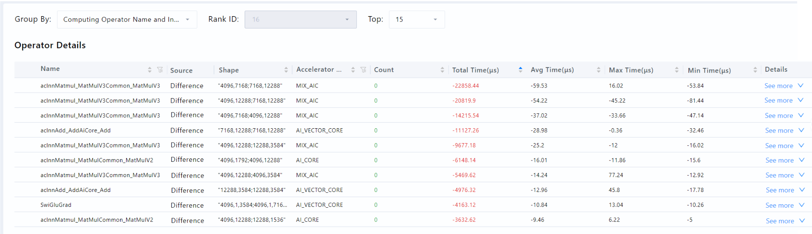

#### Scheduling Issues

When the data metrics indicate scheduling issues, compare the abnormal devices with normal devices on the Timeline page to further locate the operators that cause the issue. For details about the page, see the [MindStudio Insight Tool User Guide](https://atomgit.com/Ascend/msinsight/blob/master/docs/en/user_guide/overview.md), "System Tuning > [Timeline](https://atomgit.com/Ascend/msinsight/blob/master/docs/en/user_guide/system_tuning.md#timeline)". On the Timeline page, select the host-to-device link type. Host-to-device shows the delivery and execution relationship between CANN layer operators and Ascend Hardware operators, and between CANN layer operators and HCCL communication operators. You can use it to locate scheduling issues.

Host-to-device links usually have two shapes: slanted and vertical. The following figure shows a case with scheduling issues. If the host-to-device links are slanted, as shown on the left, scheduling tasks are arranged properly in this period, and the Ascend devices run compute and communication tasks at full load. If the host-to-device links are vertical, as shown on the right, the Ascend devices quickly finish the tasks delivered by the CPU and do not run compute and communication tasks at full load, which generally indicates scheduling issues. In this case, you can tune performance by increasing the batch size, binding CPU cores, or replacing operators with fused ones.

**Figure 5** Scheduling issues

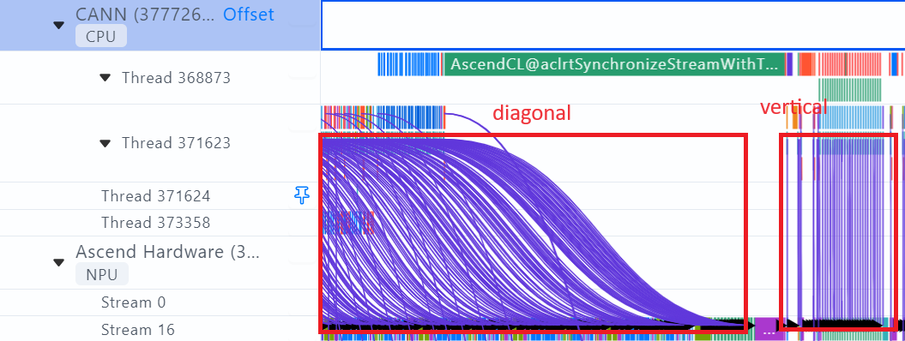

#### Communication Issues

When the data metrics indicate communication issues, go to the Communication page for further analysis. The Communication page shows the performance of all network links in the cluster and the communication performance of all nodes. By analyzing the overlap time between cluster communication and compute, you can find slow hosts or slow nodes in cluster training. Usually, you analyze performance issues based on key metrics such as the communication matrix and communication duration.

**Communication Matrix**

**Figure 6** Communication matrix

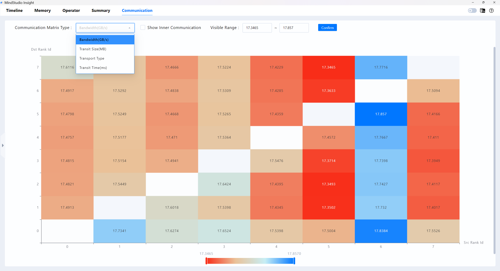

The preceding figure shows the communication matrix visualization page of MindStudio Insight. It provides information such as the bandwidth, transfer size, link type, and transfer duration between devices in each communication domain.

1. First, check the transfer size to determine whether the transfer volume differs between devices in the collective communication and whether the distribution is uneven.
2. Then, check the transfer duration and bandwidth. If these values are abnormal or differ greatly between devices, abnormal links exist in the communication domain.

**Communication Duration**

Communication duration is the time spent on communication between compute devices. Many factors can make communication take too long, such as incorrect communication protocol configuration and an excessively large amount of transferred data. Only by finding the links whose communication takes too long and resolving the issue can data be transferred between compute devices more smoothly, which improves the overall cluster performance.

After you select a specific communication domain, you can open the Communication Duration page to view the duration summary of each compute device in the domain, the HCCL thumbnail of communication operators, and the distribution of communication duration. This lets you quickly learn the relative position relationships of communication operators and detailed communication data.

**Figure 7** HCCL thumbnail

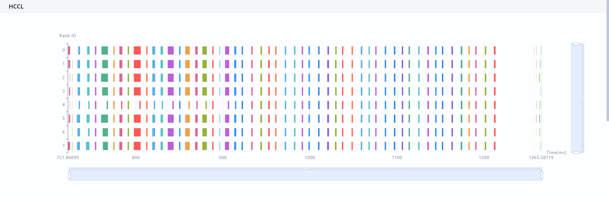

**Figure 8** Communication duration distribution

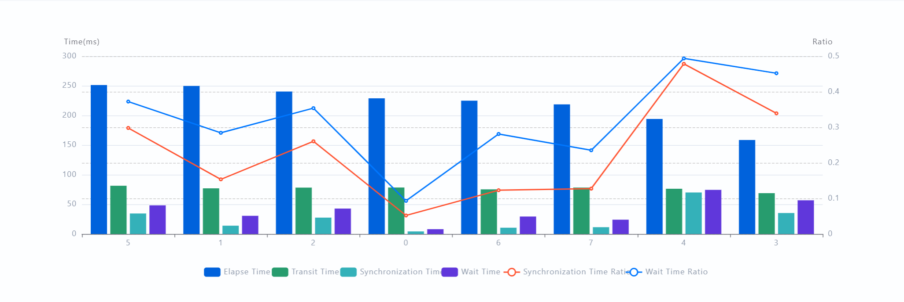

The preceding figure shows the communication duration analysis of a communication domain in a set of performance data. The communication duration data shows that device 3 has the longest synchronization time and device 4 has the shortest, and the difference in synchronization time is obvious. A long synchronization time generally means that the device is waiting for other devices, while a short synchronization time generally means that other devices are waiting for this device. Therefore, you can preliminarily determine that device 3 is a fast device and device 4 is a slow device.

## Performance Tuning Case Study

### Case Description

A multimodal model suddenly showed significant performance degradation during training. We will tune the performance by following the process described earlier.

Use Ascend PyTorch Profiler to collect performance data during LLM training. The cluster in this case has 16 devices in total.

> [!NOTE]
>
> The data in this case was analyzed based on an earlier version of the tools and data and serves as case guidance only. If the data and tool output differ from those of the latest version, the latest version output prevails.

### Analysis and Localization with MindStudio Insight

MindStudio Insight loads all data and locates the issue.

1. Summary page analysis: The proportion of communication time of each device in this communication domain is also high, and the total compute time (pure compute time + overlapped communication time) accounts for only one third of the total duration. Therefore, you can localize the issue as a communication issue.

   **Figure 1** Summary page

   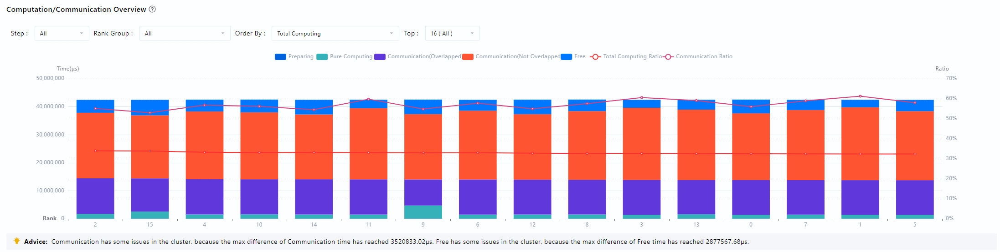

2. Switch to the Communication page: You can see a large number of inter-device asynchronizations (the red part in the box), which indicates that many operators have been waiting for a long time. Select the most obvious slow device (device 12) to analyze the cause in detail.

   **Figure 2** Communication page

   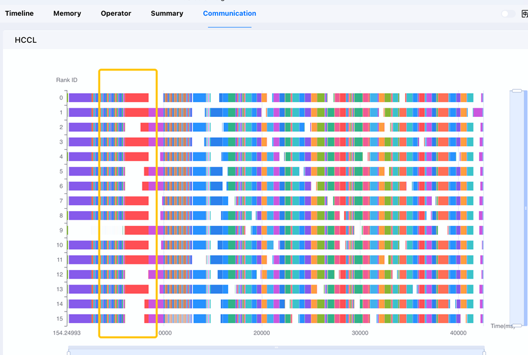

3. Switch to the Timeline page: device 12 clearly has long periods of Free (idle time), and many events on the AscendCL side occupy resources. You can preliminarily determine that the high memory usage of this device causes memory defragmentation when new data is requested, which results in long idle periods. You can use `export PYTORCH_NPU_ALLOC_CONF="expandable_segments:True"` to resolve the memory fragmentation issue and improve memory utilization. The performance issue is resolved after debugging.

   **Figure 3** Timeline page

   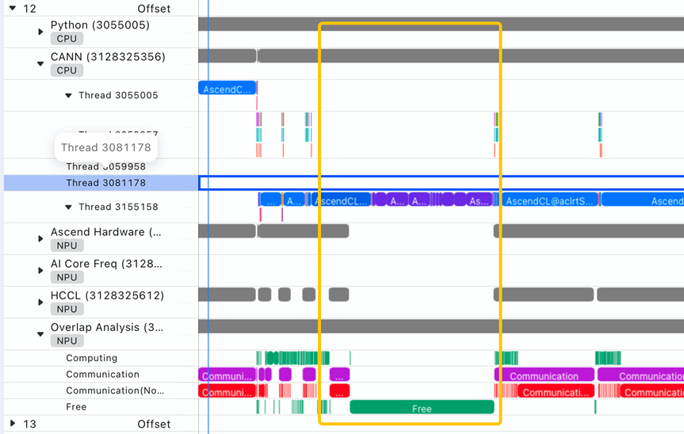

   **Figure 4** Timeline page

   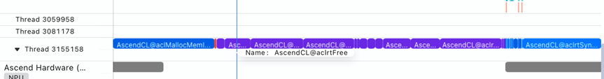

### Localization with advisor

You can also use the [advisor expert suggestion tool](https://atomgit.com/Ascend/msprof-analyze/blob/master/docs/en/user_guide/advisor_instruct.md) to help locate the issue in this case.

1. Run the `msprof-analyze advisor all -d $HOME/profiling_data/` command to obtain the path of the file that stores the expert suggestions. `$HOME/profiling_data/` is the path where the performance data is stored.

   **Figure 1** advisor output

   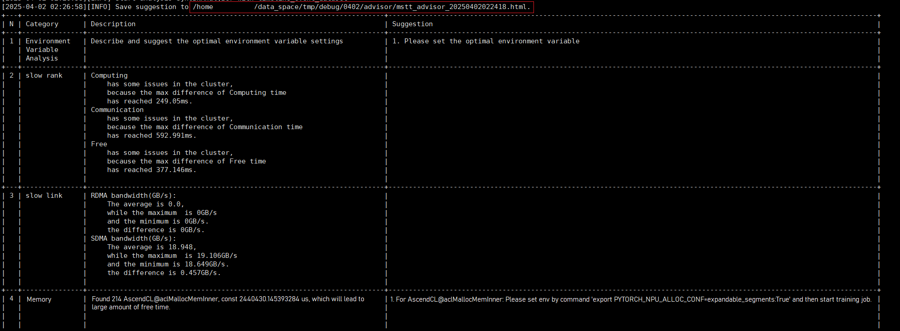

2. Open the HTML file to view the suggestions in the red box. They are consistent with our analysis conclusion, and the performance issue can be resolved.

   **Figure 2** advisor expert suggestions

   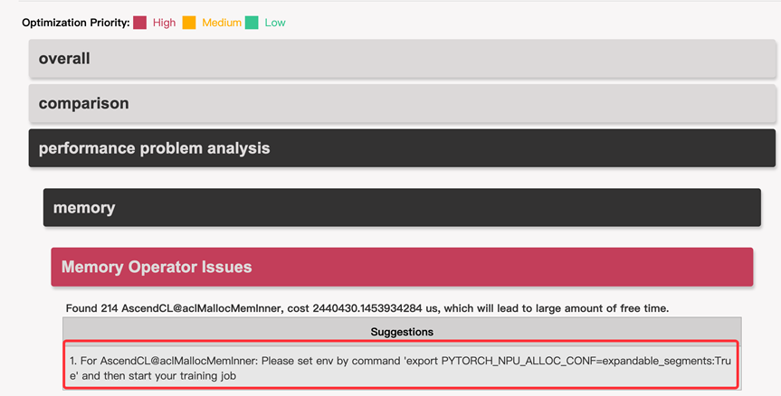
