# Performance Tool Usage

## Overview of Performance Tools

This chapter systematically describes how to efficiently use the tuning toolchain in training and inference tasks to implement a complete closed-loop process from performance data collection to issue locating. The training scenario focuses on model tuning, while the inference scenario covers both model tuning and service-oriented tuning. This chapter focuses on **model tuning** and **service-oriented tuning**.

**Model Tuning**

| Tuning Step | Tool | Details |
| ----------- | ---- | ------- |
| Performance data collection | Depending on how collection is enabled, it falls into the following categories: msprof CLI collection and AI framework Profiler interface collection. For details, see [Model Tuning Performance Data Collection Tools](#model-tuning-performance-data-collection-tools). AI framework Profiler interface collection &#8226; PyTorch scenario: Ascend PyTorch Profiler &#8226; MindSpore scenario: MindSpore Profiler msprof CLI collection The msprof CLI tool does not collect AI framework layer data. | Select an appropriate performance data collection tool to record the AI framework and Ascend hardware and software data required during model running. For details, see [Model Tuning Performance Data Collection Tools](#model-tuning-performance-data-collection-tools). The msprof CLI tool mainly collects CANN layer and NPU layer performance data and serves as the foundation for other collection interfaces. The AI framework Profiler interface encapsulates the msprof CLI tool and additionally collects and parses AI framework layer performance data. Therefore, it is the most commonly used collection method in training or online inference scenarios. By function, AI framework Profiler interfaces fall into the following modes: regular collection (that is, static collection), dynamic collection, and online monitoring. In addition, some training or inference suites further encapsulate the AI framework Profiler interface, and you can call it directly through the interface provided by the suite, such as [MindSpeed-MM](https://atomgit.com/Ascend/MindSpeed-MM/blob/master/docs/en/tools.md#profiling-tool) and [MindFormers](https://www.mindspore.cn/mindformers/docs/zh-CN/r1.3.2/perf_optimize/perf_optimize.html#profiler工具). |
| Performance data analysis | Quick analysis tools for model tuning: &#8226; Cluster analysis (`cluster_analyze`) &#8226; Expert advice (`advisor`) &#8226; Performance breakdown comparison (`compare`) For details, see [Quick Analysis for Model Tuning (msprof-analyze CLI)](#quick-analysis-for-model-tuning-msprof-analyze-cli). | For a quick preliminary analysis, you can use the functions provided by msprof-analyze: &#8226; `cluster_analyze`: In cluster scenarios where all data cannot be analyzed directly, such as with thousands or tens of thousands of devices, you can use this tool to extract cluster iteration duration and communication data and quickly locate slow devices, slow nodes, and slow links. You are advised to use this tool together with the Summary and Communication tabs of the MindStudio Insight visualization tool. For details, see the [Cluster Performance Analysis](#cluster-performance-analysis) chapter of MindStudio Insight. &#8226; `advisor`: This tool turns the identification of common issues and optimization suggestions into tool capabilities, helping you quickly narrow down and locate typical performance issues or determine the direction for further analysis. &#8226; `compare`: This tool compares training duration and memory usage to locate the specific degraded operators/APIs and helps you improve performance tuning efficiency. It supports single-device performance comparison between GPU and NPU and between NPU and NPU. It is better suited to scenarios with baseline comparison data, such as performance degradation after GPU-to-NPU migration and performance jitter.|
| Performance data visualization | In-depth analysis tool for model tuning. For details, see [In-Depth Analysis for Model Tuning (MindStudio Insight)](#in-depth-analysis-for-model-tuning-mindstudio-insight). | The MindStudio Insight visualization tool displays complete Profiling data graphically, helping you deeply understand and accurately locate the root cause of issues. This tool uses a top-down analysis method, that is, it drills down progressively from the macro level to the micro level and from the entire cluster to a single node. For details about its usage strategy and specific operations, see [In-Depth Analysis for Model Tuning (MindStudio Insight)](#in-depth-analysis-for-model-tuning-mindstudio-insight). |

**Service-Oriented Tuning**

Only the inference scenario involves service-oriented tuning. For details about how to use service-oriented tuning tools, see [Service-Oriented Tools](#service-oriented-tools).

| Tuning Step | Tool | Details |
| ----------- | ---- | ------- |
| Environment pre-check | Inference pre-check tool (msprechecker) | This step belongs to the broad scope of performance tuning. It checks whether issues with the system, environment variables, or configuration files affect the overall service performance. |
| Quick analysis | &#8226; Service-oriented advisor tool (msserviceadvisor) &#8226; Automatic parameter optimization tool (modelevalstate) | &#8226; The service-oriented advisor tool suits scenarios that require quick improvement of service-oriented performance, but it does not support fine-grained tuning. &#8226; The automatic parameter optimization tool is suitable for improving service performance in a targeted manner and can achieve nearly 95% of the performance achieved by the best manual tuning. |
| In-depth analysis | Service-oriented tuning tool (msServiceProfiler) | This step performs in-depth analysis and suits users with extensive experience in service-oriented operations. |

## Model Tuning Tools

### Usage Steps

Model tuning can be divided into performance collection and performance analysis, as described below:

1. **Collect performance logs**: You are advised to analyze the Profiling logs first. For how to use the tools, see [Model Tuning Performance Data Collection Tools](#model-tuning-performance-data-collection-tools).

   > [!NOTE]
   >
   > - When you collect performance data for the first time, you are advised to collect only L1 data and disable the call stack (that is, set `with_stack` to `False`). You can set `warmup` to 1 and `active` to 2 to collect data for two steps.
   > - If competitor analysis is involved, you are advised to collect the performance metrics of the competitor under the same conditions (including but not limited to the number of steps collected, hyperparameter settings, and the data used).

2. **Analyze performance bottlenecks**: After you collect the Profiling logs, use performance analysis tools to analyze bottlenecks.

   1. Use the msprof-analyze tool for a preliminary analysis to locate performance issues at a coarse granularity and to determine a clear direction for subsequent in-depth analysis. For details, see [Quick Analysis for Model Tuning (msprof-analyze CLI)](#quick-analysis-for-model-tuning-msprof-analyze-cli).
   2. Use the MindStudio Insight tool to further identify bottleneck points and thoroughly analyze the root cause of the issue. For details, see [In-Depth Analysis for Model Tuning (MindStudio Insight)](#in-depth-analysis-for-model-tuning-mindstudio-insight).

### Model Tuning Performance Data Collection Tools

MindStudio provides multiple flexible system-level performance data collection methods. You can select an appropriate method based on actual requirements to accurately locate performance bottlenecks and improve training efficiency.

Depending on how they are enabled, these methods fall into the following categories: CLI collection (msprof) and AI framework Profiler interface collection (Ascend PyTorch Profiler and MindSpore Profiler).

The msprof CLI tool mainly collects CANN layer and NPU layer performance data and serves as the foundation for other collection interfaces.

> [!NOTE]
>
> The msprof CLI tool does not collect AI framework layer data.

The AI framework Profiler interface encapsulates the msprof CLI tool and additionally collects and parses AI framework layer performance data, making it **the most commonly used collection method**. By function, AI framework Profiler interfaces fall into the following modes: regular collection (that is, static collection), dynamic collection, and online monitoring.

In addition, some training or inference suites further encapsulate the AI framework Profiler interface, and you can call it directly through the interface provided by the suite, such as [MindSpeed-MM](https://atomgit.com/Ascend/MindSpeed-MM/blob/master/docs/en/tools.md#profiling-tool) and [MindFormers](https://www.mindspore.cn/mindformers/docs/zh-CN/r1.3.2/perf_optimize/perf_optimize.html#profiler工具).

**Figure 1** Performance collection framework

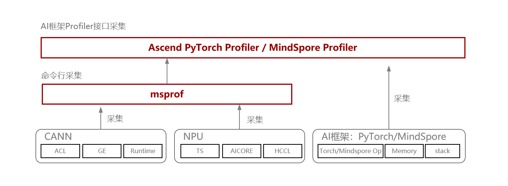

**Table 1** Collection method description

| Collection Method | Features | Recommended Scenario | Reference Documentation |
| --------------------- | ------------ | ------------------------ | --------------------------- |
| msprof CLI collection | The msprof CLI tool can collect and parse performance data such as AI task running performance data and Ascend AI processor system data. The msprof CLI tool does not collect AI framework layer data. | This method is available in both training and inference scenarios. | [msProf Model Tuning Tool](https://atomgit.com/Ascend/msprof/blob/master/docs/en/quick_start/msprof_quick_start.md) |
| Ascend PyTorch Profiler interface collection | It is fully aligned with the usage in the PyTorch GPU scenario and can collect PyTorch framework data and Ascend hardware and software data. | Regular performance analysis based on PyTorch. | [Ascend PyTorch Tuning Tool](https://atomgit.com/Ascend/pytorch/blob/v2.14.0-26.2.0/docs/en/developer_notes/ascend_pytorch_profiler_user_guide.md) |
| MindSpore Profiler interface collection | It can collect MindSpore framework data and Ascend hardware and software data. | Regular performance analysis based on MindSpore. | [MindSpore Tuning Tool](https://atomgit.com/Ascend/docs/blob/master/MindStudio/master/en/menu/mindspore_profiler_user_guide.md) |

When you use the AI framework Profiler for collection, you can configure parameters by referring to [Table 2](#ZH-CN_TOPIC_0000002504087082__table3829mcpsimp).

**Table 2** Parameter configuration

| Scenario | Parameter Configuration |
| -------- | ----------------------- |
| Regular performance analysis scenario | &#8226; `profiler_level=Level1` &#8226; Keep `aic_metrics` at the default value `PipeUtilization` &#8226; Set `activities` to collect CPU and NPU data &#8226; Enable other switches as required |
| NPU/GPU comparison scenario | This configuration compares the end-to-end duration of the NPU and GPU: &#8226; `profiler_level=Level0` &#8226; Set `activities` to collect only NPU data or CPU and NPU data (as required) &#8226; Disable other switches |
| Code location scenario | If you need to locate the code position of an abnormal operator, enable the `with_stack` or `with_modules` switch in a regular scenario to enable the call stack (enable it only when necessary, as it causes performance overhead to increase). |
| Analyze the NPU on-chip memory allocation of operators | `profile_memory=True` |
| Analyze cluster communication | `profiler_level=Level1` |

The collection methods in [Table 1](#ZH-CN_TOPIC_0000002504087082__table38291mcpsimp) can be divided by function into regular collection, dynamic collection, and lightweight online performance data monitoring, as shown in [Table 3](#ZH-CN_TOPIC_0000002504087082__table1893295514719).

**Table 3** Collection categories

| Collection Method | Features | Recommended Scenario |
| --------------------- | ------------ | ------------------------ |
| Regular collection | Set a collection period in advance or collect all data, and write detailed performance data to drive. | Regular performance analysis |
| `dynamic_profile` dynamic collection | During model training, you can **start the collection process at any time** and **dynamically modify collection configuration items** without frequently changing script code. | Scenarios with high start-stop costs (such as ultra-large-scale training) |

### Quick Analysis for Model Tuning (msprof-analyze CLI)

For performance bottlenecks in AI jobs, the [msprof-analyze tool](https://atomgit.com/Ascend/msprof-analyze/blob/master/docs/en/quick_start/msprof-analyze_quick_start.md) provides a CLI tool for quick analysis. It has the following core capabilities, as shown in [Table 1](#ZH-CN_TOPIC_0000002535887119__table2845mcpsimp).

**Table 1** Core capabilities of the msprof-analyze tool

| Tool | Function Description |
| -------- | ------------------------ |
| `cluster_analyze` (cluster analysis) | It can locate slow nodes, slow devices, and slow links, and can be used together with the MindStudio Insight visualization tool. |
| `compare` (performance breakdown comparison) | It compares operators between NPU and GPU and between two NPUs in terms of time and memory, helping you quickly locate the problematic operator. |
| `advisor` (expert advice) | Based on the experience of performance tuning experts and the affinity between Ascend hardware and software and operators, it provides automated tuning capabilities, helping you identify performance bottlenecks and giving optimization suggestions. |

- `cluster_analyze` (cluster analysis)

  `cluster_analyze` (cluster analysis) results are displayed by the MindStudio Insight visualization tool to assist with communication matrix and communication duration analysis.

  **Figure 1** Example of visualizing cluster analysis results with MindStudio Insight

  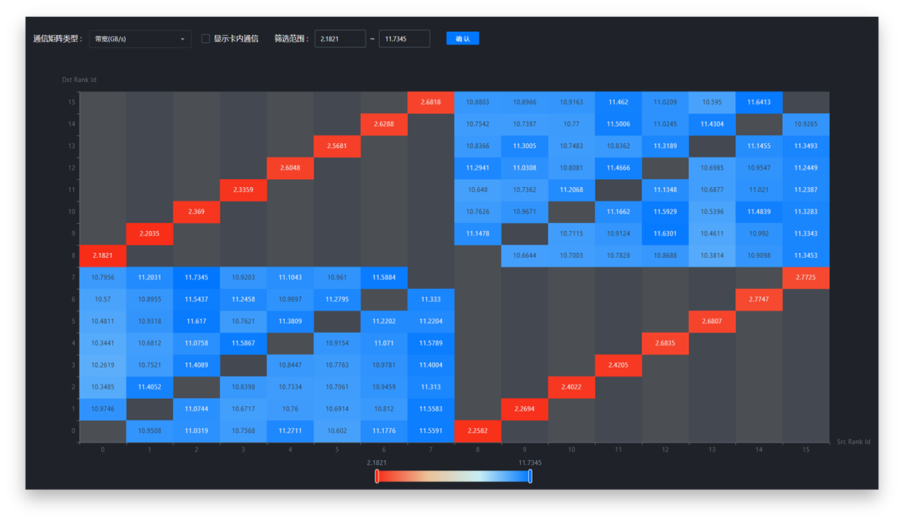

- `compare` (performance comparison)

  The `compare` tool breaks down the duration into the following core dimensions: **operator execution, communication (the portion not masked by computation), scheduling overhead, and memory usage**. This helps accurately locate performance bottlenecks.

  **Figure 2** Example of a compare tool analysis report

  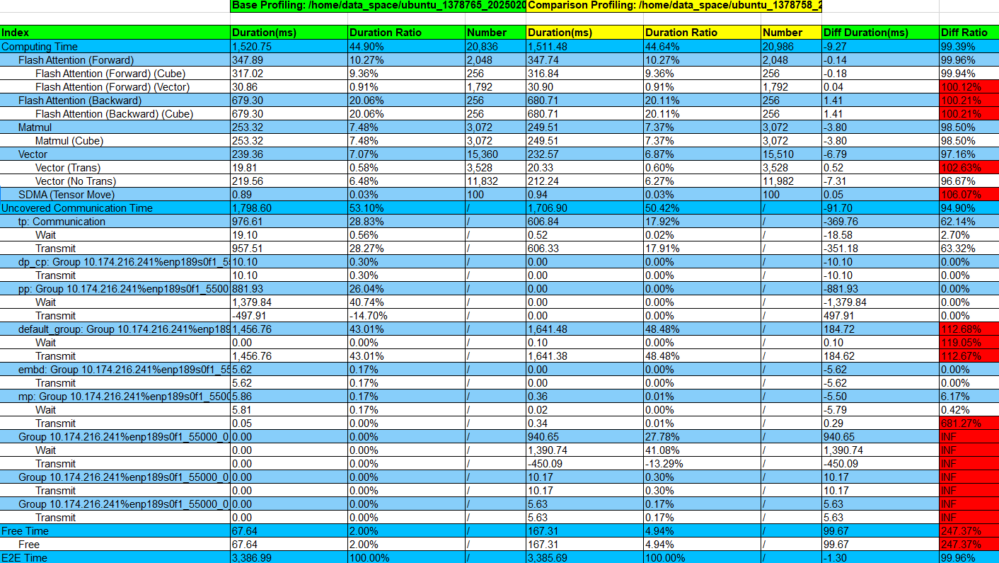

- `advisor` expert advice

  The `advisor` tool automatically identifies performance bottlenecks and gives optimization suggestions. It covers dimensions such as dispatch, computation, and communication in cluster and single-device scenarios, helping you analyze Profiling data end to end.

  **Figure 3** Main functions of the advisor tool

  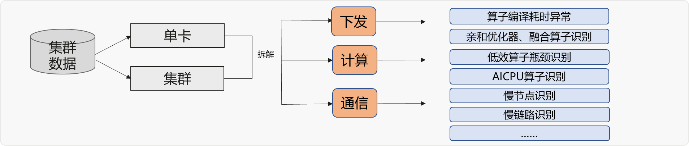

  The `advisor` tool grades optimization suggestions by urgency. Red labels indicate the highest priority and must be handled first.

  **Figure 4** Example of an advisor tool analysis report

  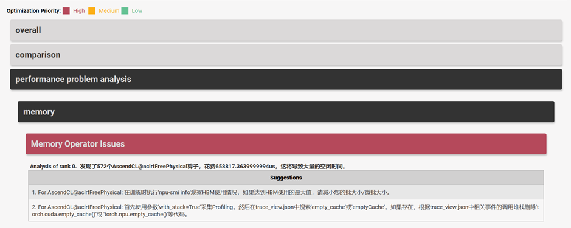

### In-Depth Analysis for Model Tuning (MindStudio Insight)

#### Overview

The MindStudio Insight tool visually presents all Profiling data to help you further analyze and confirm issues.

The process for using the MindStudio Insight tool to analyze issues is shown in [Figure 1](#ZH-CN_TOPIC_0000002535807093__fig71814018265).

**Figure 1** Flowchart for analyzing issues with the MindStudio Insight tool

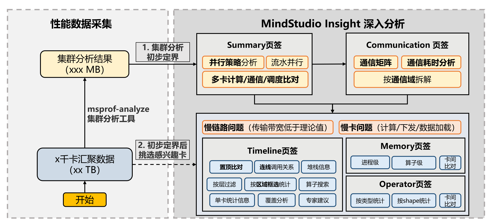

1. Use the cluster analysis function to narrow down the scope.

   1. Enter the Summary page first and compare computation, communication, and scheduling across devices to preliminarily determine the issue category. For details about this scoping process, see [Summary](#summary).

   2. Then enter the Communication page and break down data by communication domain to further locate slow device or slow link issues. After you identify an abnormal device or abnormal link, you can jump directly to the Timeline based on the communication operator to pinpoint the issue. For details, see [Communication](#communication).

      > [!NOTE]
      >
      > - When the number of devices is small, you can directly import the raw performance data to automatically generate cluster analysis results (the visualization tool calls the msprof-analyze CLI tool).
      > - When there are too many devices and the full performance data is too unwieldy, you are advised to manually call the msprof-analyze tool from the CLI and open the `cluster_analysis_output` cluster analysis deliverable with MindStudio Insight, which is lighter and faster.

2. After narrowing down the scope, select the required devices and further analyze from the single-device dimension.

   - Timeline page: It lays out the details of host and device execution during training or inference on a time axis, intuitively presenting API duration on the host side and Task duration on the device side. For details about how to use it, see [Timeline](#timeline).
   - Memory page: It presents the overall memory trend as a memory line chart. You can box-select and zoom in on the peak areas in the line chart to accurately locate the process or operator that consumes a large amount of memory. For details about how to use it, see [Memory](#memory).
   - Operator page: It provides duration statistics for compute operators and communication operators, which can be counted by type or Shape. It also supports comparison between two devices for a more intuitive view of operator details. For details about how to use it, see [Operator](#operator).

#### Obtaining Software Packages

The ways to obtain the software package and documentation of the MindStudio Insight tool are shown in [Table 1](#ZH-CN_TOPIC_0000002535887061__table4505318193511). Download the appropriate version based on your requirements.

**Table 1** Ways to obtain the software package and documentation

| Category | Link |
| -------- | ---- |
| Software package | [Link](https://www.hiascend.com/developer/software/mindstudio/download) |
| Documentation | [Link](https://atomgit.com/Ascend/msinsight/blob/master/docs/en/user_guide/overview.md) |

#### Cluster Performance Analysis

##### Summary

Common functions on the Summary page include **parallel strategy analysis, pipeline parallelism analysis, comparison of computation, communication, and scheduling across multiple devices, and expert load balancing analysis for MoE LLMs**.

**Preliminary Characterization**

First, compare the computation, communication, and scheduling time across devices to preliminarily characterize the issue, that is, to determine whether any part accounts for an excessively high proportion or whether there is severe desynchronization between devices with large fluctuations in communication time among devices (the fast/slow device issue). The Summary page is shown in [Figure 1](#ZH-CN_TOPIC_0000002503927234__fig135675411608).

**Figure 1** Summary page

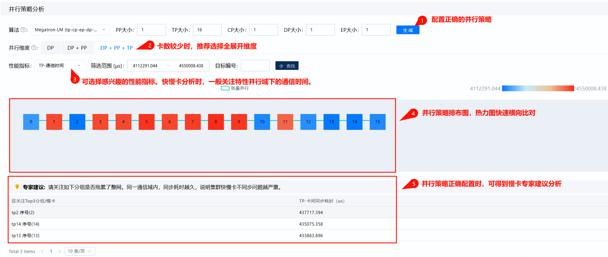

Common operation steps are as follows:

1. Configure the correct parallel strategy, that is, ensure that the parallel strategy parameter values are consistent with the parallel parameter configuration used in actual model training/inference. You can confirm the specific parallel parameters with the model developers.
2. When the number of devices is small, you are advised to select the fully expanded dimension, that is, the "DP + PP + TP" dimension.
3. You can select the performance metrics of interest for heatmap rendering to quickly compare performance metrics horizontally. During fast/slow device analysis, you generally focus on the communication time in a specific parallel domain.
4. View the parallel strategy layout diagram to quickly compare horizontally through the heatmap rendering effect.
5. When the parallel strategy is configured correctly, you can obtain `advisor` analysis for slow devices.
6. In the "Computation/Communication Overview" page at the bottom, view the comparison of computation, communication, and scheduling duration across devices to preliminarily confirm whether computation, communication, dispatch, or fast/slow device issues exist.

**Typical Cases**

- Typical case 1: As shown in [Figure 2](#ZH-CN_TOPIC_0000002503927234__fig1879412319517), the communication time fluctuates greatly among devices, there is severe desynchronization between devices, and the proportions of computation, idle time (that is, dispatch), and communication are inversely related. A device with a low proportion of communication time and high proportions of computation and idle (that is, dispatch) time is a slow device. You can preliminarily confirm that this cluster has a fast/slow device issue. To further locate the fast/slow device issue, see [Timeline operation case for locating fast/slow devices](solution_to_top1.md#timeline-based-fast-and-slow-device-localization-example).

  **Figure 2** Typical case 1

  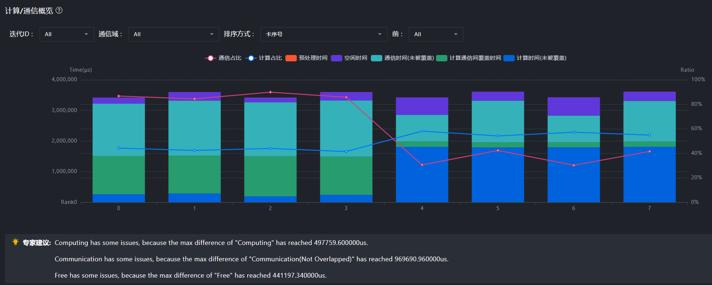

- Typical case 2: As shown in [Figure 3](#ZH-CN_TOPIC_0000002503927234__fig1531948185114), the idle time accounts for a relatively high proportion, indicating that this cluster has a significant dispatch bottleneck. See [Locating and Resolving Host Bound Issues](solution_to_top3.md) for further locating and optimization. The communication time also accounts for a relatively high proportion and fluctuates among devices. See [Communication Issue Optimization Solutions](solution_to_top1.md) for further locating and optimization.

  **Figure 3** Typical case 2

  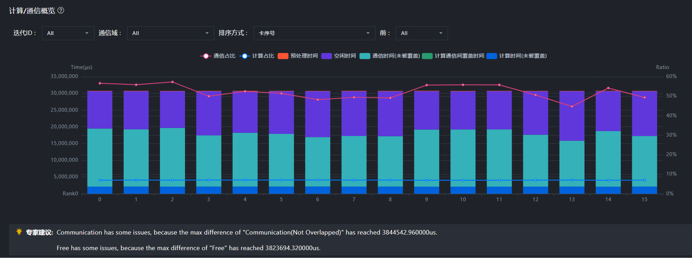

  When the number of devices is large, the full amount of data presented is too much for viewing and analysis, as shown in [Figure 4](#ZH-CN_TOPIC_0000002503927234__fig18983117211). You need to **simplify and split** the data in a reasonable way to make the analysis direction clearer.

  **Figure 4** Full data display on the "Computation/Communication Overview" page

  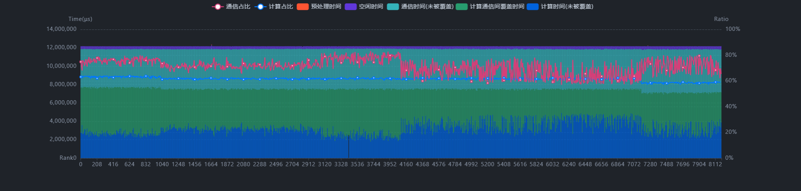

  Simplification method 1: Left-click a communication domain connection (for example, ① in [Figure 5](#ZH-CN_TOPIC_0000002503927234__fig189831172111)) to view a single communication domain and obtain an overview diagram broken down by communication domain. You can also click a box for a similar effect (the same connection line represents the same communication domain, and the same box represents the same parallel group).

  **Figure 5** Computation/Communication Overview broken down by communication domain

  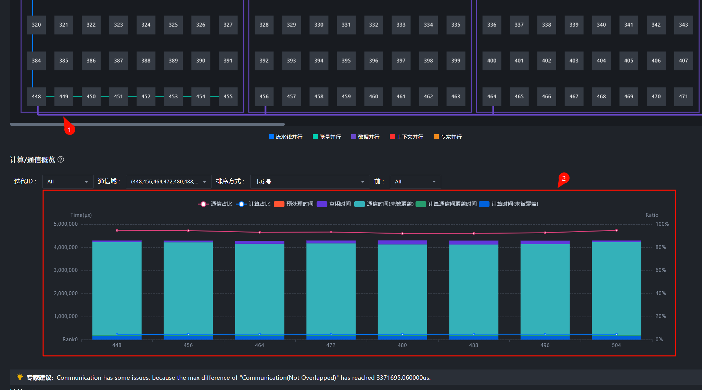

  Simplification method 2: View the collapsed view first and progressively narrow down from the whole to the part. Take a 512-device cluster with the parallel strategy DP8, PP8, and TP8 as an example. Its fully expanded dimension (that is, the "DP + PP + TP" dimension) has 512 devices. After you collapse the TP dimension (that is, the "DP + PP" dimension), every 8 devices in a TP domain are merged into one node. Therefore, the view is collapsed to 64 nodes. You can first select the "DP + PP" dimension to preliminarily locate slow groups, and then enter the "DP + PP + TP" dimension to locate slow devices.

  1. In the "DP + PP" dimension, select "DP-Average Communication Time" for "Performance Metrics". You can observe that slow groups exist at `dpIndex=4` and 7, as shown in [Figure 6](#ZH-CN_TOPIC_0000002503927234__fig17985111822).

     **Figure 6** DP+PP dimension (TP collapsed)

     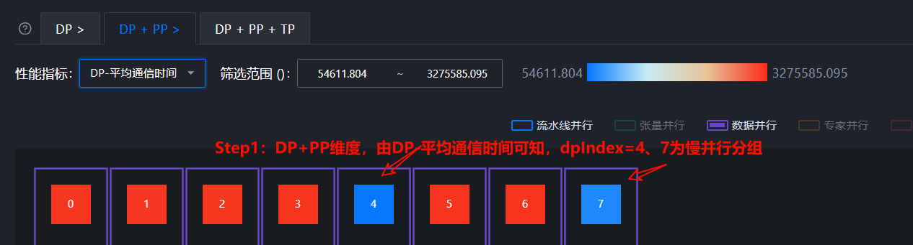

  2. Take the parallel group `dpIndex=4` as an example. Right-click 4 and choose "Expand" to jump to the "DP + PP + TP" dimension, as shown in [Figure 7](#ZH-CN_TOPIC_0000002503927234__fig3995119219). You can then switch "Performance Metrics" to "TP-Communication Time" and see that the slow device is device 38, that is, device 38 affects the TP domain (32-39) and further affects `dpIndex0` to `dpIndex7` in [Figure 6](#ZH-CN_TOPIC_0000002503927234__fig17985111822).

     **Figure 7** DP+PP+TP dimension (fully expanded dimension)

     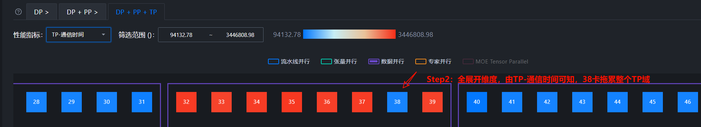

  3. After you locate the slow device, right-click the communication domain connection of interest (for example, the green connection here, which represents the TP communication domain) to view the communication duration analysis, and go to the Communication page to further analyze the communication process of the slow device, as shown in [Figure 8](#ZH-CN_TOPIC_0000002503927234__fig12999111628) and [Figure 9](#ZH-CN_TOPIC_0000002503927234__fig199171113216).

     **Figure 8** Right-click a connection to view the communication duration analysis

     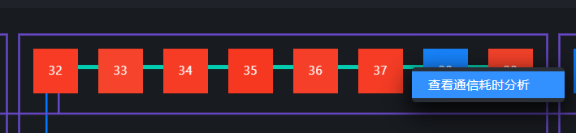

     **Figure 9** Communication page - communication duration analysis

     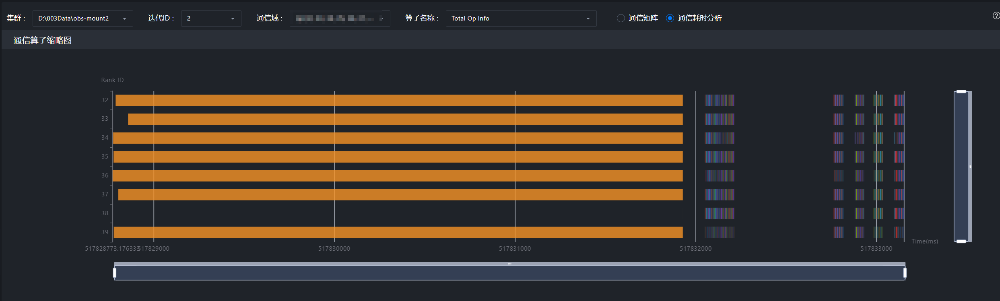

##### Communication

The Communication tab breaks down communication metrics by communication domain. If the Summary page shows that the communication time is too long, you can use the Communication page to further confirm whether slow device or slow link issues exist. You can switch between the **communication matrix** view and the **communication duration analysis** view at the position marked by the red box in [Figure 1](#ZH-CN_TOPIC_0000002503927296__fig667414820578).

**Figure 1** Switching between the communication matrix and communication duration analysis views

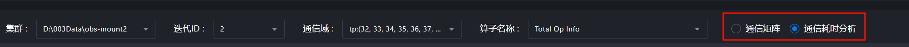

**Procedure**

1. On the Communication page, select "Communication Duration Analysis" and view the "Communication Duration" chart to confirm whether the proportion of transmission time in the communication time is too high, as shown in [Figure 2](#ZH-CN_TOPIC_0000002503927296__fig1125010131226).

   In this chart, **excessively long transmission time indicates a slow link issue**, and **excessively long synchronization time** indicates a **slow device** issue.

   **Figure 2** Communication duration

   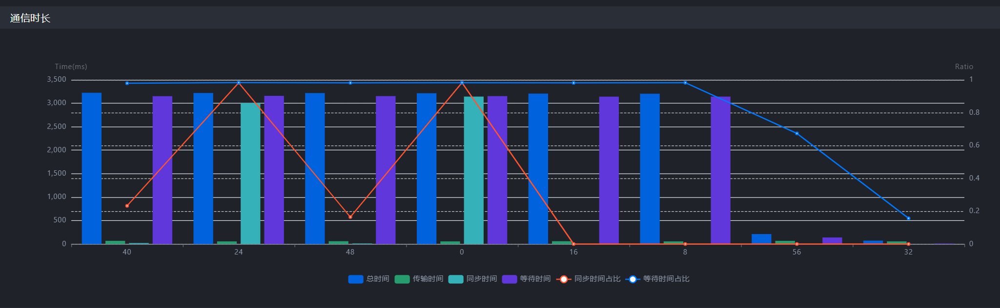

2. If the proportion of transmission time is too high, select "Communication Matrix" and view the communication matrix chart to analyze whether the transmission bandwidth is far lower than the empirical bandwidth, as shown in [Figure 3](#ZH-CN_TOPIC_0000002503927296__fig136271632185319). Provided that the amount of transmitted data is sufficient, if the bandwidth is significantly lower than the expected bandwidth, you can consider that there is room for optimization. Common causes of slow links include communication retransmission, small communication packets, and unaligned data packet bytes. For details, see the related cases in [Communication Issue Optimization Solutions](solution_to_top1.md).

   **Figure 3** Communication matrix

   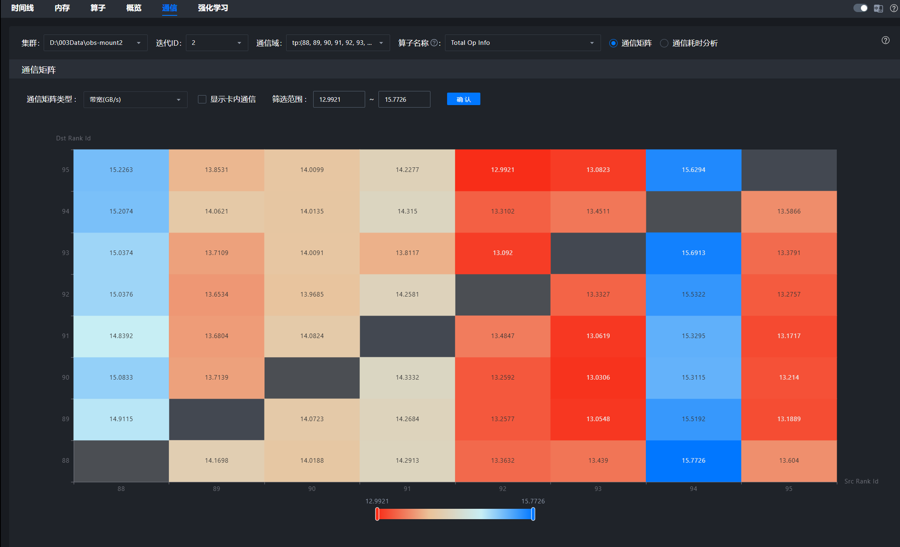

3. If the proportion of transmission time is low while the proportion of waiting or synchronization time is high, the issue is a fast/slow device issue, and you need to select "Communication Duration Analysis". View the "Communication Operator Thumbnail" with communication operators laid out horizontally to identify the slow device, as shown in [Figure 4](#ZH-CN_TOPIC_0000002503927296__fig2429143613918). For the green `hcom allGather` collective communication operator, devices 4, 5, and 13 have shorter durations and are slow devices, while devices with longer durations (for example, devices 11 and 14) are relatively fast devices. Next, you need to analyze what the slow devices do during the idle time. Go to the Timeline page to view the specific differences. For details, see [Timeline operation case for locating fast/slow devices](solution_to_top1.md#timeline-based-fast-and-slow-device-localization-example).

   **Figure 4** Identifying the slow device

   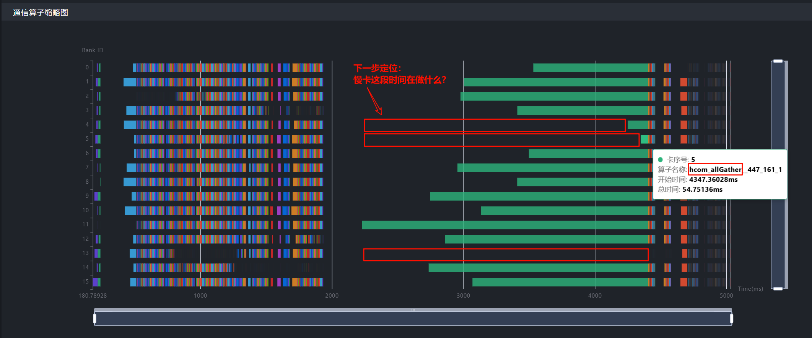

**Jumping between Communication and Timeline**

- You can jump between the Communication page and the Timeline page based on communication operators, as shown in [Figure 5](#ZH-CN_TOPIC_0000002503927296__fig16998195192919) and [Figure 6](#ZH-CN_TOPIC_0000002503927296__fig368718341305).

  If you locate an abnormal device and abnormal communication operator on the Communication page, you can jump to the Timeline view to further confirm the root cause of the issue. If you observe a communication operator with an abnormally long duration on the Timeline page, you can also jump to the Communication page to find out whether a slow device in the same communication domain is holding back this device and causing a long waiting time.

  **Figure 5** Jumping from an operator on the Communication page to the Timeline page

  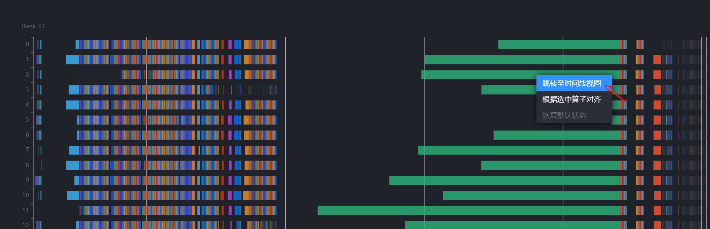

  **Figure 6** Jumping from a communication operator on the Timeline page to the Communication page

  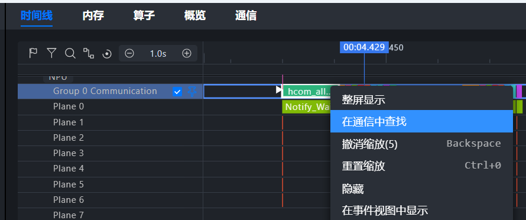

#### Single-Device Performance Analysis

##### Timeline

The Timeline lays out the details of host and device execution during training or inference on a time axis, intuitively presenting API duration on the host side and Task duration on the device side. Commonly used lanes and the page are shown in [Figure 1](#ZH-CN_TOPIC_0000002535807019__fig1128122615409), and page information is described in [Table 1](#ZH-CN_TOPIC_0000002535807019__table9307154914018).

**Figure 1** Commonly used Timeline lanes and the page

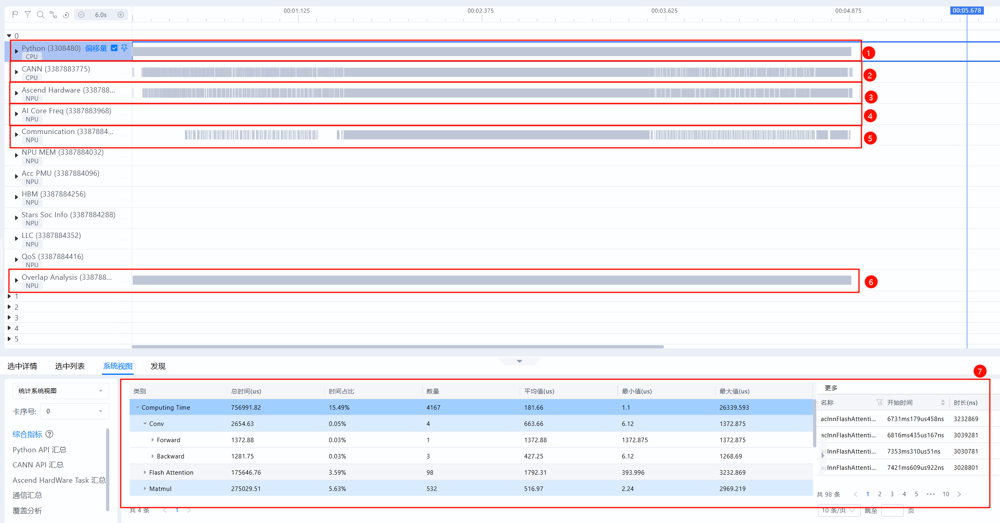

**Table 1** Description of commonly used Timeline lanes and page information

| No. | Name | Description |
| --- | ---- | ----------- |
| 1 | Python lane (level-1 pipeline) | View Python layer code. Enable the `with_stack` switch during collection to view the code call stack. |
| 2 | CANN lane (level-2 pipeline) | Collect data such as ACL interface execution, GE fusion, and Runtime. Operators on the Python side are dispatched from the level-1 pipeline to this level-2 pipeline, and tasks are dequeued from the level-2 pipeline and then dispatched to the NPU layer. |
| 3 | Ascend Hardware (NPU layer) | Also called the device side. It records the execution sequence of tasks such as computation and communication on the NPU. |
| 4 | AI Core Freq (AI Core frequency) | AI Core frequency. You can use it to observe frequency reduction issues. |
| 5 | Communication | Formerly called the HCCL lane. It records NPU layer communication events and corresponds one-to-one to the communication sub-lane of Ascend Hardware. These events are reported by components such as HCCL. You can view this lane when you locate communication details. |
| 6 | Overlap Analysis | It vertically projects the computation and communication tasks of Ascend Hardware (NPU layer) here to break down computation, communication, and idle time. It is often used to quickly compare the sources of differences in computation, communication, and idle time among devices. |
| 7 | Stats System View | It provides statistical summary information at the single-device dimension. You can switch between devices using the "Device ID" drop-down list on the left.|

This section lists the Timeline lanes and pages most commonly used during issue locating. Each lane can be expanded to view specific details, as shown in [Figure 2](#ZH-CN_TOPIC_0000002535807019__fig7728122216162). For a complete description of the page, see [Timeline](https://atomgit.com/Ascend/msinsight/blob/master/docs/en/user_guide/system_tuning.md#timeline) in [MindStudio Insight System Tuning](https://atomgit.com/Ascend/msinsight/blob/master/docs/en/user_guide/system_tuning.md).

**Figure 2** Expanding a lane to view specific details

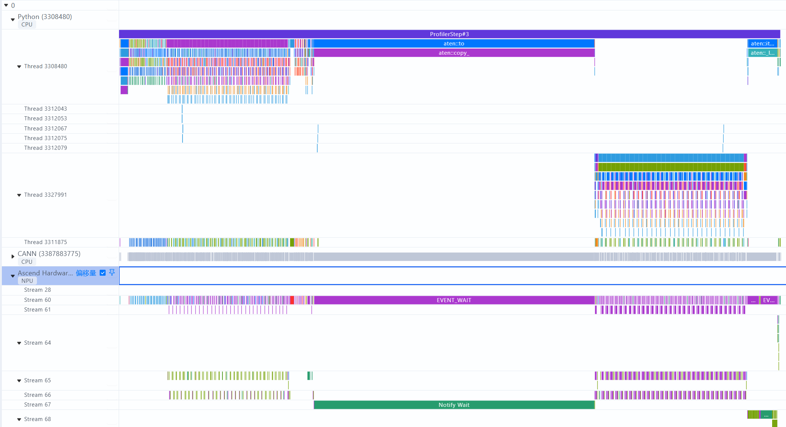

**Common Operations**

To quickly view or learn about all current shortcut key operations, click the question mark button in the upper right corner of the page and choose "Keyboard Shortcuts" from the drop-down menu to open the shortcut key description dialog box.

Common Timeline operations include **jumping between Communication and Timeline, pin-to-top comparison, overlap analysis, flagging key regions, box selection statistics, and viewing dispatch connection relationships**. For details, see [Timeline](https://atomgit.com/Ascend/msinsight/blob/master/docs/en/user_guide/system_tuning.md#timeline) in [MindStudio Insight System Tuning](https://atomgit.com/Ascend/msinsight/blob/master/docs/en/user_guide/system_tuning.md).

**Locating the Specific Source of Fast/Slow Device Differences**

The Timeline is often used to further locate the specific source of fast/slow device differences. Ideally, the computation time of each device is relatively close, and no device should finish computation early and wait for another device for a long time. When some devices have communication operators with long durations and the main duration of these operators comes from waiting (for example, Notify Wait events), first consider whether a fast/slow device issue has occurred.

Fast/slow device is a phenomenon with various underlying causes. You need to compare the differences between fast and slow devices on the Timeline to confirm the specific cause. Common causes of slow devices include load imbalance, slow computation, slow dispatch, and slow data loading (a storage issue). The specific locating process is as follows:

1. In the communication operator thumbnail on the Communication page, view the communication operators with large differences and jump to the Timeline page.

2. Use overlap analysis and pin-to-top comparison to confirm the source of differences at the Ascend Hardware layer (NPU layer).

3. On the Timeline page, select the `async_npu` dispatch connection and use the connection relationship to search upward from the NPU layer to confirm the source of differences at the Python layer. After you confirm that the difference comes from a certain part of the Python layer code, you can use this information to further confirm the root cause with model developers or operations and maintenance personnel.

   > [!NOTE]
   >
   > The Timeline page has many functions. You can use a real case to experience the role of each function. For details, see [Timeline operation case for locating fast/slow devices](solution_to_top1.md#timeline-based-fast-and-slow-device-localization-example).

**Observing Dispatch Bottlenecks**

The Timeline is a powerful tool for observing dispatch issues. Ideally, the computation pipeline on the NPU side runs continuously, and the NPU does not wait for the CPU. Once dispatch is slow, the pipeline cannot run, and AI Core computing power utilization decreases.

> [!NOTE]
>
> The ideal Free Time proportion is about 10% or less.

The typical manifestations of a dispatch bottleneck on the Timeline are as follows. For the specific locating methodology and optimization ideas, see [Dispatch Anomaly Analysis](solution_to_top3.md#dispatch-anomaly-analysis).

- In overlap analysis, the Free Time proportion far exceeds Computing and Communication, as shown in [Figure 3](#ZH-CN_TOPIC_0000002535807019__fig029044141416) and [Figure 4](#ZH-CN_TOPIC_0000002535807019__fig18956112318318).

  **Figure 3** Typical manifestation 1 of a dispatch bottleneck

  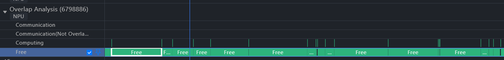

  **Figure 4** Typical manifestation 2 of a dispatch bottleneck

  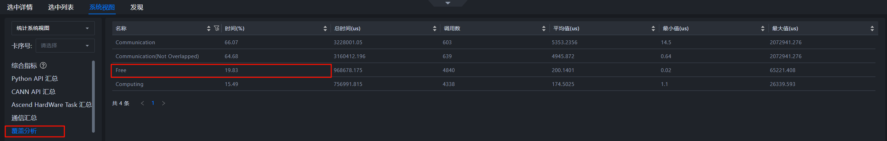

- The host-to-device connection is nearly vertical, as shown in [Figure 5](#ZH-CN_TOPIC_0000002535807019__fig12167922161).

  **Figure 5** Typical manifestation 3 of a dispatch bottleneck

  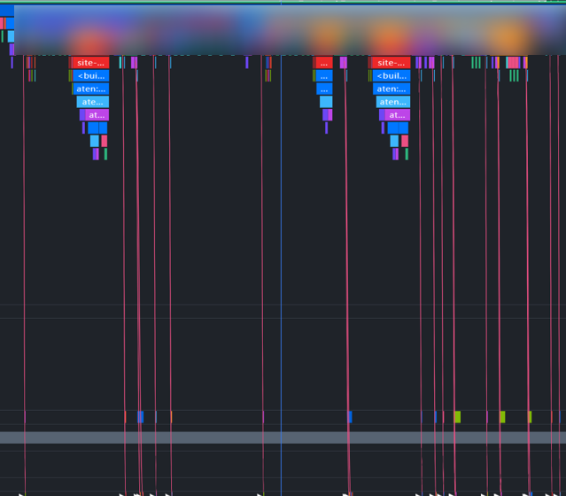

- Frequent host-to-device copies interrupt the asynchronous pipeline and cause a dispatch bottleneck, as shown in [Figure 6](#ZH-CN_TOPIC_0000002535807019__fig113818131710).

  **Figure 6** Typical manifestation 4 of a dispatch bottleneck

  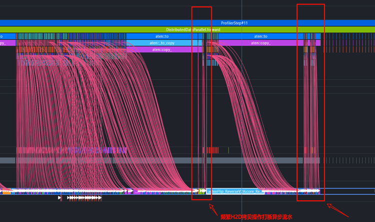

**Single-Device Statistics and Operator Search**

If you want to view the specific position of an operator in the Timeline, select "System View" in the bottom data pane, select "Stats System View" and the corresponding "Device ID", and click "Operator Details" to view all operators. You can filter by name, type, accelerator core, and input/output Shapes, sort by duration, select an operator, and click "Click" in the "Click to Jump to Timeline" column to jump to the specific position in the Timeline, as shown in [Figure 7](#ZH-CN_TOPIC_0000002535807019__fig12208010468). This operation is faster than a global search.

**Figure 7** Operator details

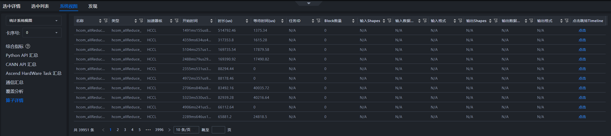

##### Memory

Memory presents the overall memory trend as a memory line chart. You can box-select and zoom in on the peak areas in the line chart to accurately locate the process or operator that consumes a large amount of memory. For operators with abnormal memory allocation or release, jump to the Timeline to locate the specific code.

> [!NOTE]
>
> Memory optimization ideas: Increase the batch size as much as possible to maximize NPU memory usage. Observe the memory trend to eliminate spikes and shave peaks and fill valleys.

In [Figure 1](#ZH-CN_TOPIC_0000002535807021__fig775318316219), you can see that NPU utilization is insufficient and memory spikes exist.

**Figure 1** Typical case

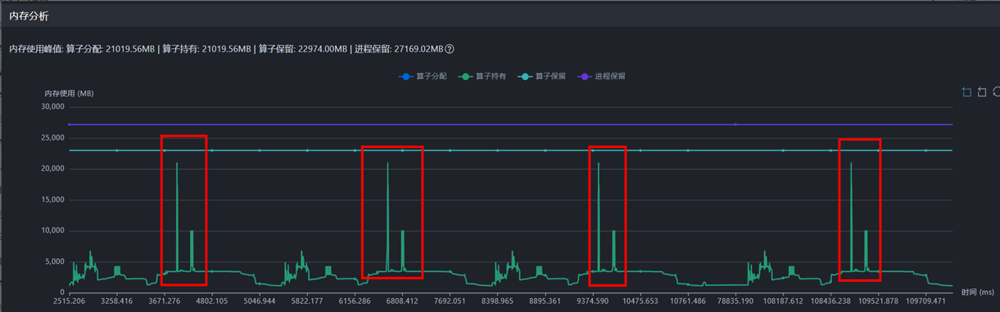

Based on the time point of a memory spike, box-select the operators in the spike time range. In the memory allocation/release details, sort in descending order of memory allocation size and jump to the Timeline based on the operator that ranks first in memory allocation to locate the specific code, as shown in [Figure 2](#ZH-CN_TOPIC_0000002535807021__fig256619222223). Then, based on the code position, discuss with model developers to confirm whether there is room for optimization.

**Figure 2** Jumping to the Timeline

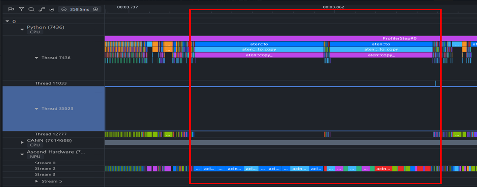

The Memory page also supports comparison between two devices. For details, see the "Memory > [Usage Instructions](https://atomgit.com/Ascend/msinsight/blob/master/docs/en/user_guide/system_tuning.md#usage-description-1)" chapter of [MindStudio Insight System Tuning](https://atomgit.com/Ascend/msinsight/blob/master/docs/en/user_guide/system_tuning.md).

##### Operator

The Operator page displays duration statistics for compute operators and communication operators. Common functions are as follows:

- Statistics by type, which is used to observe the proportion of top duration operators, especially whether inefficient operators such as conversion operators account for an excessively high proportion.
- Statistics grouped by accelerator core, which is used to observe whether AI CPU operators and vector operators account for an excessively high duration proportion.
- Statistics of compute operators by input Shape, which is used to observe whether operators degrade under a specific Shape.
- You can switch between displaying the top 15 duration operators and all operators, as shown in [Figure 1](#ZH-CN_TOPIC_0000002535807065__fig18956232172415).

For specific locating and optimization methods, see [Operator Performance Issue Optimization Solutions](solution_to_top2.md).

**Figure 1** Operator page

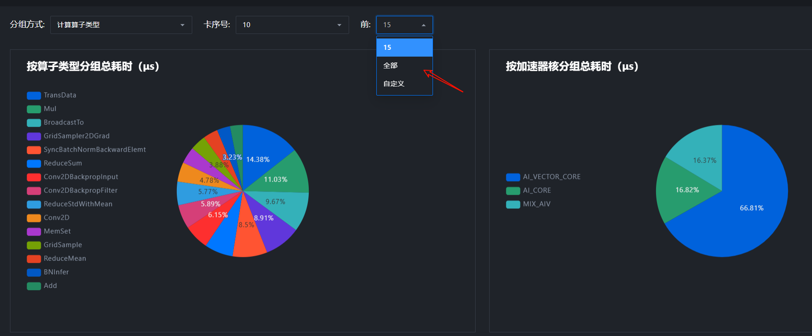

The Operator page also supports comparison between two devices. For details, see the "Operator > [Usage Instructions](https://atomgit.com/Ascend/msinsight/blob/master/docs/en/user_guide/system_tuning.md#usage-description-2)" chapter of [MindStudio Insight System Tuning](https://atomgit.com/Ascend/msinsight/blob/master/docs/en/user_guide/system_tuning.md).

**Typical Case: Using the Operator Comparison Function to Quickly Locate the Cause of Compute Performance Degradation**

Background: The same model is deployed on different machines and compute performance degrades (about 80ms per step). You need to locate the cause.

1. Move the performance data of the two devices to the same parent directory and open that parent directory with MindStudio Insight.

2. Set up data comparison between the two devices as described in the "Operator > [Usage Instructions](https://atomgit.com/Ascend/msinsight/blob/master/docs/en/user_guide/system_tuning.md#usage-description-3)" chapter of [MindStudio Insight System Tuning](https://atomgit.com/Ascend/msinsight/blob/master/docs/en/user_guide/system_tuning.md).

3. The slow device is known to take about 80ms more computation time per step than the fast device. After you enable comparison mode, sort by "Total Duration" in "Operator Details", as shown in [Figure 2](#ZH-CN_TOPIC_0000002535807065__fig459772715412). You can observe that the main source of the computation time difference is the Matmul operator. Given the same quantity (a quantity difference of 0), the total duration differs by about 74ms, which is the main source of the duration difference.

   **Figure 2** Operator comparison between devices

   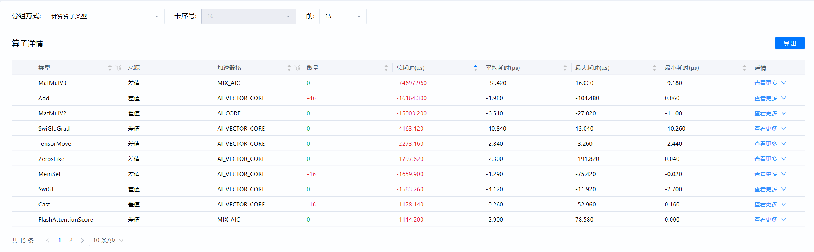

4. Further compare operators with the same Shape. You can see that operators of the same type (MatmulV3) with different Shapes degrade to different degrees. Under each Shape, the Matmul on the slow device consistently degrades compared with the fast device, as shown in [Figure 3](#ZH-CN_TOPIC_0000002535807065__fig43061311115511).

   **Figure 3** Comparison by Shape

   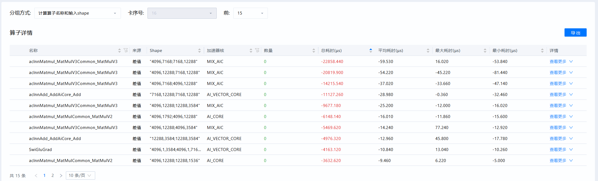

5. After investigation, the cause is finally confirmed to be differences in on-chip memory chips among different machines. Matmul is a memory-intensive operator, and the degree of contention for compute and communication bandwidth differs among machines.

### Service-Oriented Tools

This section mainly describes the usage scenarios and locating ideas for service-oriented tools. For how to locate specific issues, see [Service-Oriented Performance Tuning Localization Cases](solution_to_top6.md#service-oriented-performance-tuning-localization-cases).

1. Broad tuning: Use the inference pre-check tool (msprechecker) to check the system, environment variables, and configuration files, and identify potential issues that may affect service-oriented performance.
2. Targeted tuning: Optimize service-oriented scheduling by adjusting configuration items for current requirements (input and output length, concurrency, and so on). You can use the following methods:
   1. Service-oriented advisor tool (msserviceadvisor): This tool can quickly improve service-oriented performance, but it is not sufficient for fine-grained tuning.
   2. Service-oriented automatic parameter optimization tool (modelevalstate): This tool is suitable for improving service-oriented performance in a targeted manner and can achieve 95% of the best performance that manual tuning can achieve. However, this method takes a long time because it must continuously search for parameters to approach the optimal solution.
3. If the expected result is still not achieved, you can use the service-oriented tuning tool (msServiceProfiler) for in-depth analysis. This tool is suitable for users who are familiar with the entire service-oriented operation process.

**Table 1** Introduction to service-oriented performance tools

| Tool | Description |
| ---- | ----------- |
| [Inference Pre-Check Tool](https://atomgit.com/Ascend/msit/blob/master/msprechecker/README.md) | It supports full-process checks before, during, and after inference. &#8226; Before inference, it provides a one-click pre-check function that comprehensively checks for issues that may cause service deployment failures or performance degradation, such as environment variables, the system kernel, and configuration files. &#8226; During inference, it can write all environment-related data completely to drive. &#8226; After inference, it can compare the files written to drive to help identify differences and facilitate reproduction of the baseline environment. |
| [Service-Oriented Advisor](https://atomgit.com/Ascend/msserviceprofiler/blob/master/docs/en/user_guide/service_profiling_advisor_instruct.md) | Based on the current Benchmark output and the `config.json` configuration of the MindIE service, and combined with a theoretical analysis of the performance upper limit, it provides optimization suggestions for improving key metrics such as time to first token (TTFT) and throughput. |
| [Service-Oriented Automatic Parameter Optimization](https://atomgit.com/Ascend/msserviceprofiler/blob/master/docs/en/user_guide/serviceparam_optimizer_instruct.md) | It provides automatic parameter optimization for MindIE service-oriented and vLLM service-oriented scenarios. It uses advanced search algorithms to efficiently find the optimal solution in the parameter space and implement automatic tuning. This function also supports a lightweight design, deploys quickly and conveniently, and ensures more accurate search results. |
| [Service-Oriented Tuning Tool](https://atomgit.com/Ascend/msserviceprofiler/blob/master/docs/en/user_guide/msserviceprofiler_serving_tuning_instruct.md) | It provides parsing and breakdown capabilities for inference service-oriented performance data collection interfaces. This interface is designed specifically for service-oriented tuning. It can collect the start and end time points of key processes, identify and record information such as key function calls, key events, and service-oriented scheduling, and support the collection of operator information, helping you quickly locate performance issues. |
