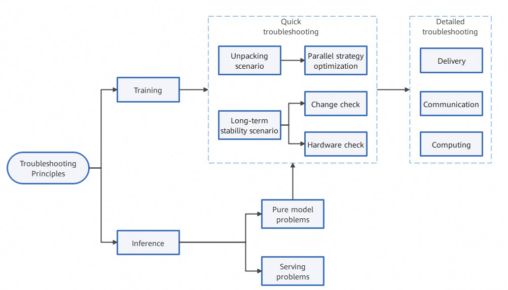
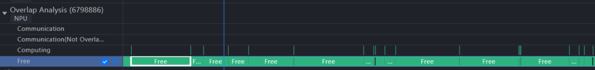
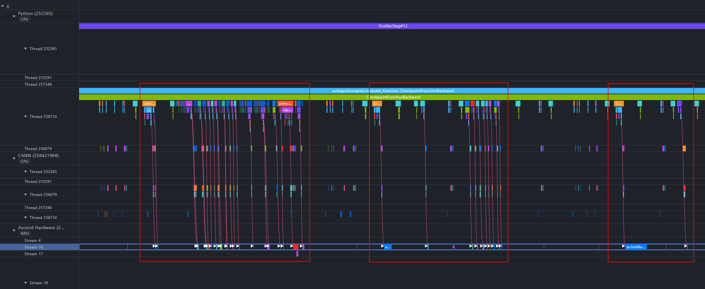
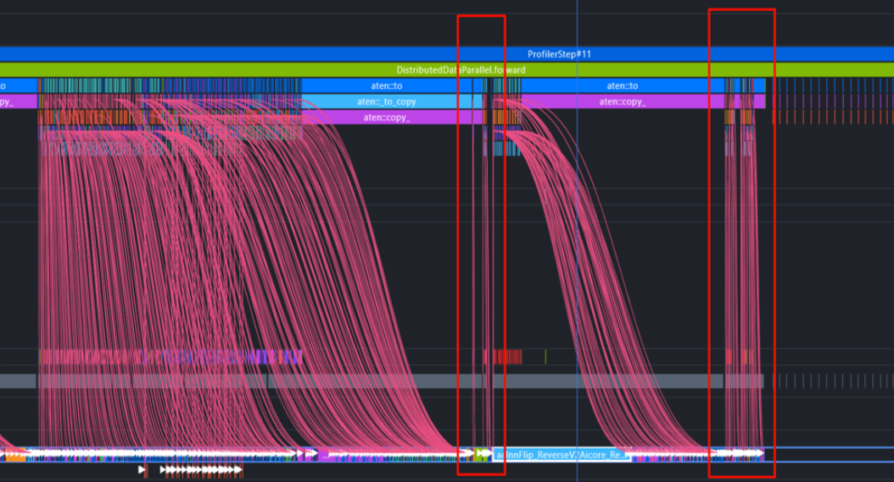
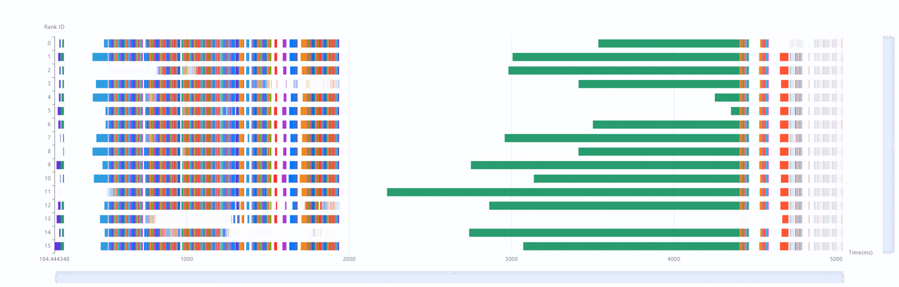
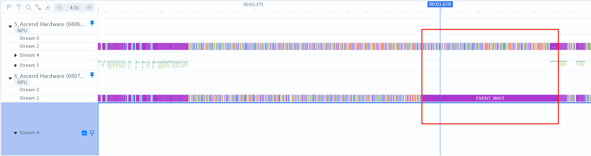
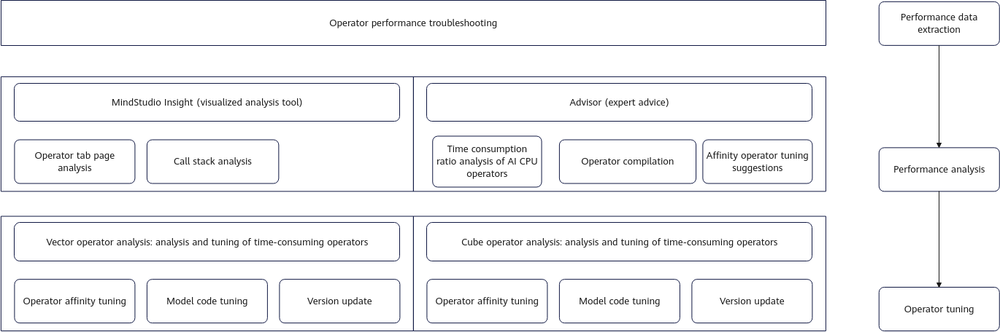

# Process for Locating Performance Issues

## Overall Locating Process

The overall approach to performance optimization revolves around [Performance Optimization Directions](overview.md#performance-tuning-options). The specific steps are as follows.

> [!NOTE]
>
> A prerequisite for performance optimization is that it does not cause precision degradation. In special cases, you need to confirm whether the precision degradation is acceptable.

1. Clarify the issue: Collect the necessary information by referring to [Information Collection](#information-collection).
2. Troubleshoot performance issues: For the troubleshooting approach, see [Troubleshooting Approach](#troubleshooting-approach).
3. Experimental verification: When you run multiple experiments, strictly control the variables and ensure that all parameters and data remain consistent except for the strategy that you change.

## Information Collection

Before you locate an issue, ensure that you collect accurate issue information, including the [basic information](#ZH-CN_TOPIC_0000002503927266__table8794114914506), the [key issue description](#ZH-CN_TOPIC_0000002503927266__table8794114914507), and the [optimization objectives](#ZH-CN_TOPIC_0000002503927266__table8794114914508).

**Table 1** Basic information

| Main Information | Description                                                  |
| ---------- | ------------------------------------------------------------ |
| Model type | Understand the model structure (Llama-like, GPT-like, whether it is MoE, and so on). |
| Job scale | Number of devices and number of machines.                       |
| Parallelism strategy | Specific parallelism parameter configuration.                |
| Framework and version | &#8226; Determine the CANN, MindSpore, or PyTorch version.  &#8226; Confirm whether a version change occurred recently, to determine whether the issue appeared before or after the version change. |

**Table 2** Key issue description

| Main Information | Description                                                  |
| ------------ | ------------------------------------------------------------ |
| Issue scenario | During model training or inference, the performance does not reach the expected standard or the level of a competing product, or anomalies such as performance degradation occur.  &#8226; Performance is lower than expected. This generally occurs after model migration, when the performance is lower than that of a competing product.  &#8226; Performance jitter occurs. During long-term stable training of a model, performance fluctuates randomly or along with specific events.  &#8226; Cluster linearity is insufficient. After the cluster scale expands, model performance does not grow as expected.  &#8226; Model-only performance is poor. Under the same configuration, model-only performance is abnormal. For details, see the solution to training issues. &#8226; Service-oriented scheduling tuning. |
| Current performance metrics | Clarify the status of the current performance issue. For the priority ranking of computing performance metrics, see Performance Tuning > Performance Overview > [Performance Metrics](https://gitcode.com/Ascend/ModelZoo-PyTorch/blob/master/PyTorch/docs/en/performance_tuning/performance_overview.md) in the [PyTorch Training Model Migration and Tuning Guide](https://gitcode.com/Ascend/ModelZoo-PyTorch/blob/master/PyTorch/docs/en/README.md). |

**Table 3** Optimization objectives

| Main Information | Description                                                  |
| -------------- | ------------------------------------------------------------ |
| Objective of performance optimization | Clarify the optimization objective and its source, for example, whether it is based on a comparison with a competing product or is derived from linearity extrapolation. If the optimization involves methods such as increasing the batch size, avoid using metrics such as the single-step duration for measurement. See Performance Tuning > Performance Overview > [Performance Metrics](https://gitcode.com/Ascend/ModelZoo-PyTorch/blob/master/PyTorch/docs/en/performance_tuning/performance_overview.md) in the [PyTorch Training Model Migration and Tuning Guide](https://gitcode.com/Ascend/ModelZoo-PyTorch/blob/master/PyTorch/docs/en/README.md) and select a reasonable metric as a replacement. |

## Troubleshooting Approach

### Quick Troubleshooting

Quick troubleshooting covers two scenarios: out-of-the-box and long-term stability. The details are as follows:

1. Out-of-the-box scenario: An out-of-the-box performance issue generally refers to the scenario where a model is loaded for the first time. In this case, you need to clarify the performance optimization objective. If a competing product provides a performance reference, you can compare the differences between the two in detail by using tools such as Profiling. Before you formally start a task, you are advised to first optimize the parallelism strategy and confirm the optimal parallelism strategy. If the issue cannot be resolved, see the locating solution for the long-term stability scenario.
2. Long-term stability scenario: A performance issue under long-term stability usually refers to a sudden performance drop or performance issue that occurs after the system has performed well without any performance issue for a period of time.
   1. Change check: Determine whether any change was made recently, including but not limited to cluster re-planning and version changes. If the performance issue appears after a change, you can try to roll back the recent change when conditions permit. If you confirm that the change caused the issue, you are advised to first consider the version issue or the possible impact of the operations involved in the change (such as a restart) on the cluster. For details, see [Methodology for Locating Performance Degradation After a Version Upgrade](solution_to_top7.md).
   2. Hardware check: When performance fluctuates, check whether a hardware issue occurred at the corresponding point in time, such as a hardware alarm for NPU frequency reduction or network packet loss. Note that the hardware check here is only a preliminary check that focuses on hardware alarms. If no hardware alarm or key event such as network packet loss exists, see [Detailed Troubleshooting](#detailed-troubleshooting) for locating.

### Detailed Troubleshooting

Detailed troubleshooting focuses on three common categories of issues: dispatch, communication, and computing. For information about how to use performance tools, see [Performance Tool Usage](performance_tool_usage.md).

> [!NOTE]
>
> - Use the msprof-analyze tool for a preliminary analysis to locate performance issues at a coarse granularity and to determine a clear direction for subsequent in-depth analysis. For details, see [Quick Analysis for Model Tuning (msprof-analyze CLI)](performance_tool_usage.md#quick-analysis-for-model-tuning-msprof-analyze-cli).
> - Use the MindStudio Insight tool to further identify bottleneck points and thoroughly analyze the root cause of the issue. For details, see [In-Depth Analysis for Model Tuning (MindStudio Insight)](performance_tool_usage.md#in-depth-analysis-for-model-tuning-mindstudio-insight).

**Figure 1** Detailed troubleshooting flowchart

#### Dispatch Issues

A dispatch issue means that the operator dispatch process takes an abnormal amount of time. Dispatch means that Graph Engine dispatches an operator execution request to the Runtime. The Runtime determines the Task type of the operator and, based on the type, dispatches the operator execution request to the device for execution. For details, see [Operator Compilation and Running Process](https://www.hiascend.com/document/detail/en/CANNCommunityEdition/920/others/tbeaicpudevg/atlasopdev_10_0012.html) in the [TBE&AI CPU Operator Development Guide](https://www.hiascend.com/document/detail/en/CANNCommunityEdition/920/others/tbeaicpudevg/atlasopdev_10_0001.html).

Ideally, the computing pipeline on the NPU side keeps running, and the NPU never waits for the CPU. Once a dispatch delay occurs, the pipeline is blocked, which affects the compute utilization of the AI Core. In this case, a dispatch issue exists. You mainly observe dispatch issues in the [Timeline](performance_tool_usage.md#timeline) of MindStudio Insight. If any of the following symptoms exists, see [Dispatch Anomaly Analysis](solution_to_top3.md#dispatch-anomaly-analysis) for analysis.

- Excessive Free Time proportion: In Overlap Analysis, the Free Time proportion far exceeds the Computing and Communication proportions. Ideally, the Free Time proportion should be within 10%.

  **Figure 2** Viewing Free Time

  

- The host-to-device connection lines in the red box are nearly vertical, and the device in the blue box is relatively idle.

  **Figure 3** Viewing the connection lines

  

- Frequent host-to-device copies interrupt the asynchronous pipeline and cause a dispatch bottleneck.

  **Figure 4** Finding the dispatch bottleneck

  

#### Communication Issues

A communication issue generally means that communication between NPUs is abnormal. Typical symptoms are fast and slow devices or communication bandwidth far lower than expected. For details, see [Cluster Performance Analysis](performance_tool_usage.md#cluster-performance-analysis) in MindStudio Insight. For solutions, see [Communication Issue Optimization Solutions](solution_to_top1.md).

> [!NOTE]
>
> In a large cluster scenario, the Profiling data of the full cluster may be too large to analyze. You are advised to use the cluster_analyze (cluster analysis) tool in [Quick Analysis for Model Tuning (msprof-analyze CLI)](performance_tool_usage.md#quick-analysis-for-model-tuning-msprof-analyze-cli) to perform cluster analysis on the full Profiling data first. Import the `cluster_analysis_output` deliverable directory into MindStudio Insight and check whether an obvious fast and slow device or communication transmission issue exists. Then select the Profiling data of the devices that interest you and analyze it from the single-device perspective.

- **Figure 5** shows the "Communication Duration Analysis" function on the Communication page of MindStudio Insight. Each color block represents a collective communication operator, and its length represents the execution time of the communication operator. If, for a collective communication operator, the execution times of the communication operators differ greatly between devices, the device with the shortest communication operator duration is the slow device (all other devices are waiting for this slow device).

  **Figure 5** Using Communication Duration Analysis in MindStudio Insight to find slow devices

  

- Obvious inter-device waiting is visible in the Timeline. As shown in the red box in **Figure 6**, fast device Rank6 has finished computing and is waiting for slow device Rank5 to finish computing.

  **Figure 6** Comparing the Profiling of fast and slow devices on the Timeline (Ascend Hardware layer)

  

- As shown in **Figure 7**, the Communication swimlane shows that the `hcom_allGather` communication operator duration of fast device Rank6 is far longer than that of slow device Rank5, and the main part of the duration comes from synchronization wait.

  **Figure 7** Comparing the Profiling of fast and slow devices on the Timeline (Communication swimlane)

  .png "timeline-comparison-of-profiling-results-between-fast-and-slow-cards-(communication-unit)")

#### Computing Issues

A computing issue, that is, an operator performance issue, is a key challenge in deep learning models. It manifests as low execution efficiency of some basic computing units, which affects the running speed of the entire model and wastes resources. Such issues require dedicated analysis tools and code optimization techniques. For example, when you evaluate the performance of a fused operator, you can compare metrics such as the computing time and memory usage under different configurations to make a comprehensive judgment. For details, see [Operator Performance Issue Optimization Solutions](solution_to_top2.md) for locating and resolving such issues.

**Figure 8** Locating operator performance issues

