# Communication Issue Optimization Solutions

## Introduction

The most intuitive manifestation of a communication issue is that the cluster communication time is long and the communication duration accounts for a much larger proportion than the computing duration, as shown in [Figure 1](#ZH-CN_TOPIC_0000002504087092__fig97371217617). Alternatively, a communication operator with an obviously excessive duration exists, as shown in [Figure 2](#ZH-CN_TOPIC_0000002504087092__fig315152711916). In the figure, labels ① and ② are two reduceScatter operators whose durations are far longer than the computing stream.

**Figure 1** Manifestation 1 of a communication issue: the communication duration is far longer than the computing duration

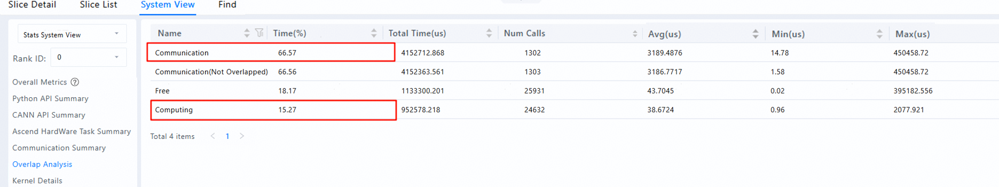

**Figure 2** Typical manifestation 2 of a communication issue: a communication operator with an obviously excessive duration

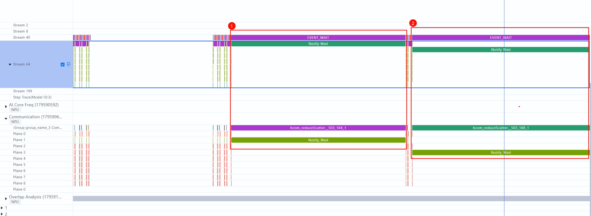

Note that a communication issue on a device is not necessarily caused by the communication transmission itself. It may also be caused by waiting for other slow devices, that is, a fast and slow device issue.

To determine whether an excessive communication duration on a device is caused by the communication transmission itself or by a fast and slow device issue, use the following methods:

- As described in [Communication](performance_tool_usage.md#communication), go to the Communication Duration Analysis tab in MindStudio Insight. If the **Transmission Time** of the device accounts for a high proportion, the communication transmission itself has a issue. If the **Synchronization Time** accounts for a high proportion, a fast and slow device issue exists.

  **Figure 3** Communication duration analysis

  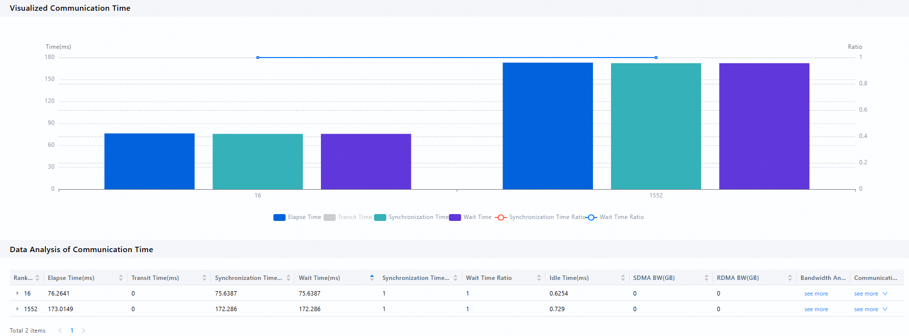

- You can use the [Summary](performance_tool_usage.md#summary) tab to compare the computing, communication, and idle time of multiple devices and observe whether a fast and slow device issue exists. Take [Figure 4](#ZH-CN_TOPIC_0000002504087092__fig1472719122113) as an example. If the idle time and the communication time of each device are negatively correlated (that is, a device with long idle time has short communication time, and a device with short idle time has long communication time), you can determine with high probability that the cluster has a fast and slow device issue caused by dispatch performance fluctuation. Similarly, a computing fast and slow device issue also exists, in which the computing time and the communication time are negatively correlated.

  **Figure 4** Fast and slow device issue caused by dispatch

  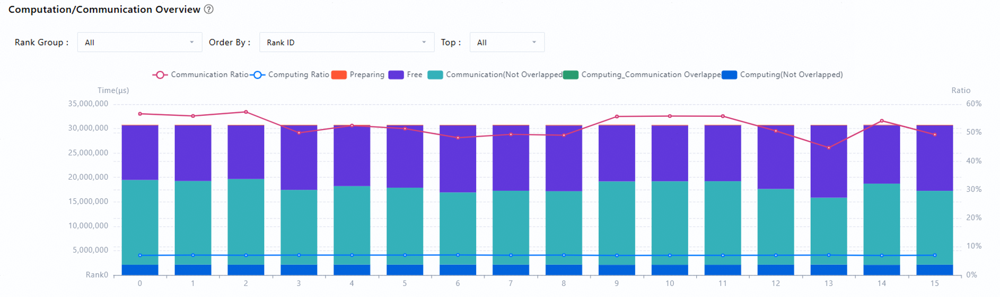

If you confirm that a fast and slow device issue exists, refer to [Methods for Locating Fast and Slow Device Issues](#methods-for-locating-fast-and-slow-device-issues) to further locate the cause of the difference between fast and slow devices.

If you confirm that no fast and slow device issue exists, focus on communication itself. Possible causes include [communication retransmission](#communication-retransmission), [small-packet communication](#small-packet-communication), [source and destination address byte misalignment](#source-and-destination-address-byte-misalignment), [computing and communication bandwidth preemption](#computing-and-communication-bandwidth-preemption), and [profiling data inflation](#profiling-data-inflation).

## Methods for Locating Fast and Slow Device Issues

### Overview

For fast and slow devices, the fast device and the slow device are relative concepts. A fast device is the device that first completes its computing task in the cluster, and a slow device is a device that completes its computing task relatively slowly in the cluster task. A cluster usually needs to complete collective communication. If different devices complete their tasks at different times, fast devices tend to wait for slow devices to finish computing, which degrades the performance of the entire cluster.

A fast and slow device issue is a phenomenon with a wide variety of root causes. The general localization approach is to use the pinpoint analysis method to compare the differences between fast and slow devices on the Timeline tab in MindStudio Insight and confirm the specific cause.

Common causes of slow devices include load imbalance, computing performance fluctuation, host-side dispatch performance fluctuation, and data loading performance fluctuation.

This section covers the following topics:

- [Pinpoint Analysis Method for Fast and Slow Devices](#pinpoint-analysis-method-for-fast-and-slow-devices): describes the general approach to fast and slow device analysis.
- [Timeline-Based Fast and Slow Device Localization Example](#timeline-based-fast-and-slow-device-localization-example): demonstrates how to use the Timeline tab in MindStudio Insight to locate a fast and slow device issue.
- [Operator Comparison-Based Fast and Slow Device Localization Example](#operator-comparison-based-fast-and-slow-device-localization-example): demonstrates how to use the operator comparison function to locate a computing fast and slow device issue.
- [Additional Fast and Slow Device Cases](#additional-fast-and-slow-device-cases): presents more typical fast and slow device cases.

### Pinpoint Analysis Method for Fast and Slow Devices

You can quickly locate the root cause of the difference between fast and slow devices on the Timeline tab in MindStudio Insight.

**Figure 1** Pinpoint analysis method

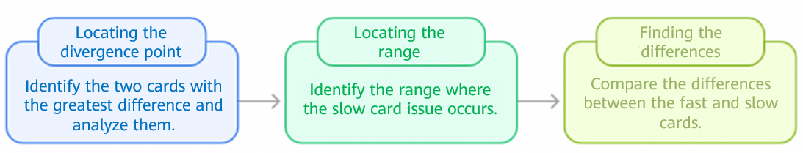

#### Locating the Point

First, find the point where the fast and slow device issue occurs. Go to the communication operator thumbnail view on the Communication tab, select a relatively late iteration ID, and observe the collective communication operator with the largest difference first. Start from the place where the fast and slow device issue has the greatest impact, and right-click to jump to the corresponding communication position. Take the green operator as an example, as shown in [Figure 2](#ZH-CN_TOPIC_0000002535807027__fig16785105671316).

**Figure 2** Locating the point

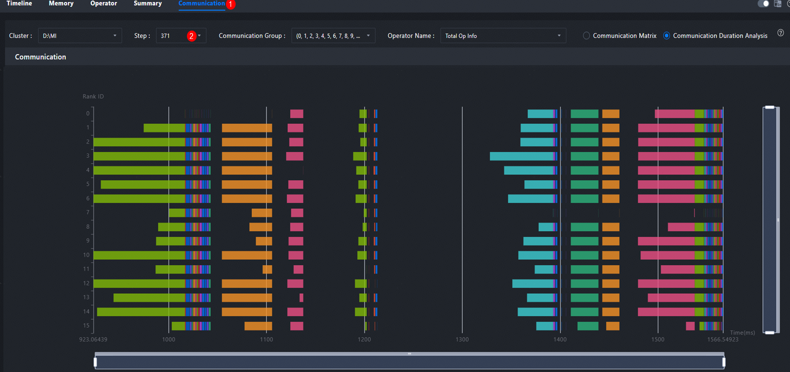

#### Defining the Interval

1. Zoom in on the communication operator. Find the devices to compare (find the devices with the largest duration gap, such as device 0 and device 3), as shown in [Figure 3](#ZH-CN_TOPIC_0000002535807027__fig1399855918136).

   **Figure 3** Defining the interval 1

   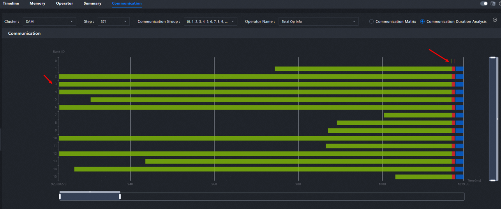

2. Right-click the communication operator and choose **Jump to Timeline View** to jump to the corresponding position on the Timeline. You are advised to add a flag marker at the beginning of the Python-side dispatch API that corresponds to the HCCL communication operator on both devices.

   **Figure 4** Defining the interval 2

   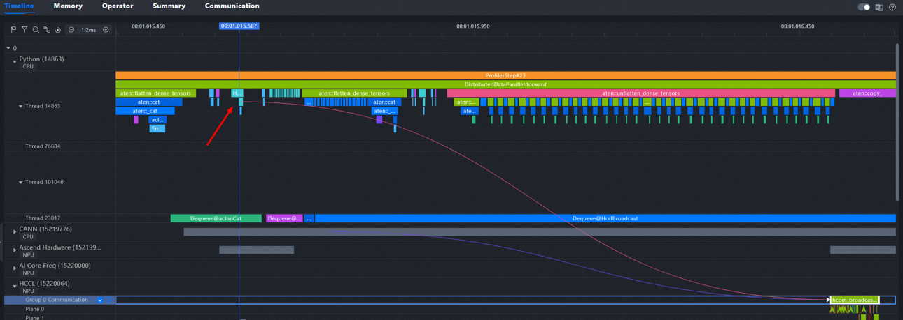

3. Find the place where the fast and slow device issue starts (the position of the white line) and use it as the start of the comparison region. Use the flag marker of each device as the end of the comparison interval for that device, which gives the fast device region and the slow device region respectively, as shown in [Figure 5](#ZH-CN_TOPIC_0000002535807027__fig11471433161010).

   **Figure 5** Finding where the fast and slow device issue occurs

   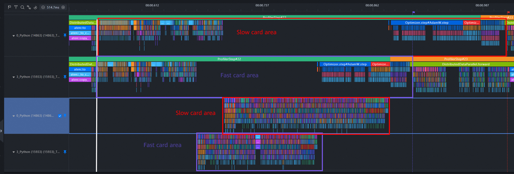

#### Finding the Differences

Compare the different parts in the fast device region and the slow device region respectively to further find the specific cause of the difference.

Take [Figure 6](#ZH-CN_TOPIC_0000002535807027__fig15176410142) as an example. Three main regions cause the fast and slow device issue, that is, regions 1 and 4, regions 2 and 5, and regions 3 and 6.

**Figure 6** Example

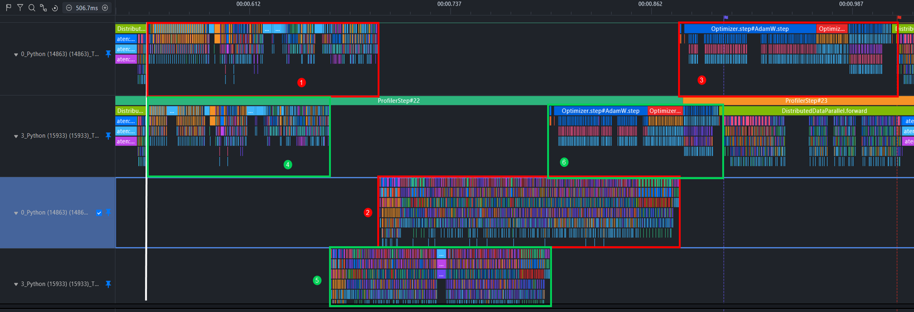

At this point, you have located the point where the fast and slow device issue occurs. The next step is to locate the root cause of the fast and slow device issue based on the operators and the code.

### Timeline-Based Fast and Slow Device Localization Example

This section describes a specific example of using MindStudio Insight to further locate a fast and slow device issue.

If you have already preliminarily identified a fast and slow device desynchronization issue in the cluster through [Summary](performance_tool_usage.md#summary), and confirmed through [Communication](performance_tool_usage.md#communication) that, in the cluster communication time, the transmission time proportion is low and the wait or synchronization time proportion is high, you can determine that the current cluster has a fast and slow device issue, and you need to view **Communication Duration Analysis**. Confirm exactly where the slow device is slow by tiling the communication operators horizontally.

As shown in [Figure 1](#ZH-CN_TOPIC_0000002504087044__fig145361328205714), for the green hcom allGather collective communication operator, device 4, device 5, and device 13, which have shorter durations, are slow devices, while the devices with longer durations (such as device 11 and device 14) are relatively fast devices.

The next localization goal is to analyze what the slow device is doing during the blank time. Go to the Timeline module and check the specific differences.

**Figure 1** Tiled view of communication operators

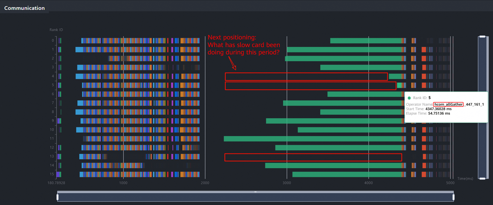

1. Select the communication operator, right-click, and choose **Jump to Timeline View** to jump from the communication operator to the Timeline view. Use flags to mark the approximate range for subsequent localization.

   **Figure 2** Jumping from a communication operator to the Timeline view

   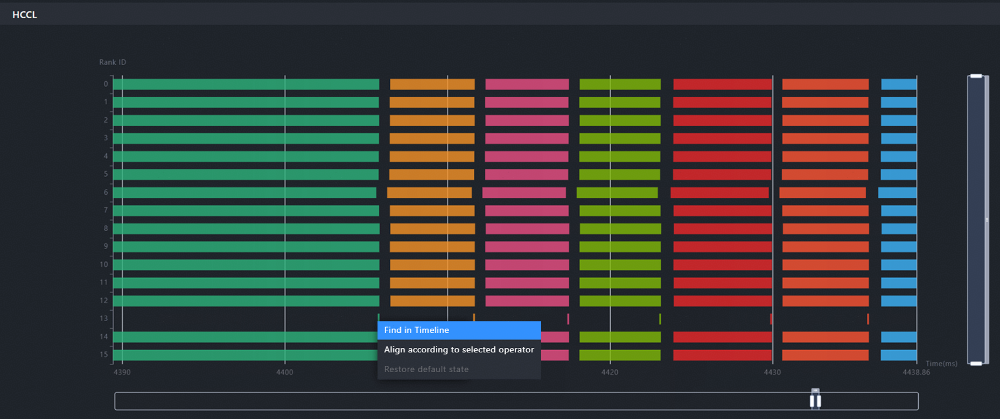

   **Figure 3** Marking the approximate range with flags

   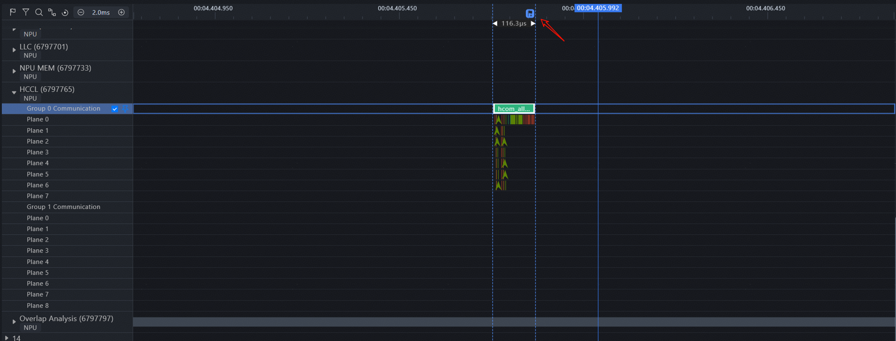

2. Select a step (display one full screen per step), and pin the Overlap Analysis lanes of the slow device (device 13) and the fast device (device 14) to the top for comparison to confirm the source of the difference (the Overlap Analysis lane projects the computing and communication tasks of the Ascend Hardware layer together, which makes comparison clearer).

   **Figure 4** Limiting the study region to one step (display one full screen per step)

   .png)

   **Figure 5** Pinning the overlap analysis lanes of the slow device (device 13) and the fast device (device 14) to the top for comparison to confirm the source of the difference

   -and-fast-card-(card-14)-to-the-top-to-compare-the-overlap-analysis-l.png)

3. Box-selection statistics show that the slow device lane has significantly more computing tasks than the fast device lane.

   **Figure 6** Box-selection statistics

   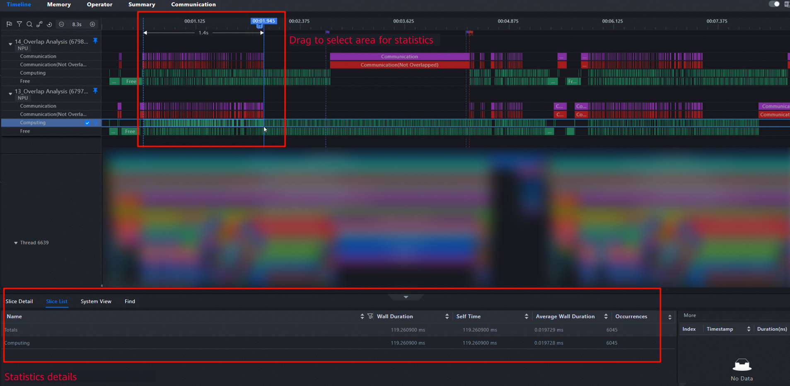
   Most of the difference comes from the second half, which indicates that load imbalance causes the fast and slow device issue.

   **Figure 7** Comparison of operator count differences

   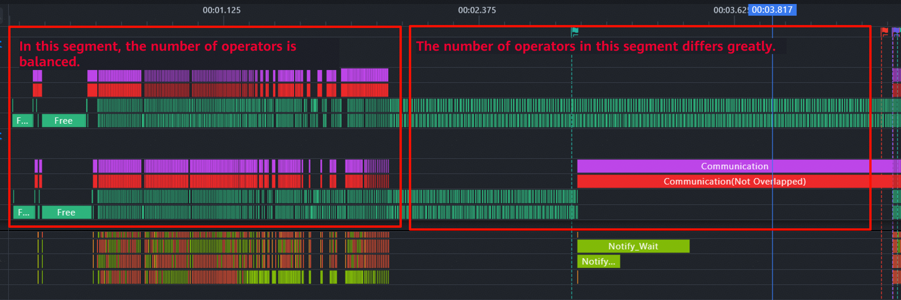

4. Use the `async_npu` dispatch connections to confirm which Python API dispatches the extra operators (lock the box-selected region to display only the connections in the locked region instead of all connections).

   **Figure 8** async_npu dispatch connections

   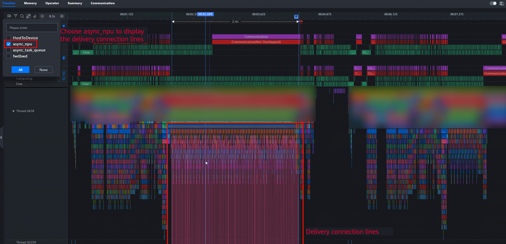

   Box-selection statistics for the Ascend Hardware layer show that for the same Python-side API, the fast device dispatches 1218 computing operators and the slow device dispatches 3303 computing operators. Therefore, the load imbalance of that Python-side API causes the fast and slow device issue.

5. Confirm with the model developer whether this load imbalance can be avoided.

### Operator Comparison-Based Fast and Slow Device Localization Example

If you find in the overview page of MindStudio Insight that the fast and slow devices in the cluster are caused by computing time fluctuation, in addition to the pinpoint analysis method described in [Pinpoint Analysis Method for Fast and Slow Devices](#pinpoint-analysis-method-for-fast-and-slow-devices), you can also compare the operator durations of fast and slow devices to quickly identify the source of the difference.

#### Determining Fast and Slow Devices from the Overview Page

In the Overview page of MindStudio Insight, check the computing/communication overview area. You can see that devices 0 to 7 are computing slow devices (long computing time and short communication time), and devices 8 to 15 are computing fast devices (short computing time and long communication time). The long communication time of the latter is caused by waiting for the former.

**Figure 1** Overview page of computing fast and slow devices

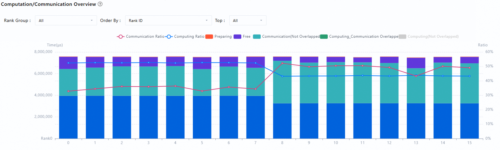

#### Comparing Operator Differences

As described in [Operator](performance_tool_usage.md#operator), you can quickly identify the operators that cause the duration difference, as shown in [Figure 2](#ZH-CN_TOPIC_0000002503927274__fig146751313103511). First, set device 7 and device 8 to cross-device comparison mode, and then sort by total duration in ascending order. If the fast and slow devices have a large difference in operator count, computing load imbalance exists, and you can confirm with the model developer whether this load imbalance can be avoided. If the count of a certain type of operator is the same but the average duration differs, ask the relevant operator development owner for help, or combine the method in [Pinpoint Analysis Method for Fast and Slow Devices](#pinpoint-analysis-method-for-fast-and-slow-devices) to further confirm the root cause through the Timeline.

**Figure 2** Cross-device operator comparison

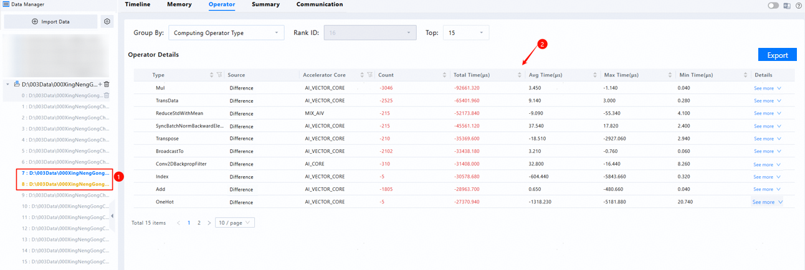

Similarly, you can use the compare tool in [Model Tuning Quick Analysis (msprof-analyze CLI)](performance_tool_usage.md#quick-analysis-for-model-tuning-msprof-analyze-cli) to open the KernelCompare comparison page and analyze operator differences.

**Figure 3** KernelCompare comparison page of the compare performance breakdown tool

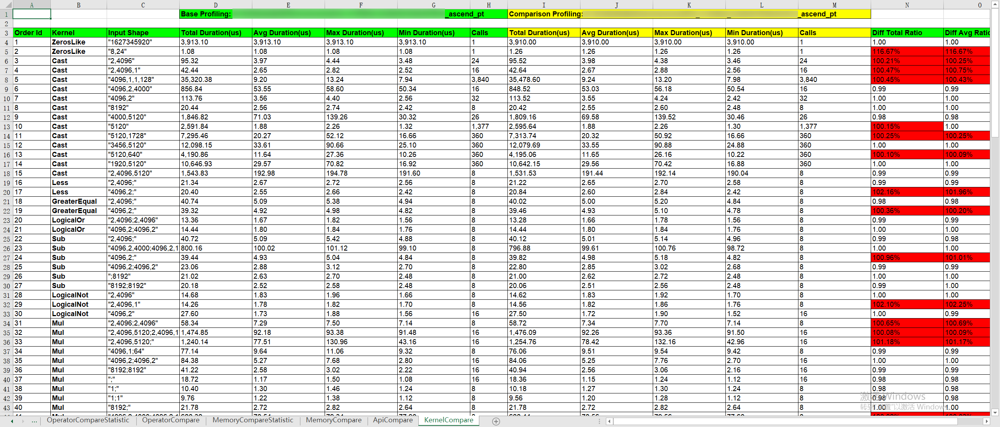

### Additional Fast and Slow Device Cases

#### Case 1: Performance Continues to Degrade After the Cluster Saves a Checkpoint

**Issue Description**

Four servers with 64 devices. Performance continues to degrade after a checkpoint is saved.

**Issue Analysis**

First, as shown in [Figure 1](#ZH-CN_TOPIC_0000002503927272__fig175962111612), after using the msprof-analyze tool in [Model Tuning Quick Analysis (msprof-analyze CLI)](performance_tool_usage.md#quick-analysis-for-model-tuning-msprof-analyze-cli) for cluster analysis, you can find that the fluctuation trends of communication time and free time between devices are negatively correlated (that is, in the same rank, a long communication duration corresponds to a short Free duration, and a short communication duration corresponds to a long Free duration). Therefore, you can infer that device 0, which has the shortest Free Time, is a fast device that finishes first and waits for other devices, while device 1, which has the longest Free Time, is a slow device that finishes last. That is, this case is a fast and slow device issue caused by host-side dispatch performance fluctuation.

**Figure 1** cluster_step_trace_time.csv deliverable

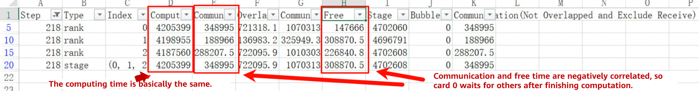

Open the Timeline view. As shown in [Figure 2](#ZH-CN_TOPIC_0000002503927272__fig16619142217167) and [Figure 3](#ZH-CN_TOPIC_0000002503927272__fig969067145819), the communication wait of device 0 occurs in the gradient aggregation phase after backpropagation. Compare similar positions on the Timelines of the fast and slow devices, and you can find an abnormal gap at the end of the step on slow device Rank1, which stalls in this phase and causes fast device Rank0 to wait.

**Figure 2** Timeline view (Rank0)

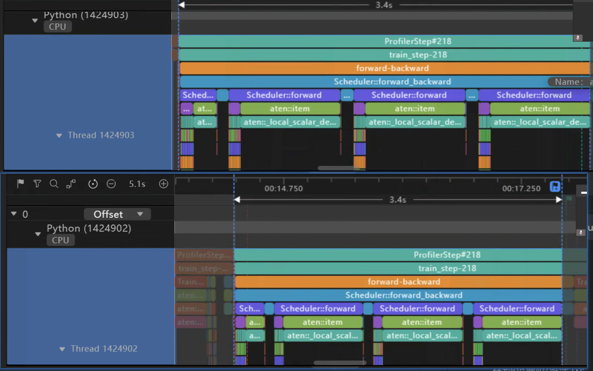

**Figure 3** Timeline view (Rank1)

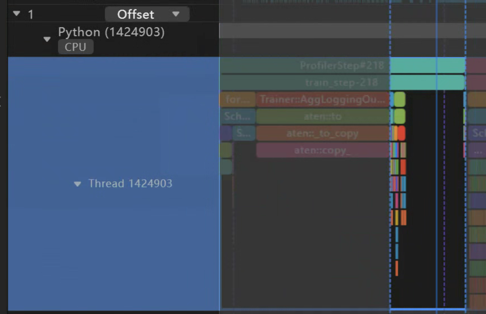

**Root Cause Identified**

The final root cause of this issue is that the code does not release memory at the end of the step on the slow device. After you release the memory manually, the issue disappears.

#### Case 2: Excessive Wait Time of the Cluster AllReduce Communication Operator

**Issue Description**

The wait time of the allreduce communication operator in a 256p cluster is long, and the linearity does not meet the requirement.

**Issue Analysis**

The direct manifestation of the issue is a long-duration notify wait in the dp communication domain, as shown in [Figure 1](#ZH-CN_TOPIC_0000002535807039__fig9295127131610).

**Figure 1** Timeline analysis of the dp communication domain

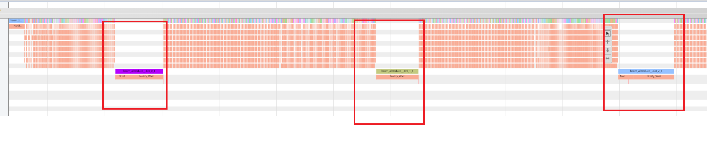

Find this communication domain on the Communication page. You can see a very long notify wait, a huge gap in Elapse Time (total communication time), and a gap of more than 200 ms between the fastest device and the slowest device.

**Figure 2** Communication duration analysis

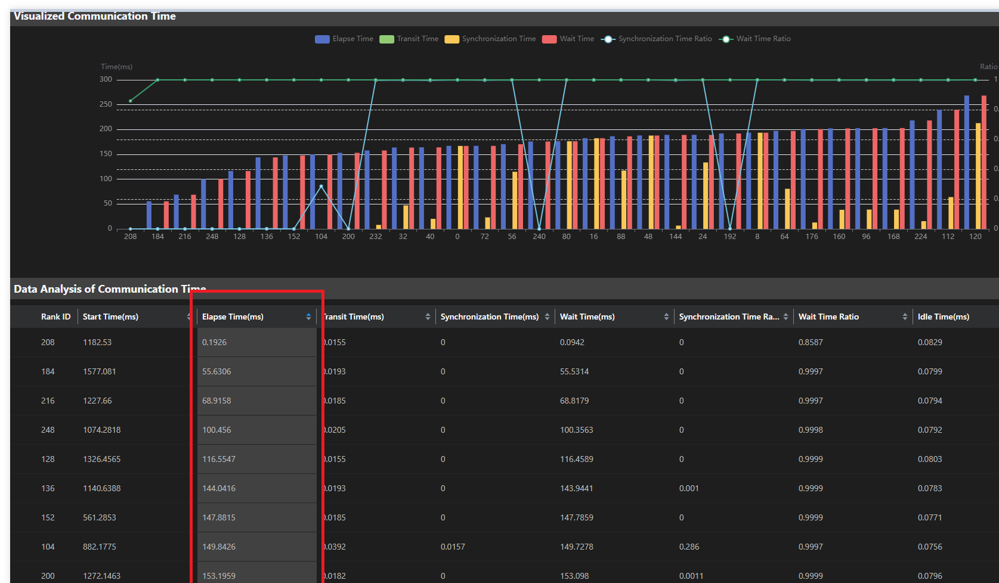

As shown in [Figure 3](#ZH-CN_TOPIC_0000002535807039__fig1010153111614), open the Timeline views of fast device 0 and slow device 208 at the same time. You can find that slow device 208 is mainly slow in tp communication. In one micro computation, the tp domain communication of slow device 208 takes 494 ms, while that of fast device 0 takes 340 ms, which is a large gap. The tp domain communication transmission speeds of the fast and slow devices are basically the same, and the gap is mainly caused by wait time.

**Figure 3** Timeline view of fast device 0 and slow device 208

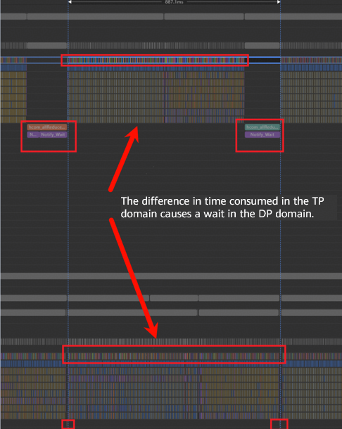

Further observe the devices in the same tp domain as device 208, and you can find that device 214 is the slow device that drags down the entire tp domain. That is, device 214 drags down device 208 through the tp domain, and device 208 further drags down device 0 along the dp domain. Therefore, device 214 is the true root-cause slow device. As shown in [Figure 4](#ZH-CN_TOPIC_0000002535807039__fig43241642201912), compare the Timelines of device 208 and device 214, and you can see that device 214 has a slow host dispatch issue.

**Figure 4** Timeline of device 208 and device 214

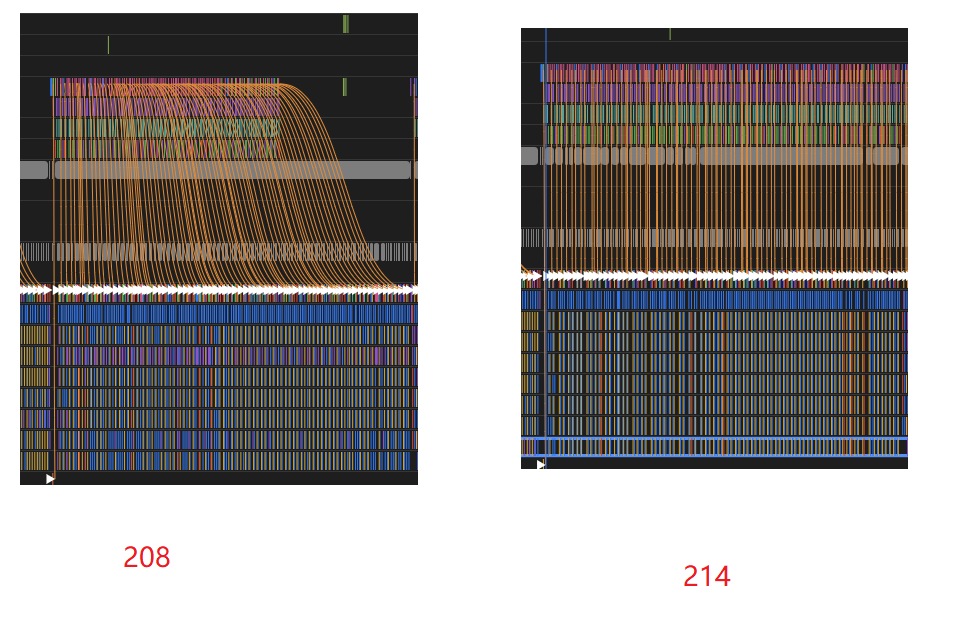

As shown in [Figure 5](#ZH-CN_TOPIC_0000002535807039__fig1646164615811), use the box-selection statistics function of the Timeline to compare the CANN-side interfaces responsible for dispatch on device 208 and device 214. You can see that the duration of the CANN-side interfaces on device 214 is significantly longer than that on device 208.

**Figure 5** Box-selection statistics of the CANN-side interfaces on device 208 and device 214

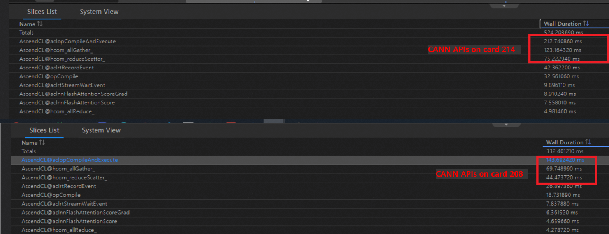

**Root Cause Identified**

Through pinpoint comparison and analysis of the fast and slow device Timelines, you can preliminarily confirm that the difference between the fast and slow devices is caused by the host-side dispatch bottleneck of the slow device (device 214). To further resolve the host-side dispatch bottleneck, refer to [Locating and Resolving Host Bound Issues](solution_to_top3.md).

## Communication Retransmission

### Determining Whether Communication Retransmission Occurs Based on Cluster Data

In distributed training, if a communication operator takes more than 4 seconds (a typical threshold for communication retransmission), after you exclude the possibility of a fast and slow device issue, you can suspect that packet retransmission occurs. Performance data of a single device alone makes it difficult to directly distinguish these two cases. Therefore, you can use MindStudio Insight for further troubleshooting.

Communication retransmission usually occurs in performance jitter issues between clusters, and you can confirm it by comparing the profiling data of normal and abnormal steps in MindStudio Insight.

1. On the cluster result overview page of MindStudio Insight, you can see the duration distribution of different steps, as shown in [Figure 1](#ZH-CN_TOPIC_0000002504087090__fig13354164218130).

   **Figure 1** Cluster overview page of MindStudio Insight

   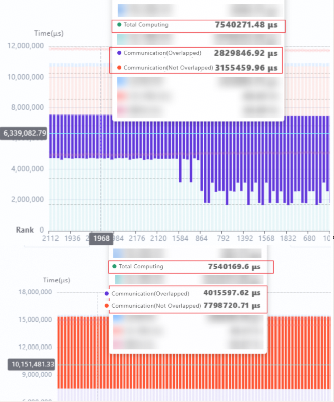

2. Compare the overview results of the two steps, and you can find that the computing time and idle time between devices are relatively close, which indicates that no obvious fast and slow device issue exists. The difference is mainly in the communication duration (communication time (covered) + communication time (not covered)).

3. Compare all devices synchronously at the same time, and you can find that the communication duration gap of every device between Step11 and Step12 is about 4.7 s.

4. As shown in [Figure 2](#ZH-CN_TOPIC_0000002504087090__fig1049254151413), observe the Timeline result of device 320. The operator is `LinearWithGradAccumulationAndAsyncCommunication`, which is a communication operator used for synchronization, and subsequent task dispatch (`AscendCL@aclnnTopK`) is blocked.

   **Figure 2** Timeline of Rank320

   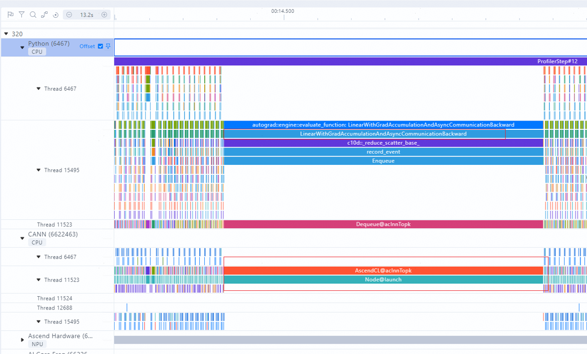

   Based on the analysis of all data, the NPU (computing) and CPU (scheduling) are normal. The difference in communication time between devices comes from an abnormal timeout of point-to-point communication, which is most likely communication retransmission caused by a network exception.

5. After you find a communication retransmission issue, you are advised to check whether the switch network is properly configured. For example, check whether the PFC control mechanism is not added, which causes PFC congestion and then communication retransmission.

### Typical Communication Retransmission Case

**Issue Description**

When the Llama3-70B model is migrated from 4 servers to a 32-server cluster, linearity degrades.

**Issue Analysis**

As shown in [Figure 1](#ZH-CN_TOPIC_0000002535807041__fig1423422518177), use [Model Tuning Quick Analysis (msprof-analyze CLI)](performance_tool_usage.md#quick-analysis-for-model-tuning-msprof-analyze-cli) to analyze the normal 4-server cluster and the abnormal 32-server cluster separately. A comparison of the two results shows that the duration difference is mainly in communication, and the overall communication duration of the 32-server cluster is longer.

**Figure 1** cluster_step_trace_time.csv deliverable, comparison between the normal 4-server cluster and the abnormal 32-server cluster

Take device 0 as an example. Compare device 0 in the normal cluster and in the abnormal cluster, and you can find that the issue occurs in the allReduce and broadcast operators at the end of the iteration, as shown in [Figure 2](#ZH-CN_TOPIC_0000002535807041__fig636142716175).

**Figure 2** Timeline of device 0 in the abnormal cluster

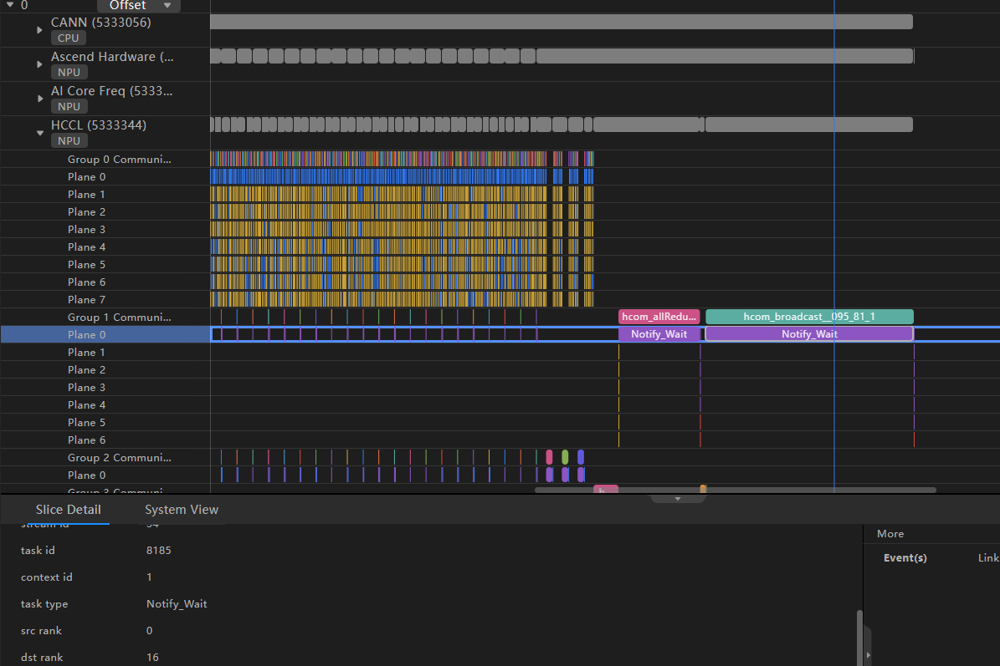

Jump repeatedly based on the dst rank in the selected details of the communication operator (the destination device, which in a notify wait communication event generally indicates the slow device being waited for). You can find that device 440 drags down other devices in the same tp communication domain, as shown in [Figure 3](#ZH-CN_TOPIC_0000002535807041__fig2023542961715).

**Figure 3** Timeline of device 440 in the abnormal cluster

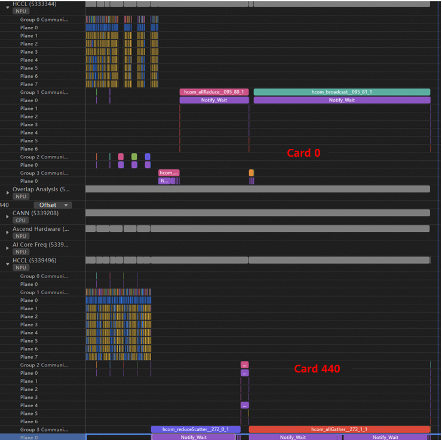

Go to the Communication tab, select **Communication Duration Analysis**, and find the corresponding communication domain. Sort by Wait Time in ascending order, and find the devices in this communication domain that have short wait time and long transmission time, as shown in [Figure 4](#ZH-CN_TOPIC_0000002535807041__fig1634973181714).

**Figure 4** Communication tab > Communication Duration Analysis

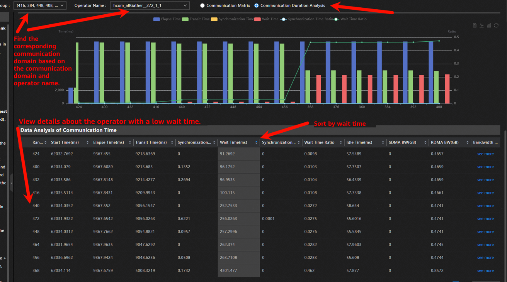

Further check the bandwidth analysis of the device with long transmission time, and you can find a large number of RDMA communication packets with extremely low bandwidth, as shown in [Figure 5](#ZH-CN_TOPIC_0000002535807041__fig12279203317179). A network transmission issue is suspected, and you need to troubleshoot the network configuration.

**Figure 5** Bandwidth analysis

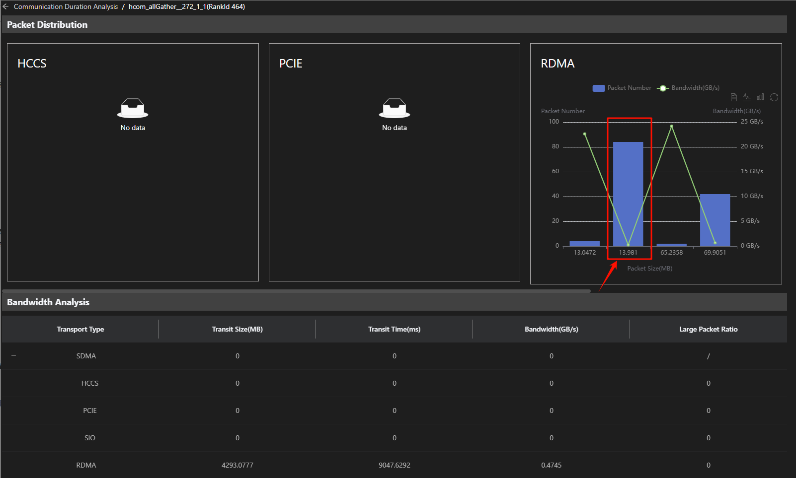

**Resolution**

After troubleshooting the network configuration, you can find that the traffic between the switch and the compute node servers is routed through a queue without PFC congestion control. This causes a large amount of packet loss on the network of the corresponding queue and then causes RDMA data network packet retransmission. After you correctly configure the related environment variables, the issue is resolved.

## Small-Packet Communication

### Case: ZeRO3 Mode Causes Small-Packet Communication

**Issue Description**

The same model is migrated from the NPU to the GPU, and the performance does not meet the requirement.

**Issue Analysis**

Use the compare performance comparison tool in [Model Tuning Quick Analysis (msprof-analyze CLI)](performance_tool_usage.md#quick-analysis-for-model-tuning-msprof-analyze-cli) to compare the data of the baseline GPU and the migrated NPU. You can find a large gap in the communication uncovered time, as shown in [Figure 1](#ZH-CN_TOPIC_0000002535887091__fig18477143015137).

**Figure 1** compare comparison between the GPU and the NPU

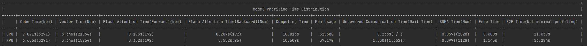

Compare the Timelines of the baseline GPU and the migrated NPU, and you can find that the difference mainly comes from the allGather communication part at the end of the step. The NPU takes about 100 ms, while the GPU takes only about 4 ms, as shown in [Figure 2](#ZH-CN_TOPIC_0000002535887091__fig311914449169).

**Figure 2** Timeline comparison between the GPU and the NPU

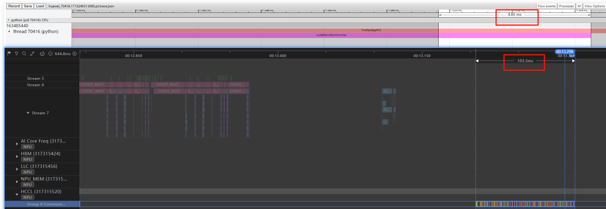

The bandwidth of this part of the NPU communication operators is only 0.2 GB/s. You can observe a large number of allGather communication operators, the transmitted data volume is only 256 Bytes, and communication link establishment takes up most of the duration, as shown in [Figure 3](#ZH-CN_TOPIC_0000002535887091__fig38716463229). These operators are mainly performing ZeRO3 operations.

**Figure 3** allGather small-packet communication operator

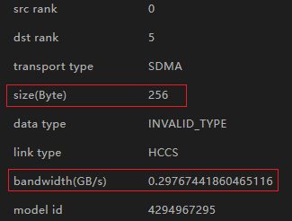

Zero Redundancy Optimizer (ZeRO) mode is a method for saving memory, and ZeRO mode changes the communication strategy. The main principle of ZeRO is to partition data such as optimizer states, gradients, and weights, and then synchronize them through collective communication when they are needed, which reduces the peak memory usage. It is a typical approach of trading time for space.

**Resolution**

Change the ZeRO3 algorithm to the ZeRO2 algorithm, that is, no longer partition the model weights. This increases memory usage but reduces the communication overhead between devices. After you switch to ZeRO2, the overall performance improves by 2.7%.

## Source and Destination Address Byte Misalignment

Byte misalignment means that when a cluster performs communication, if the source address or destination address is not aligned to a specific byte boundary (for example, 512-byte alignment), the transmission bandwidth drops significantly, which affects communication performance. This misalignment issue is common in SDMA transmission (that is, intra-node transmission) and often occurs in the ZeRO algorithm. Solutions usually include padding the data appropriately to ensure address alignment, which optimizes communication performance.

**Issue Description**

The performance of a single server with eight devices is lower than expected. Through the communication matrix analysis of MindStudio Insight, you can find that the average bandwidth is very low, only 1 to 2 GB/s, which is far lower than the empirical value, as shown in [Figure 1](#ZH-CN_TOPIC_0000002504087072__fig5563919151714).

**Figure 1** Cluster communication matrix analysis

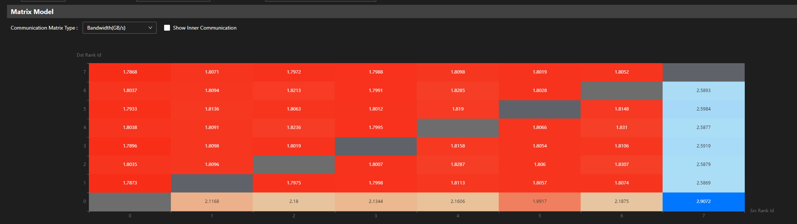

**Issue Analysis**

Further locate the specific operator, and you can find that the bandwidth of one allGather operator is particularly low. It takes more than 300 ms and the bandwidth is only 0.1 GB/s, as shown in [Figure 2](#ZH-CN_TOPIC_0000002504087072__fig18242421111714).

**Figure 2** Selected details of the allGather operator on the Timeline

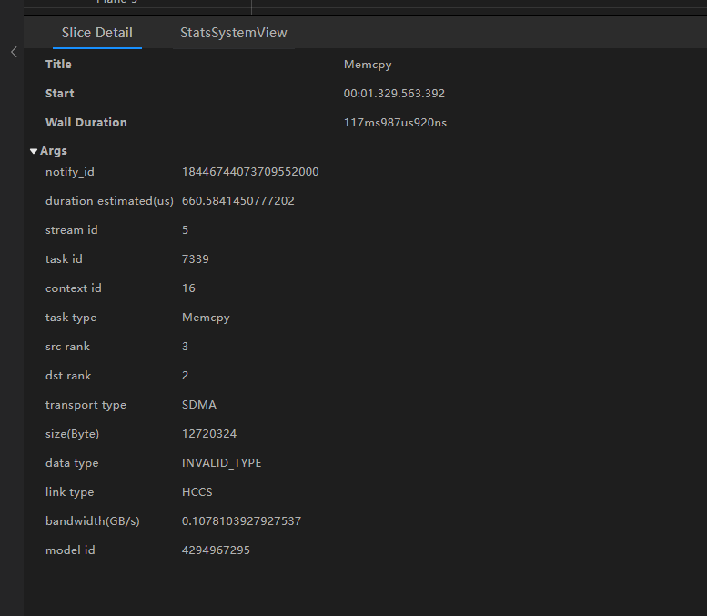

According to the analysis of HCCL experts, the source address and destination address of the allGather communication operator in the DP communication domain cannot be aligned, which severely degrades communication performance.

**Resolution**

Perform byte-aligned padding on the allGather bucket of the DP communication domain to align bytes. Currently, AscendSpeed already supports byte-aligned padding on the allGather bucket of the DP communication domain, while DeepSpeed and Megatron have not been modified yet. You need to change `nccl_start_alignment_factor` in the DeepSpeed source code, as shown in [Figure 3](#ZH-CN_TOPIC_0000002504087072__fig1128582301711). After the modification, the allGather duration changes from 350 ms to 50 ms.

**Figure 3** Modifying nccl_start_alignment_factor for byte alignment

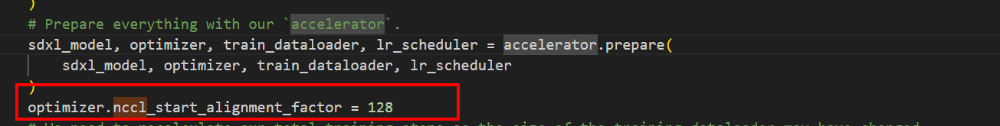

## Computing and Communication Bandwidth Preemption

Operators such as MatMul and FA are memory-bound operators and are prone to mte bound. When such operators run in parallel with communication operators, as shown in [Figure 1](#ZH-CN_TOPIC_0000002504087110__fig10255174541713), computing and communication preempt memory bandwidth, which causes the communication transmission bandwidth to be lower than the empirical value (it may drop by about 1 to 2 times, but not extremely low), as shown in [Figure 2](#ZH-CN_TOPIC_0000002504087110__fig13417943141714).

**Solution**: If bandwidth preemption caused by computing-communication parallelism is severe, compare the performance data with and without computing-communication parallelism, evaluate whether the impact of bandwidth preemption exceeds the benefit of computing-communication parallelism, and choose the option with better performance.

**Figure 1** The MatMul operator running in parallel with the allGather communication operator

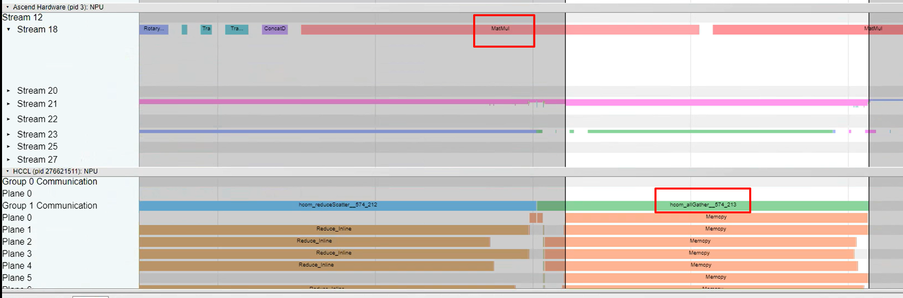

**Figure 2** Computing and communication bandwidth preemption on the allGather operator

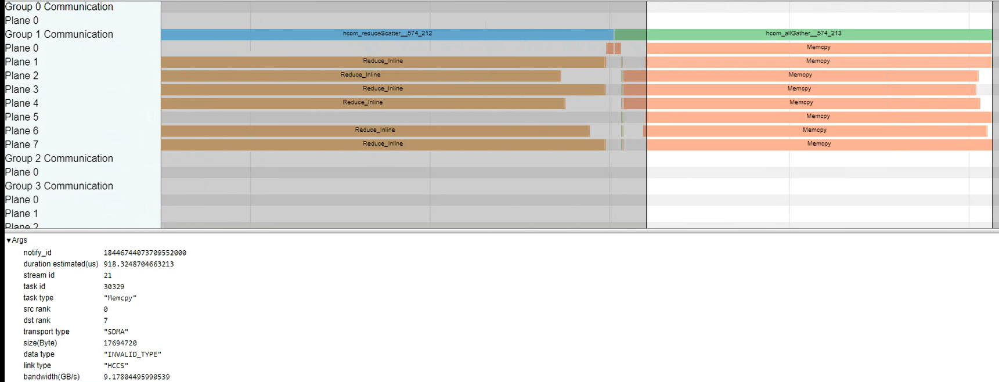

## Profiling Data Inflation

While collecting profiling data with the [Model Tuning Performance Data Collection Tools](performance_tool_usage.md#model-tuning-performance-data-collection-tools), if you enable a high collection level or configure many collection items, performance data sampling may put great pressure on the host side, which causes the collected performance data to inflate and become inaccurate. When the profiling collection level is set to Level2, communication scheduling inflates. The specific manifestation may be that host-side dispatch of communication operators is blocked and long Free durations appear.

**Solution**: Lower the collection level appropriately. You are advised not to enable Level2 unless necessary. If you must enable it, compare and analyze the Level1 data as well to exclude the impact of data inflation on the data.
