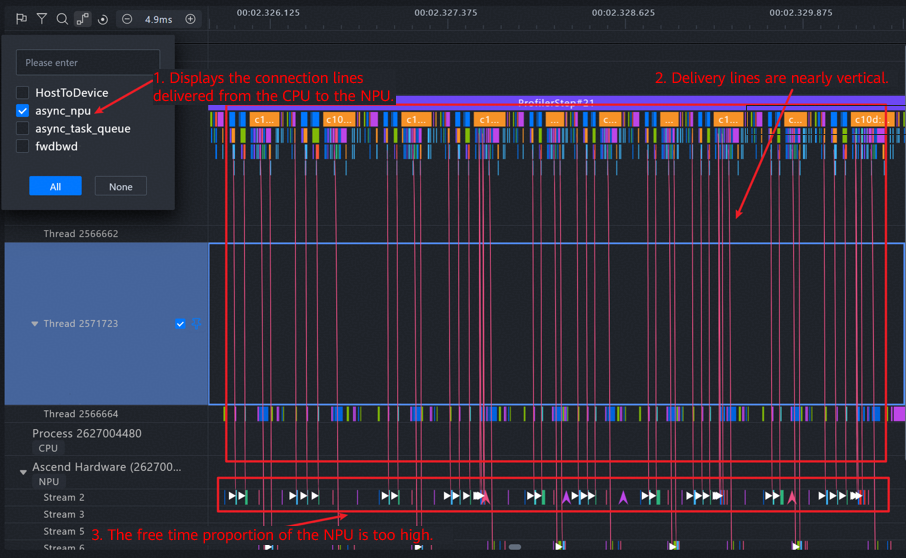
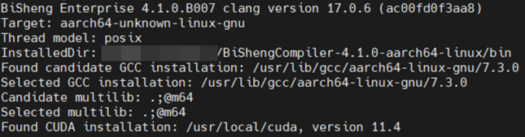
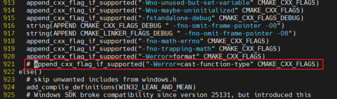
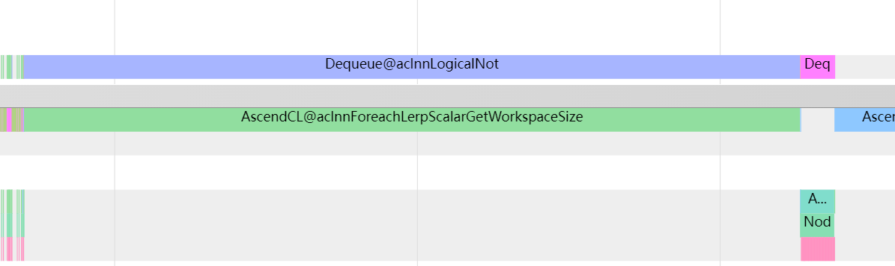
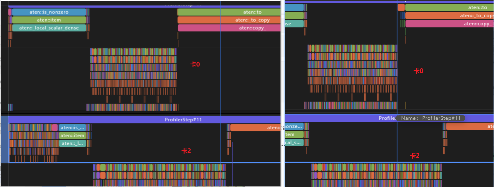
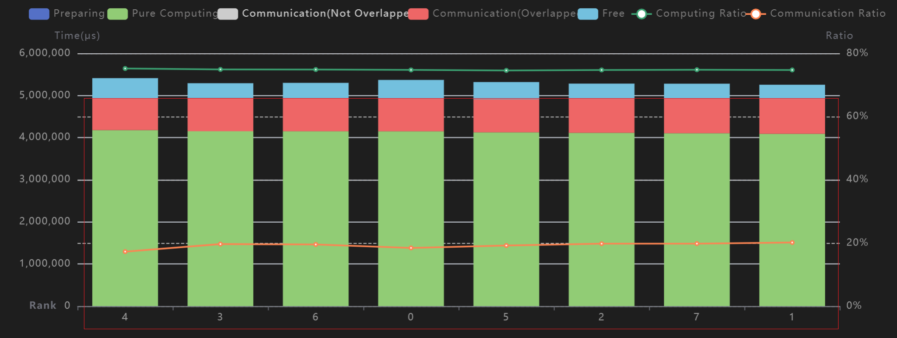
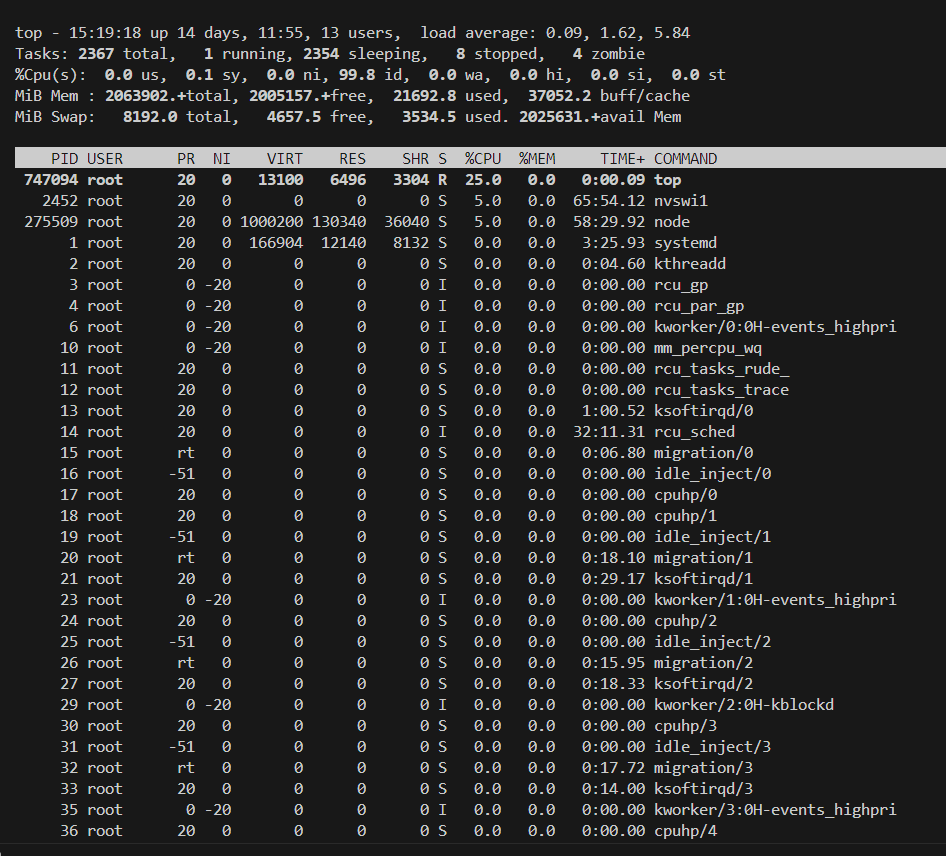
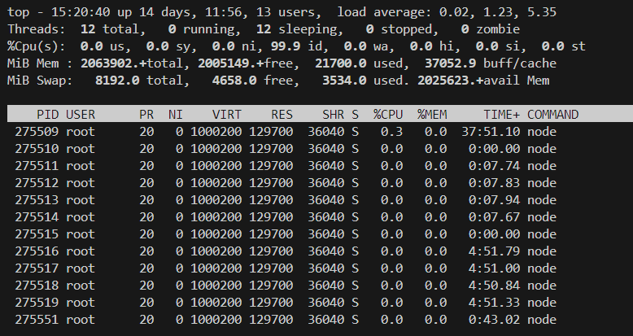
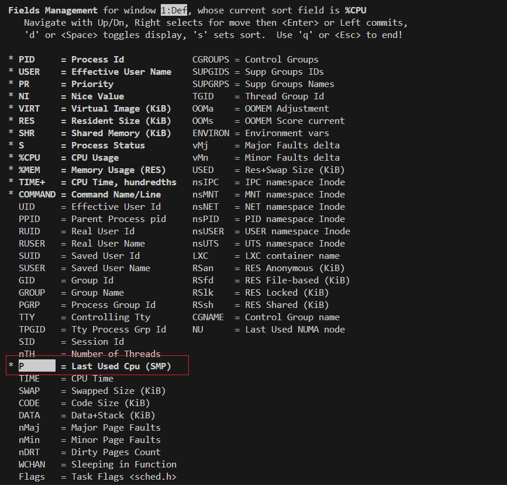
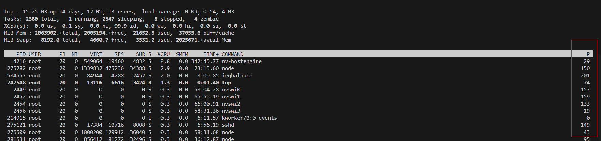

# Locating and Resolving Host Bound Issues

## Host Bound Issue Classification

### Host Bound Issue Overview

In TorchNPU training and inference scenarios, task dispatch on the host side (CPU), such as operator scheduling and memory allocation, and task execution on the device side (NPU) are performed asynchronously. When host-side task dispatch takes longer than device-side task execution, the device remains idle while waiting for new tasks, which creates a performance bottleneck, that is, a Host Bound issue.

### Symptoms of Host Bound Issues

1. The operator dispatch connections appear as a dense vertical pattern, which indicates that the NPU is waiting for the CPU to dispatch tasks.

2. The proportion of NPU idle time (Free time) caused by waiting is excessively high.

   **Figure 1** Performance data of a typical Host Bound scenario

   

### Optimization Methods for Host Bound Issues

Host Bound issues are mainly caused by two factors: operator dispatch latency and excessive CPU computing load. You can use the methods in [Table 1](#ZH-CN_TOPIC_0000002503927258__table12690162612911) to optimize them.

**Table 1** Common optimization methods for Host Bound issues<a name="ZH-CN_TOPIC_0000002503927258__table12690162612911"></a>

| Optimization Method | Advantage | Description |
| ------------ | ---------------- | ------------------------------------------------------------ |
| Operator dispatch optimization | Reduce the number of operator dispatches | After you identify the bottleneck with the [methods for locating fast and slow device issues](solution_to_top1.md#methods-for-locating-fast-and-slow-device-issues), optimize it through logic optimization, equivalent computation replacement, operator fusion, and other methods. See [Affinity Operator Optimization Strategies](solution_to_top2.md#affinity-operator-optimization-strategies). |
|              | Improve operator dispatch speed | &#8226; [Pipeline optimization](#pipeline-optimization): a general and efficient optimization method. Its core idea is to migrate some operator adaptation tasks to the secondary pipeline, thereby balancing the load between the two pipelines and reducing the wake-up time when tasks are dequeued.<br>&#8226; [Core binding optimization](#core-binding-optimization): controls the processor affinity of CPU-side operator tasks (that is, core binding) to improve task execution efficiency, avoid memory access across Non-Uniform Memory Access (NUMA) nodes, and reduce task scheduling overhead.<br/>&#8226; [Compilation optimization](#compilation-optimization): applies the Link Time Optimization (LTO) and Profile-Guided Optimization (PGO) technologies of BiSheng Compiler to build the core components, Python, PyTorch (torch), and Ascend TorchNPU, from source. This effectively improves program performance. |
| CPU computing optimization | Exploit the advantages of heterogeneous computing power | Minimize the use of AI CPU operators and preferentially select operators with better affinity. See [Affinity Operator Optimization Strategies](solution_to_top2.md#affinity-operator-optimization-strategies). |
|              | Exploit the advantages of parallel computing | Promote asynchronous parallel processing between the CPU and NPU (for example, place data processing logic in the `DataLoader`), and reduce stream synchronization operations (for example, use `item()`, `cpu()`, and `npu()` with caution, and merge or avoid them where possible).|

In addition, there is a class of dispatch anomaly issues, in which the operator dispatch process takes significantly longer because of factors such as resource preemption and operating system scheduling policy conflicts. See [Dispatch Anomaly Analysis](solution_to_top3.md#dispatch-anomaly-analysis).

## Pipeline Optimization

**Enabling Instructions**

Enable this feature by setting the following environment variable. It usually applies to network scenarios where Host Bound issues are severe.

```cfg
export TASK_QUEUE_ENABLE=2
```

**Detailed Principles**

The `task_queue` operator dispatch queue supports three configuration levels (the add operator is used as an example). You can configure them as needed. For details, see [TASK_QUEUE_ENABLE](https://atomgit.com/Ascend/pytorch/blob/master/docs/en/api/environment_variable/op_execution/TASK_QUEUE_ENABLE.md) in the [TorchNPU Environment Variable Reference](https://atomgit.com/Ascend/pytorch/blob/master/docs/en/api/environment_variable/env_variable_list.md).

**Precautions**

- When `ASCEND_LAUNCH_BLOCKING` is set to "1", the `task_queue` operator queue is forcibly disabled, and the `TASK_QUEUE_ENABLE` configuration does not take effect. For the `ASCEND_LAUNCH_BLOCKING` configuration, see [ASCEND_LAUNCH_BLOCKING](https://atomgit.com/Ascend/pytorch/blob/master/docs/en/api/environment_variable/op_execution/ASCEND_LAUNCH_BLOCKING.md) in the [TorchNPU Environment Variable Reference](https://atomgit.com/Ascend/pytorch/blob/master/docs/en/api/environment_variable/env_variable_list.md).

- When `TASK_QUEUE_ENABLE` is set to 2, the increased concurrency of memory access may raise the NPU memory peak during running.

## Core Binding Optimization

**Enabling Instructions**

Enable this feature by setting the following environment variable. It applies to network scenarios where autonomous task scheduling is insufficient or fast and slow device issues are prominent.

```cfg
export CPU_AFFINITY_CONF=<mode>,npu<value1>:<value2>-<value3>
```

- `mode`: core binding mode. When it is set to "0" or left unconfigured, core binding is disabled. When it is set to "1", coarse-grained core binding is enabled. When it is set to "2", fine-grained core binding is enabled.
- `npu<value1>:<value2>-<value3>`: custom core binding range. This setting currently takes effect only when `mode` is not set to "0". `value1` indicates the NPU number, and `value2`-`value3` specifies the CPU core binding range for the process of that device.

**Detailed Principles**

- **Coarse-grained core binding**: binds all threads associated with a single NPU to the specified CPU core range.
- **Fine-grained core binding**: binds the main threads associated with a single NPU to the specified CPU core range, with each thread exclusively occupying one core so that the threads are isolated from each other.

**Configuration Example**

1. Enable coarse-grained core binding.

   ```shell
   export CPU_AFFINITY_CONF=1
   ```

2. Enable fine-grained core binding.

   ```shell
   export CPU_AFFINITY_CONF=2
   ```

3. Enable custom core binding.

   ```shell
   export CPU_AFFINITY_CONF=1,npu0:0-1,npu1:2-5,npu3:6-6
   ```

4. After you perform the preceding configuration, the NPU binding details are as follows.

   - The process of NPU 0 is bound to CPU cores 0 to 1.
   - The process of NPU 1 is bound to CPU cores 2 to 5.
   - The process of NPU 3 is bound to CPU core 6.
   - The processes of other NPUs use the default core range.

## Compilation Optimization

### Acquisition of Compilation Optimization Packages

Configuring a compilation optimization environment is complex and the complete process is time-consuming. To improve deployment efficiency and achieve out-of-the-box performance gains, you can directly obtain prebuilt generalized compilation optimization packages, which include a compressed package for the compilation-optimized Python and the whl installation packages for torch and TorchNPU. You can directly configure the Python compressed package as a [soft link](https://repo.oepkgs.net/ascend/pytorch/vllm/python/). The whl installation packages for torch and TorchNPU are generated through optimization with model data from typical scenarios and provide certain generalized performance gains. For package download links, see [Table 1](#ZH-CN_TOPIC_0000002503927236__table18319122153814).

**Table 1** Package acquisition for the vLLM scenario<a name="ZH-CN_TOPIC_0000002503927236__table18319122153814"></a>

| Name                       | Acquisition Link                                    |
| -------------------------- | --------------------------------------------------- |
| Python compressed package  | <https://repo.oepkgs.net/ascend/pytorch/vllm/python/> |
| torch and TorchNPU whl installation packages | <https://repo.oepkgs.net/ascend/pytorch/vllm/torch/>  |
| Runtime dependency so      | <https://repo.oepkgs.net/ascend/pytorch/vllm/lib/>    |

### Installation of BiSheng Compiler

You must install BiSheng Compiler in advance for Python compilation optimization and for torch and TorchNPU compilation optimization.

1. Obtain the compiler installation package from the Kunpeng community website. The following uses version 4.1.0 as an example. Click the [link](https://kunpeng-repo.obs.cn-north-4.myhuaweicloud.com/BiSheng%20Enterprise/BiSheng%20Enterprise%20203.0.0/BiShengCompiler-4.1.0-aarch64-linux.tar.gz) to download it.

2. After the download is complete, run the following commands to install and configure the compiler.

   ```shell
   # Decompress the BiSheng Compiler installation package
   tar -xvf BiShengCompiler-4.1.0-aarch64-linux.tar.gz

   # Configure environment variables
   export PATH=$(pwd)/BiShengCompiler-4.1.0-aarch64-linux/bin:$PATH
   export LD_LIBRARY_PATH=$(pwd)/BiShengCompiler-4.1.0-aarch64-linux/lib:$LD_LIBRARY_PATH
   ```

3. After the configuration is complete, run the following command to verify the installation.

   ```shell
   clang -v
   ```

4. If the following version information is displayed, the configuration is successful.

   **Figure 1** Output indicating successful BiSheng Compiler configuration

   

### Python Compilation Optimization

**Dependency Installation**

The Python source compilation process attempts to call system libraries. If the relevant system header files are missing during compilation, compilation can still complete, but an error is triggered at runtime when the corresponding components are called.

- Fedora/RHEL/CentOS (dnf-based systems)

  ```shell
  sudo dnf install gcc gcc-c++ gdb lzma glibc-devel libstdc++-devel openssl-devel \
  readline-devel zlib-devel libffi-devel bzip2-devel xz-devel \
  sqlite sqlite-devel sqlite-libs libuuid-devel gdbm-libs perf \
  expat expat-devel mpdecimal python3-pip
  ```

- Debian/Ubuntu (apt-based systems)

  ```shell
  sudo apt-get install build-essential gdb lcov pkg-config \
  libbz2-dev libffi-dev libgdbm-dev libgdbm-compat-dev liblzma-dev \
  libncurses5-dev libreadline6-dev libsqlite3-dev libssl-dev \
  lzma lzma-dev tk-dev uuid-dev zlib1g-dev libmpdec-dev
  ```

**Compiling Python**

Download and decompress the Python source code of the required version from the following address: <https://www.python.org/downloads/source/>

The following uses Python 3.8.17 as an example. Refer to the following commands to compile and install it.

```shell
# Decompress the source file and enter the directory
tar -xvf Python-3.8.17.tgz
cd Python-3.8.17

# Configure the compilation environment (BiSheng Compiler must be installed in advance)
export CC=clang
export CXX=clang++

# Compile and install (install_path is the absolute path of the Python installation target)
mkdir -p <install_path>
./configure --prefix=<install_path> --with-lto --enable-optimizations
make -j
make install
```

After compilation is complete, the python3 and pip3 executables built with compilation optimizations are generated in the `install_path/bin` directory.

**Configuring Soft Links**

To make the compilation-optimized Python easier to enable in the environment, configure system soft links with the following commands.

```cfg
# <default_path> is the default Python path of the system (you can query it with which python)
cd <default_path>

# Back up the original Python binary file
mv python python_bak

# Create a new Python soft link
ln -s <install_path>/bin/python3 python
```

Configure the pip file in the same way. After the configuration is complete, you are advised to check whether the Python path on the first line of the pip file is correct.

```shell
vi pip
```

After you complete the preceding operations, you can invoke the compilation-optimized Python with the Python command and manage packages with the pip command.

**Precautions**

- If a message indicating a missing .so file or module appears when the model runs, check whether the dependencies are fully installed.
- The compiled Python environment can be migrated across servers. Note that migration is supported only from a lower glibc version to a higher one, and the reverse is not feasible.

### torch and TorchNPU Compilation Optimization

**Prerequisites**

```shell
# Download the torch source code. The following uses version 2.1.0 as an example
git clone -b v2.1.0 https://github.com/pytorch/pytorch.git pytorch-2.1.0
cd pytorch-2.1.0
git submodule sync
git submodule update --init --recursive

# Install torch dependencies
pip install -r requirements.txt

#Download the TorchNPU source code. The version must match the torch version
git clone -b v2.1.0 https://gitee.com/ascend/pytorch.git torch_npu
```

Modify the `CMakeLists.txt` file in the torch source code directory and comment out the following line to suppress the warning (this line has been removed in later versions of torch. Therefore, no comment is needed):

```text
append_cxx_flag_if_supported("-Werror=cast-function-type" CMAKE_CXX_FLAGS)
```

**Figure 1** Example of code commenting



**First Compilation (Instrumented Compilation)**

```shell
# Configure environment variables (/path/to/profile is the default storage path for performance data, which you can later change by setting LLVM_PROFILE_FILE)
export CMAKE_C_FLAGS="-flto=thin -fuse-ld=lld -fprofile-generate=/path/to/profile"
export CMAKE_CXX_FLAGS="-flto=thin -fuse-ld=lld -fprofile-generate=/path/to/profile"
export CC=clang
export CXX=clang++
export USE_XNNPACK=0

# Compile torch
cd pytorch-2.1.0
git clean -dfx
python3 setup.py bdist_wheel

# Compile TorchNPU (install the newly compiled torch first)
cd torch_npu
git clean -dfx
bash ci/build.sh --python=3.8 --enable_lto --enable_pgo=1
```

**Collecting Profiling Data**

```shell
# Install the instrumented packages
pip install pytorch-2.1.0/dist/torch-*.whl --force-reinstall --no-deps
pip install torch_npu/dist/torch_npu-*.whl --force-reinstall --no-deps

# Set key environment variables
export OMP_PROC_BIND=false
export LLVM_PROFILE_FILE=/tmp/profile/default_%m.profraw  # Ensure that the /tmp/profile directory is empty

# Run the actual training task to collect performance data, for example: bash run_model.sh
...
```

**Second Compilation (Optimized Compilation)**

```cfg
# Convert the profiling data format
llvm-profdata merge /tmp/profile -o default.profdata

# Configure the optimized compilation environment
export CMAKE_C_FLAGS="-flto=thin -fuse-ld=lld -fprofile-use=/path/to/profile/default.profdata"
export CMAKE_CXX_FLAGS="-flto=thin -fuse-ld=lld -fprofile-use=/path/to/profile/default.profdata"
export CC=clang
export CXX=clang++
export USE_XNNPACK=0

# Compile the optimized version of torch
cd pytorch-2.1.0
git clean -dfx
python3 setup.py bdist_wheel

# Compile the optimized version of TorchNPU (copy default.profdata to the torch_npu directory)
cd torch_npu
git clean -dfx
cp /path/to/profile/default.profdata .
bash ci/build.sh --python=3.8 --enable_lto --enable_pgo=2
```

The torch and TorchNPU generated by compilation are high-performance optimized packages.

## Dispatch Anomaly Analysis

### Background

Currently, dispatch anomalies are one of the common causes of fast and slow device issues. Typical symptoms are as follows.

- The execution time of a specific operator on a single compute device increases significantly (you can observe this in the [Timeline](performance_tool_usage.md#timeline) of MindStudio Insight).

  **Figure 1** Abnormal increase in the execution time of a single function

  

- The overall dispatch time is prolonged. As shown in [Figure 2](#ZH-CN_TOPIC_0000002503927256__fig1918315395150), a comparison shows that the dispatch time of device 0 is noticeably longer.

  **Figure 2** Operator dispatch is generally slower<a name="ZH-CN_TOPIC_0000002503927256__fig1918315395150"></a>

  

Such issues are usually difficult to locate because of scenario complexity and can be classified as dispatch anomaly issues.

### Prerequisite Checks

Before you perform an in-depth analysis, complete the following basic checks:

- **Extra process check**: Check whether background processes or plug-ins that affect CPU performance exist in the running environment (the service scenario owner usually confirms this, and this factor is rarely the main cause).

- **Task balance check**: Use profiling tools to analyze the computing time of each device. If the time of each device is similar and no obvious fast or slow device phenomenon exists, you can preliminarily determine that tasks are balanced (the service scenario owner can confirm this further). See [Figure 1](#ZH-CN_TOPIC_0000002503927280__fig0119124117159).

  **Figure 1** Relatively balanced computing tasks across multiple devices<a name="ZH-CN_TOPIC_0000002503927280__fig0119124117159"></a>

  

- **Core binding isolation check (for A+K scenarios)**: In A+K scenarios where the server scheduling capability is limited (CPU core switching or preemption may occur), you are advised to try core binding isolation for tasks.

  To do so, use the `taskset` command or set the environment variables `export CPU_AFFINITY_CONF=1` and `export CPU_AFFINITY_CONF=2`.

  > [!NOTE]
  >
  > For details about the `CPU_AFFINITY_CONF` environment variable, see [Core Binding Optimization](https://atomgit.com/Ascend/ModelZoo-PyTorch/blob/master/PyTorch/docs/en/performance_tuning/performance_tuning_methods/scheduling_opt.md#core-binding-optimization) under "Performance Tuning > Performance Tuning Methods > Scheduling Optimization" in the [PyTorch Training Model Migration and Tuning Guide](https://atomgit.com/Ascend/ModelZoo-PyTorch/blob/master/PyTorch/docs/en/README.md).

### Formal Analysis

#### CPU Running Status

After you complete the [prerequisite checks](#prerequisite-checks), perform the following steps to check the CPU status:

- **Command input**: Run the `top` command in the CLI to view the system CPU running status in real time.

  **Figure 1** top command execution interface

  

- **Process and thread viewing**: To view all threads of a specific process (PID), run: `top -H -p pid`.

  **Figure 2** Viewing a specified process with top

  

- **Interface operations**:

  - F key: enter field selection mode
  - Arrow keys ↑/↓: browse fields
  - D key: select or deselect display items
  - Right arrow key: select a field, then use the arrow keys to swap its sorting position with other fields
  - Left arrow key: exit the sorting operation

  **Figure 3** Selecting parameters to display in the top interface

  

- **Result analysis and handling**:

  - After you press the F key and add the P (Last used CPU) field, you can observe the number of the CPU core on which each process last ran.
  - If you find abnormal switching of process CPU cores, the possible causes include differences in the CPU topology inside a virtual machine or container, or an excessively large core binding range.
  - For the latter, you can run `export CPU_AFFINITY_CONF=2` to try fine-grained core binding optimization.

  **Figure 4** Displaying the last CPU used by each process

  

#### Exception Stack Capture

When a performance exception is detected, capture and analyze the related stack information in a timely manner:

- Viewing with `gdb`

  ```shell
  gdb -p <pid>
  # Enter the GDB CLI and print the process/main thread call stack
  bt
  # View the thread call stack
  info threads
  thread<n>
  bt
  ```

- Viewing with `pstack`

  ```shell
  pstack <pid>
  ```

- Viewing with `cat`

  ```shell
  cat /proc/<pid>/stack
  ```
