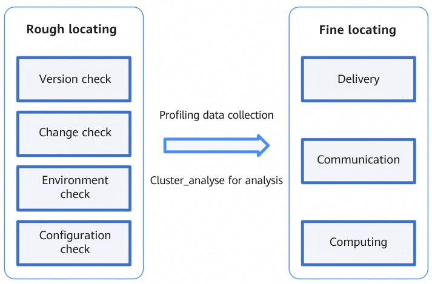

# Methodology for Locating Abnormal Fluctuations in Cluster Performance

## Approach for Analyzing Cluster Performance Degradation

For the overall approach to analyzing cluster performance issues, see [Troubleshooting Approach](./positioning_process_for_performance_issues.md#troubleshooting-approach).

For a general long-term stability performance issue, that is, a performance fluctuation that occurs during normal training, you first need to consider recent changes and perform a preliminary check for hardware issues, and then use Profiling to find the specific issue point and locate it in detail.

To improve locating efficiency, you are advised to use the two-step coarse-to-fine locating method, as shown in [Figure 1](#ZH-CN_TOPIC_0000002535807059__fig1169003471618).

**Figure 1** Locating process

The core idea of the two-step coarse-to-fine locating method is as follows. Because collecting and analyzing Profiling data for large-scale cluster training is difficult, start with a coarse granularity, focus on recent cluster changes (such as configuration changes and component upgrades) and hardware metrics (such as CPU and memory utilization and network throughput), and quickly identify the abnormal period and suspicious modules. If no obvious abnormality is found, use the fine locating method to deeply analyze low-level details such as computing, communication, and dispatch by using Profiling tools, and further locate the root cause of the bottleneck from dimensions such as thread stacks, I/O latency, and lock contention. This methodology emphasizes the correlated analysis of change information and metrics. It also uses visualization methods such as Profiling, flame graphs, and call chains to implement a closed loop from macro-level abnormality locating to micro-level root cause analysis, providing an accurate hierarchical diagnosis path for cluster performance optimization.

In addition, to resolve the difficulty of verification, when conditions permit, you are advised to use methods such as N-way partitioning and single-server model tests for the service to reproduce the issue at a small scale, which facilitates verification.

1. **Coarse locating**

   Coarse locating is generally carried out in scenarios without Profiling. Coarse locating methods are mainly based on the analysis of past issues and on experience. Prominent issues mainly fall into the following four categories:

   - Resource accumulation: Requested resources are not released in time, or resources are requested abnormally, causing resources to accumulate and affecting performance.
   - Resource preemption: Other processes exist on the host side, or other machines read and write the shared storage under heavy pressure when resource isolation is not properly performed.
   - Communication retransmission: Communication retransmission occurs due to issues such as packet loss, which affects performance.
   - Environment change: A change was made recently, including but not limited to upgrades, use of a new cluster, and starting or stopping certain services.

   To address the preceding issues, you can use the following methods for coarse locating before Profiling analysis:

   - Version check: Collect the versions in use, including at least HDK, OS, CANN, and the framework. Use the compatibility list to confirm whether compatibility issues exist in the versions, and also confirm whether known performance-related issues exist in the versions.
   - Change check: Determine whether any change was made recently, including but not limited to version upgrades and cluster re-planning.
   - Environment check: Check whether hardware alarms exist and whether KPIs such as storage (I/O and so on) and network (packet loss and so on) are normal.
   - Configuration check: Refer to the typical check items in the [Pre-Check Tool Guide](https://atomgit.com/Ascend/msit/blob/master/msprechecker/README.md) to check whether the configuration is correct.

   > [!NOTE]
   >
   > The coarse locating check items come from experience in locating historical issues and can cover most common performance fluctuation issues. If an issue cannot be handled by coarse locating, you need to troubleshoot it in detail by using fine locating.
   >
   > In addition, you can use methods such as N-way cluster partitioning and single-server model tests to minimize the unit for reproducing the issue. If you confirm that the issue can be reproduced on a single server, check whether process preemption exists, whether the CPU utilization changes, and whether the messages or dmesg logs contain alarms or errors.

2. **Fine locating**

   For the fine locating process, see [Detailed Troubleshooting](positioning_process_for_performance_issues.md#detailed-troubleshooting). Use the model tuning tool to further locate the abnormal points and perform a detailed analysis.

Corroborate the conclusions of the coarse and fine locating processes to determine the final root cause and solution.

## Practical Locating Tips

1. In large-scale scenarios, if the goal is to complete the training task within a specified period, you can first clarify the optimization objective and calculate the benefit of locating the issue. To do so, compare the time consumed by experiments and collection on the production cluster for locating the issue with the benefit brought by the completed optimization.
2. For locating issues in large-scale clusters, first consider reproducing the large-scale issue in a small-scale cluster or even a single-server environment to facilitate experiments, thereby reducing the impact on production tasks. Methods include but are not limited to N-way partitioning, single-server tests, and pre-checks.
3. In practice, the first collection generally uses L1 without stacks. In large-scale cluster scenarios, if you write Profiling data directly to the shared storage, the collected data may expand excessively. In addition, if resource isolation is not properly performed, other jobs in the cluster may be affected. Therefore, you can consider writing Profiling data to the local storage first and then collecting it to the shared storage in batches by using a script.
4. When conditions permit, you can enable the dynamic performance data collection function when the model performs training.
