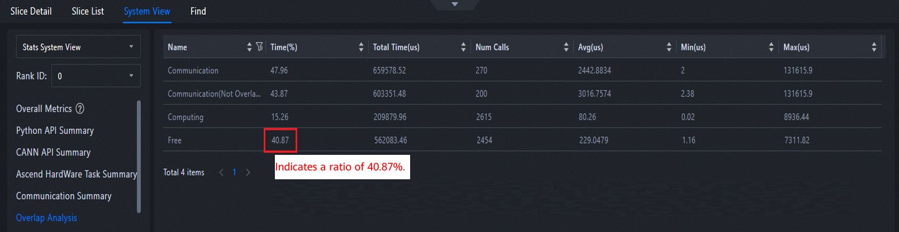
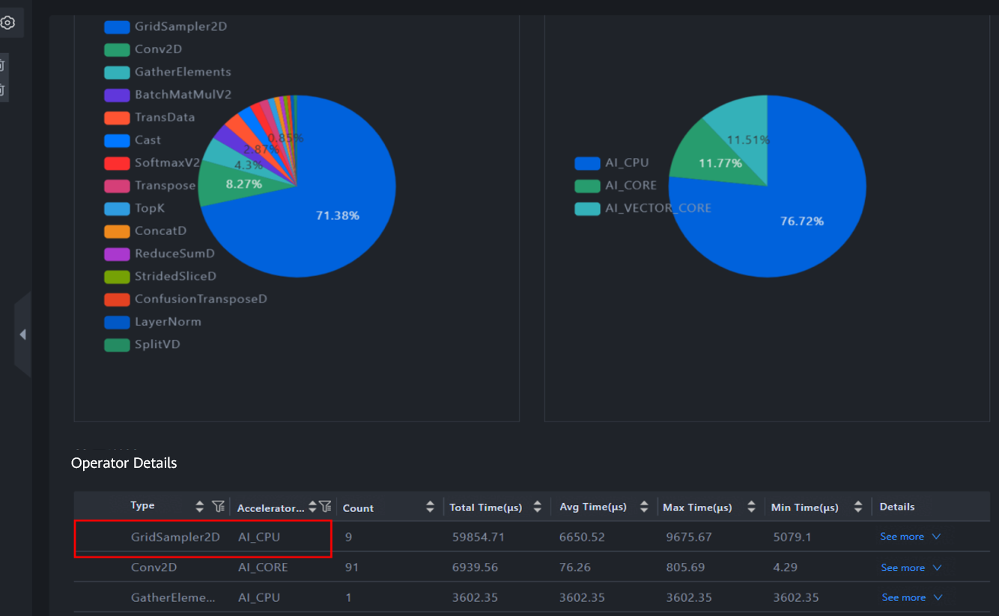
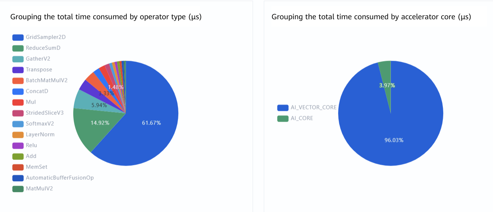
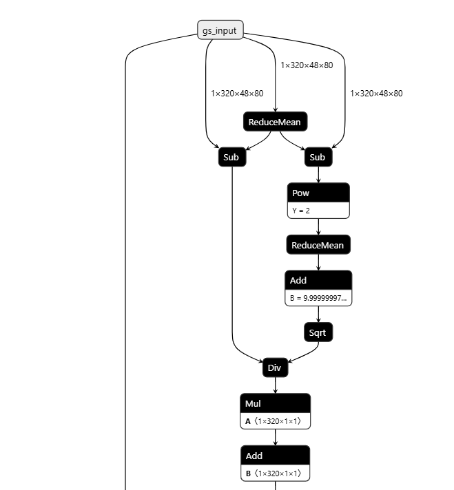
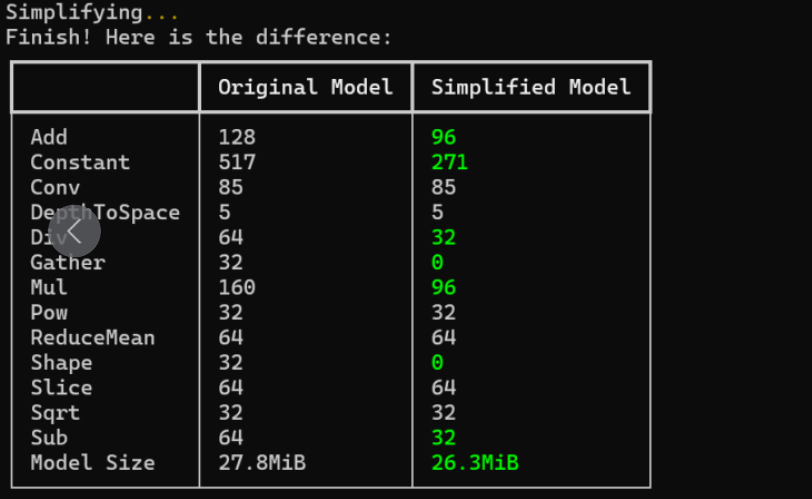
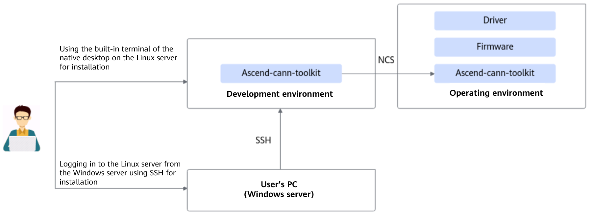
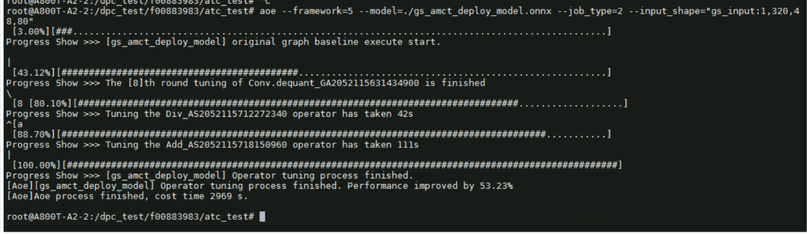
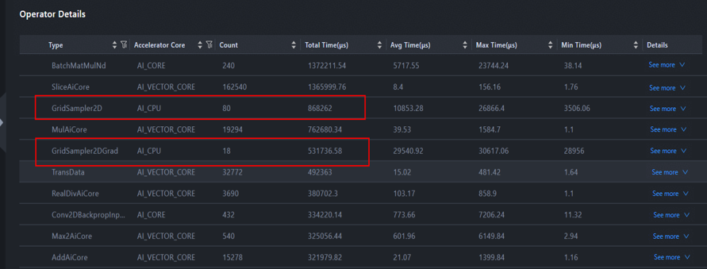
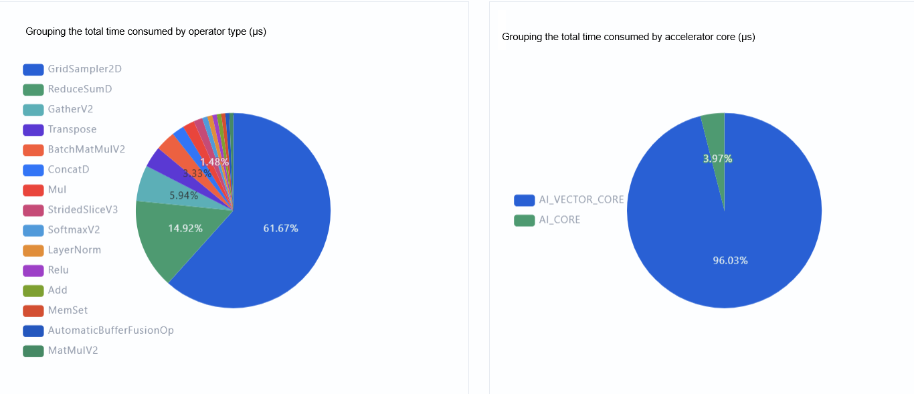
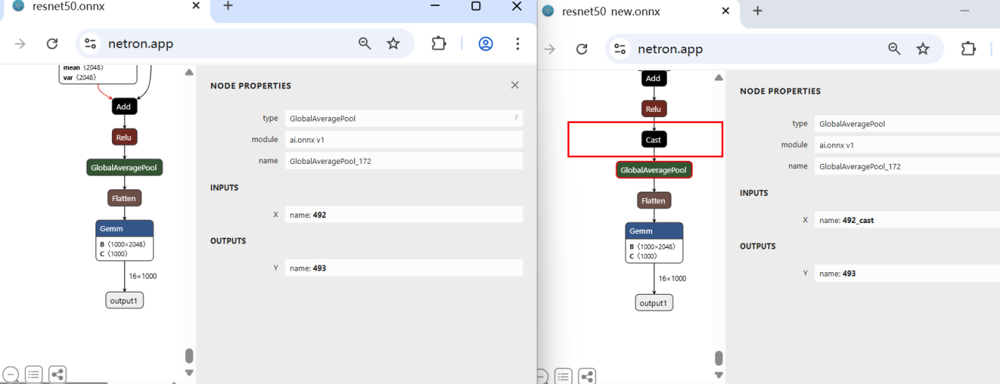

# ONNX Offline Inference Scenario Solution

## Information Collection

This document uses the Atlas 200I A2 acceleration module as an example to analyze the following information that you usually need to collect in an Atlas 200I A2 inference scenario.

**Profiling Information Collection**

For details about how to collect Profiling data, see the [msprof Model Tuning Tool](https://atomgit.com/Ascend/msprof/blob/master/docs/en/quick_start/msprof_quick_start.md).

1. Log in to the running environment and go to the directory where the msprof tool is located, `/var`.

2. Run the following command to collect performance data. `application` is the user program.

   ```shell
   msprof --output={path} {application}
   ```

   Command example:

   ```shell
   msprof --output=${HOME}/profiling_output ${HOME}/HIAI_PROJECTS/MyAppname/out/main
   ```

3. After the command is executed, a `PROF_XXX` directory is generated in the directory specified by `--output`. The directory structure is as follows.

   ```text
   ├── device_{id}
   │├──data
   │└──...
   └──host
   │├──data
   │└──...
   ```

4. Upload the `PROF_XXX` directory to the development environment where the toolkit package is installed, and run the following command to parse the data.

   ```shell
   msprof --export=on --output=<dir>
   ```

   New data files are added in the `PROF_XXX` directory. The directory structure is as follows:

   ```text
   ├── device_{id}
   │├──data
   ├──host
   │├──data
   │└──...
   └──mindstudio_profiler_output
   │├──xx_*.csv
   │├──xx_*.json
   │└──...
   ...
   ```

**Log Collection for Converting ONNX to OM Through ATC**

Set the log level for converting the ONNX file, and redirect the log output to a file. To analyze this issue, perform the following steps:

1. Configure the ATC runtime environment variables.

   ```cfg
   export ASCEND_SLOG_PRINT_TO_STDOUT=1
   export ASCEND_GLOBAL_LOG_LEVEL=0
   ```

2. Add `--log=debug` to the ATC command to collect conversion logs.

   Command example:

   ```shell
   atc --model=$modelPath/$onnxfile \
   --log=debug \
   --framework=5  \
   --input_shape="x:$batchsize,3,$height,$width" \
   --input_fp16_nodes="x" \
   --output_type=FP16 \
   --op_select_implmode=high_precision \
   --output=$outputPath/$outname  \
   --soc_version=Ascendxxxyy \  # xxxyy is the actual chip type that you use
   ```

3. Run ATC again, redirect the output information to a log text file, and obtain that file together with the `fusion_result.jsonl` file generated by the ATC run for subsequent performance analysis.

**Collecting Inference Logs**

Run the OM file to perform inference and collect the logs output by inference. The collection steps are as follows:

1. Configure the runtime environment variables for the OM model.

   ```cfg
   export ASCEND_SLOG_PRINT_TO_STDOUT=1
   export ASCEND_GLOBAL_LOG_LEVEL=1
   ```

2. Then run the OM file and redirect the output information to a log text file.

**Providing the ONNX and OM Files from Before and After ATC Conversion**

ONNX is currently one of the most mainstream model formats in the industry and is widely used for model exchange and deployment. Offline inference requires converting the ONNX file to an OM file for inference.

Collect both the ONNX file exported from the model run in the training environment and the OM file generated by conversion for subsequent analysis.

## Issue Analysis

### Analyzing Performance Data Files

1. Import the collected performance data files into MindStudio Insight for analysis.

2. Analyze the Free proportion. Usually, the Free proportion of the Atlas 200I A2 acceleration module should be relatively small (<10%). As shown in [Figure 1](#ZH-CN_TOPIC_0000002535807001__fig82447235328), the Free proportion exceeds 30%, which is clearly abnormal. You need to further analyze whether the OS of the chip is running other services that occupy resources, which in turn causes waiting.

   **Figure 1** Analyzing the Free proportion<a name="ZH-CN_TOPIC_0000002535807001__fig82447235328"></a>

   

3. Analyze the operators that run on the AI CPU. As shown in [Figure 2](#ZH-CN_TOPIC_0000002535807001__fig722253853315), GridSampler2D runs on the AI CPU. Find the problematic operator and contact the responsible person to determine whether the operator can be optimized to run on the AI Core or requires further analysis.

   **Figure 2** Analyzing operators that run on the AI CPU<a name="ZH-CN_TOPIC_0000002535807001__fig722253853315"></a>

   

4. Analyze the operators that run on the AI Core but take a long time. As shown in [Figure 3](#ZH-CN_TOPIC_0000002535807001__fig1947769133520), the Conv2D operator accounts for most of the time consumed. Find the problematic operator and contact the responsible person to check whether the operator can be further optimized.

   **Figure 3** Analyzing operators that run on the AI Core and take a long time<a name="ZH-CN_TOPIC_0000002535807001__fig1947769133520"></a>

   

5. Analyze the `op_summary` file.

   You are advised to sort by `Task Duration` in descending order and focus first on operators that take a long time, because these operators are the performance bottleneck operators. If neither `vec_ratio` nor `mac_ratio` exceeds 0.8, the operator still has room for optimization. If `mtex_ratio` is high, data movement takes a long time, and you can consider fusing the operator with the preceding and following operators to reduce movement. For parameter details, see [Table 1](#ZH-CN_TOPIC_0000002535807001__table386705312365).

   **Table 1** Parameters<a name="ZH-CN_TOPIC_0000002535807001__table386705312365"></a>

   | Parameter              | Description                                                         |
   | ----------------- | ------------------------------------------------------------ |
   | aic_mte1_time(us) | Represents the time consumed by MTE1-type instructions (L1->L0A/L0B movement instructions), excluding movement wait time. |
   | aic_mte1_ratio    | Represents the proportion of the cycle count of MTE1-type instructions (L1->L0A/L0B movement instructions) in the total cycle count. |
   | aic_mte2_time(us) | Represents the time consumed by MTE2-type instructions (GM->AICORE movement instructions).               |
   | aic_mte2_ratio    | Represents the proportion of the cycle count of MTE2-type instructions (GM->AICORE movement instructions) in the total cycle count. |
   | aic_mte3_time(us) | Represents the time consumed by MTE3-type instructions (AICORE->GM movement instructions).               |
   | aic_mte3_ratio    | Represents the proportion of the cycle count of MTE3-type instructions (AICORE->GM movement instructions) in the total cycle count. |

### ATC Conversion Log Analysis

Check whether the log contains records that the long-running operators do not hit the high-performance knowledge base:

- Search keyword 1: does not hit the high-priority operator information library.

  Log example:

  ```text
  INFO:root: 2025-02-10-12:52:23.694.284 Op[/backbone/stages.2/blocks.14/attn/Div_4] does not hit the high-priority operator information library, which might result in compromised performance.
  INFO:root: 2025-02-10-12:52:23.709.410 Op[/backbone/stages.2/blocks.15/attn/Div_1] does not hit the high-priority operator information library, which might result in compromised performance.
  ```

- Search keyword 2: from cost_model

  Log example:

  ```text
  [DEBUG] TBE(41403,python3):2025-03-20-15:08:44.009.430 [get_tiling_cube.py:147][get_auto_tiling_v2] [auto tiling] tiling is from cost model tiling, kernel name is :"te_fused_op_conv2d_fix_pipe_d637645277a21bcd6e83a554eeadce4e230fd724a51d46ed7c1ff600f7cddfc8_0"
  ```

### OM and ONNX Files

You can use the [netron](https://netron.app/) tool to load the OM and ONNX files and view the model structure. You can clearly see the topology, inputs, and outputs of the operators in the ONNX model, which facilitates subsequent graph modification. For an example of loading an ONNX or OM file, see [Figure 1](#ZH-CN_TOPIC_0000002535887041__fig9649164411478).

**Figure 1** Operator topology<a name="ZH-CN_TOPIC_0000002535887041__fig9649164411478"></a>



## Optimization Methods

### Model Compression and Quantization

Quantization can compress a model and reduce the amount of computation.

> [!NOTE]
>
> - Ascend supports quantization only for Cube operators (MatMul and Conv).
> - Quantization inserts some data conversion operators, which may cause performance deterioration. If you need quantization, you are advised to use methods such as AOE to optimize the model after quantization and compare the performance before and after quantization. For the AOE method, see [ONNX Model Tuning](#onnx-model-tuning).

Quantization methods include the following:

- Quantization through ATC: use the `--compression_optimize_conf` parameter during ATC conversion to directly obtain the quantized OM file. For details about the usage, see the [ATC Offline Model Compilation Tool User Guide](https://www.hiascend.com/document/detail/en/CANNCommunityEdition/latest/devaids/atctool/docs/en/user_guides/atc_tools/overview/learning_guide.md) and its [Parameters](https://www.hiascend.com/document/detail/en/CANNCommunityEdition/latest/devaids/atctool/docs/en/user_guides/atc_tools/CLI_options/general_restrictions.md).
- `AMCT_ONNX`: quantize the ONNX model. You need to download and install "AMCT (ONNX)", which is equivalent to the ONNX version of ATC parameter quantization. You can obtain the AMCT tool from the CANN software download link. AMCT supports joint quantization and may provide additional performance improvement on the ResNet structure.
- msModelSlim tool: quantize the ONNX model. This tool is provided with the CANN package and does not require installation. It supports quantization of ONNX models larger than 2 GB. For usage guidance, see the [msModelSlim tool](https://atomgit.com/Ascend/msmodelslim/blob/master/docs/en/quick_start/quantization_quick_start.md).

### ONNX Model Tuning

#### Simplifying the ONNX File

ONNX Simplifier is an open-source tool that simplifies ONNX models. It infers the entire computation graph and replaces redundant operators with constant outputs (also called constant folding).

Run the following commands to use the ONNX Simplifier tool.

```shell
pip install onnx-simplifier
onnxsim -h  # View the parameter description
onnxsim  --overwrite-input-shape="1,3,224,24" efficient.onnx efficient_sim.onnx
```

As shown in [Figure 1](#ZH-CN_TOPIC_0000002535807047__fig1360715412575), after you run onnxsim on the exported ONNX file, you can see that some operations in the ONNX model are reduced.

**Figure 1** Using the ONNX Simplifier tool<a name="ZH-CN_TOPIC_0000002535807047__fig1360715412575"></a>



#### ATC Tuning

The reference command for running the ATC tool is as follows. For example:

```shell
atc --framework=5 \
--model=models/vit-b-16.img.fp32.bs${bs}.opt.onnx \
--output=models/vit-b-16.img.bs${bs} \
--input_format=NCHW \
--input_shape="image:${bs},3,224,224" \
--soc_version=Ascend${chip_name} \
--log=error \
--optypelist_for_implmode="Sigmoid" \
--op_select_implmode=high_performance \
--enable_small_channel \
--insert_op_conf=./insert_op.cfg
```

For details about the parameters in the command, see [Table 1](#ZH-CN_TOPIC_0000002535807083__table698594314591). For more parameter details, see the [ATC Offline Model Compilation Tool User Guide](https://www.hiascend.com/document/detail/en/CANNCommunityEdition/latest/devaids/atctool/docs/en/user_guides/atc_tools/overview/learning_guide.md).

**Table 1** Parameters<a name="ZH-CN_TOPIC_0000002535807083__table698594314591"></a>

| Parameter                      | Description                                                         |
| ------------------------- | ------------------------------------------------------------ |
| --model                   | ONNX model file.                                               |
| --framework               | 5 indicates an ONNX model.                                              |
| --output                  | Output OM model.                                               |
| --input_format            | Format of the input data.                                             |
| --input_shape             | Shape of the input data.                                             |
| --log                     | Log level.                                                   |
| --soc_version             | Processor model.                                                 |
| --optypelist_for_implmode | Specified operator.                                                   |
| --op_select_implmode      | Selects high performance or high precision mode and works together with `--optypelist_for_implmode`. |
| --enable_small_channel    | Works together with `--insert_op_conf`.                                 |
| --fusion_switch_file      | Disables or enables some fusion rules.                                      |

#### AOE Tuning

For products in EP mode, you can perform AOE tuning directly in the environment where the OM model runs. The reference command is as follows:

```shell
aoe --framework 5 --model ./model.onnx --output model --job_type 2 --ip xx.xx.xx.xx --aicore_num=1
```

For detailed parameter explanations and usage, see the [AOE Tuning Tool User Guide](https://www.hiascend.com/document/detail/en/CANNCommunityEdition/latest/devaids/aoe/auxiliarydevtool_aoe_0001.html).

#### NCS Tuning

Some products run in RC mode and generally have a small memory capacity. As a result, the model cannot be tuned through local AOE, and another tuning method, NCS tuning, is required.

##### Installing the CANN Package

- Environment preparation

  The environment consists of a regular Linux server (referred to as the host machine later in this document) and a server equipped with an Ascend NPU (referred to as the device machine later in this document). You need to install the toolkit package on the servers. For the installation method of the toolkit package, see [CANN Quick Installation](https://www.hiascend.com/cann/download) for the corresponding version.

  **Figure 1** Environment preparation

  

- Configuring environment variables

  - Host machine

    Load the environment variable script `set_env.sh` in the CANN installation path. In this example, the CANN installation path is `${install_path}`.

    ```cfg
    source ${install_path}/ascend-toolkit/set_env.sh
    ```

  - Device machine

    ```cfg
    export LD_LIBRARY_PATH=${install_path}/latest/tools/ncs/lib64/:${install_path}/latest/runtime/lib64/:$LD_LIBRARY_PATH
    export PATH=${install_path}/latest/tools/ncs/bin/:$PATH
    ```

    Set `install_path` to the actual installation path of the CANN software.

##### Configuring Key Certificates

First, ensure that the host machine and the device machine are on the same primary network segment and can ping each other.

1. Upload a shell script to the host machine. The script is as follows:

   ```shell
   DEVICE_IP=10.x.x.196   # Your device ip
   HOST_IP=10.x.x.66 # Your host IP
   PASS_PHRASE=Ncx12345 # Your pass phrase
   KEY_LEN=3072 # [3072,4096]
   VALID_DAYS=365 # The cert will expire after the valid days
   COUNTRY=CN # Your country name abbr.(2 letter code)
   STATE=Zhejiang # Your province name
   LOCATION=Hangzhou # Your city name
   ORGANIZATION=ABC # Your company name
   ORGANIZATION_UNIT=DEF # Your section name
   COMMON_NAME_ROOT=www.aoe.com # Your domain name
   ENCRYPT_MODE=aes256 # [aes256,aes128]

   ########## Modify the content preceding this separator line based on your actual situation. Modifying the following content is not advised. ##########

   # Generate conf
   rm -rf host-ext.cnf device-ext.cnf
   echo "[ext]" >> host-ext.cnf
   echo "subjectAltName=IP:${HOST_IP}" >> host-ext.cnf
   echo "[ext]" >> device-ext.cnf
   echo "subjectAltName=IP:${DEVICE_IP}" >> device-ext.cnf

   # Generate root cert
   openssl req -x509 -newkey rsa:${KEY_LEN} -days ${VALID_DAYS} \
   -nodes -keyout ca-key.pem -out ca-cert.pem \
   -subj "/C=${COUNTRY}/ST=${STATE}/L=${LOCATION}/O=${ORGANIZATION}/OU=${ORGANIZATION_UNIT}/CN=${COMMON_NAME_ROOT}" \
   -addext keyUsage=keyCertSign

   # Generate device cert request
   openssl req -newkey rsa:${KEY_LEN} -nodes -keyout device-key.pem -out device-cert.csr -subj "/C=${COUNTRY}/ST=${STATE}/L=${LOCATION}/O=${ORGANIZATION}/OU=${ORGANIZATION_UNIT}/CN=NCS"

   # Generate device cert
   openssl x509 -req -in device-cert.csr -days ${VALID_DAYS} -CA ca-cert.pem -CAkeyca-key.pem -CAcreateserial -out device-cert.pem -extensions ext -extfile device-ext.cnf

   # Generate host cert request
   opensslreq-newkeyrsa:${KEY_LEN}-nodes-keyouthost-key.pem-outhost-cert.csr-subj"/C=${COUNTRY}/ST=${STATE}/L=${LOCATION}/O=${ORGANIZATION}/OU=${ORGANIZATION_UNIT}/CN=NCA"

   # Generate host cert
   openssl x509 -req -in host-cert.csr -days ${VALID_DAYS} -CA ca-cert.pem -CAkey ca-key.pem -CAcreateserial -out host-cert.pem -extension ext -extfile host-ext.cnf

   # encrytprivatekey
   openssl rsa -in host-key.pem -passout pass:${PASS_PHRASE} -${ENCRYPT_MODE} -out host-key.pem
   openssl rsa -in device-key.pem -passout pass:${PASS_PHRASE} -${ENCRYPT_MODE} -out device-key.pem
   ```

2. Change the device IP address and host IP address to the corresponding IP addresses, and run the shell script on the host machine to generate the key certificate files.

   **Table 1** Related file description

   | File Name          | Purpose                                   |
   | --------------- | -------------------------------------- |
   | ca-cert.pem     | Root CA. Copy it to the development environment and the running environment. |
   | host-key.pem    | Private key for the development environment. Copy it to the development environment. |
   | host-cert.pem   | Certificate for the development environment. Copy it to the development environment. |
   | device-key.pem  | Private key for the running environment. Copy it to the running environment. |
   | device-cert.pem | Certificate for the running environment. Copy it to the running environment. |
   | ca-key.pem      | Intermediate process file. You can ignore it.                 |
   | ca-cert.srl     | Intermediate process file. You can ignore it.                 |
   | host-cert.csr   | Intermediate process file. You can ignore it.                 |
   | device-cert.csr | Intermediate process file. You can ignore it.                 |
   | host-ext.cnf    | Intermediate process file. You can ignore it.                 |
   | device-ext.cnf  | Intermediate process file. You can ignore it.                 |

3. Copy the three files `device-key.pem`, `device-cert.pem`, and `ca-cert.pem` to the device machine, and run the following commands in the path where the key certificates are stored.

   - Host machine

     ```shell
     akt --private_key host-key.pem --public_cert host-cert.pem --ca_cert ca-cert.pem
     ```

   - Device machine

     ```shell
     akt --private_key device-key.pem --public_cert device-cert.pem --ca_cert ca-cert.pem
     ```

     > [!NOTE] Description
     >
     > In the example commands, the private key file name is `host-key.pem` or `device-key.pem`, the device certificate file name is `host-cert.pem` or `device-cert.pem`, and the root certificate file name is `ca-cert.pem`.

4. After the command is executed, the prompt "Enter Password:" is displayed. Enter the password for the encrypted private key, `PASS_PHRASE` (the password must match the one used when the private key was generated).

   The following information is displayed, which indicates that the certificate is imported successfully.

   ```ColdFusion
   Load cert, password, and key successfully.
   ```

##### Performing Tuning

1. Before AOE tuning, you can optionally configure part of the environment on the host machine by using the following commands.

   ```shell
   export TUNE_BANK_PATH={bank_path}  # Specify the path for saving the knowledge base

   export TE_PARALLEL_COMPILER=32     # Accelerate AOE tuning
   ```

2. Run the following commands to use AOE tuning.

   On the device machine:

   ```shell
   ncs &
   ```

   After the command is executed, check whether NCS is started successfully.

   ```shell
   ps -ef|grep ncs|grep -v "grep"
   ```

   The following information is displayed, which indicates that the NCS service is started successfully. The process with ID 257435 is the ncs daemon process, and the process with ID 257440 is the ncs running process.

   ```ColdFusion
   root 257440 257435 0 07:54 pts/300:00:01 ncs--ip xx.xx.xx.xx --port XXXX --daemonfalse
   ```

   On the host machine:

   ```ColdFusion
   aoe --framework 5 --model ./model.onnx --output model --job_type 2 --ip xx.xx.xx.xx --aicore_num=1
   ```

   For details about the parameters in the command, see [Table 2](#ZH-CN_TOPIC_0000002535807043__table12900141617195). For more tuning parameters, see the [AOE Tuning Tool User Guide](https://www.hiascend.com/document/detail/en/CANNCommunityEdition/latest/devaids/aoe/auxiliarydevtool_aoe_0001.html).

   **Table 2** Parameters<a name="ZH-CN_TOPIC_0000002535807043__table12900141617195"></a>

   | Parameter         | Description                                                         |
   | ------------ | ------------------------------------------------------------ |
   | --model      | Model to be tuned.                                             |
   | --output     | Name used to save the tuned model.                                   |
   | --job_type   | Subgraph tuning or operator tuning, which are 2 and 1 respectively. You need to perform subgraph tuning first and then operator tuning, running each of them once in that order. |
   | --ip         | IP address of the device machine.                                           |
   | --aicore_num | Number of AI Cores.                                                |

3. After the command is executed, the printed information indicates the performance optimization ratio. As shown in [Figure 2](#ZH-CN_TOPIC_0000002535807043__fig2438192682417), the performance is improved by 53%.

   **Figure 2** Tuning output<a name="ZH-CN_TOPIC_0000002535807043__fig2438192682417"></a>

   

### Upgrading the CANN Version

Each CANN version upgrade optimizes some operators. If some operators have poor execution performance or run on the AI CPU, consider upgrading the CANN version. Note that you need to upgrade both the toolkit and the kernel. Usually, upgrading the CANN version does not bring negative effects.

The following two cases of the GridSampler2D operator provide an intuitive view of the solution. As shown in [Figure 1](#ZH-CN_TOPIC_0000002535887077__fig7219165773312), the operator runs on the AI CPU and its performance is poor. As shown in [Figure 2](#ZH-CN_TOPIC_0000002535887077__fig182522183417), although the operator runs on the vector_core, its execution efficiency is also extremely low. In this case, the CANN version is relatively old.

**Figure 1** Operator running on the AI CPU<a name="ZH-CN_TOPIC_0000002535887077__fig7219165773312"></a>



**Figure 2** Operator running on the vector_core<a name="ZH-CN_TOPIC_0000002535887077__fig182522183417"></a>



For the preceding two issues, you can determine that in the current CANN version, this operator runs on the AI CPU and has a performance issue. The solution is to upgrade the version to CANN 8.0.RC3 or later. After the upgrade, the improvement is obvious, and the time consumed by GridSampler2D is almost negligible.

### Graph Modification Optimization

If automatic optimization cannot meet the target, or you have identified redundant computation in the model, or you need to adjust the data type so that an operator switches from running on the AI CPU to running on the AI Core, you can optimize performance through graph modification.

The following example adds a Cast operation before the GlobalAveragePool operation. The graph modification script is as follows:

```python
import onnx
from onnx import helper, TensorProto
from onnx import shape_inference
model_path = "D:\\035-Code\\om_test\\resnet50.onnx"
model = onnx.load(model_path)
def create_cast_node(input_name, output_name, to_type):
    return helper.make_node(
        'Cast',
        inputs=[input_name],
        outputs=[output_name],
        to=to_type
    )
for i, node in enumerate(model.graph.node):
    if node.op_type == 'GlobalAveragePool':
        # Get the input of the GlobalAveragePool node
        input_name = node.input[0]
        # Generate the output name of the new Cast node
        cast_output_name = f"{input_name}_cast"
        # Create the Cast node
        cast_node = create_cast_node(input_name, cast_output_name, TensorProto.FLOAT)
        # Update the input of the GlobalAveragePool node
        node.input[0] = cast_output_name
        # Insert the Cast node into the computation graph
        model.graph.node.insert(i, cast_node)
        break  # Process only the first GlobalAveragePool node found
output_model_path = "D:\\035-Code\\om_test\\resnet50_new.onnx"  # Replace with the model path where you want to save
onnx.save(model, output_model_path)
```

After the script is executed, the effect is shown in [Figure 1](#ZH-CN_TOPIC_0000002535807089__fig5767105374219).

**Figure 1** Effect after execution<a name="ZH-CN_TOPIC_0000002535807089__fig5767105374219"></a>


