# MindIE Inference Performance Solution

## Overall Approach

You can optimize MindIE inference performance from two perspectives: model-only and service-oriented.

First, determine whether the current model-only performance has room for tuning:

1. For scenarios covered by the version baseline, compare the performance with that of the version baseline and check the configuration.
2. For scenarios not covered by the version baseline, or scenarios that still have issues after you check the configuration, first perform a model-only test with the same input and output.
3. If the model-only test result does not meet expectations, perform model-only performance tuning. If it meets expectations, perform service-oriented performance tuning.
4. During service-oriented tuning, locate performance bottlenecks as shown in [Figure 1](#ZH-CN_TOPIC_0000002535807067__fig294108141612).

**Figure 1** Flowchart for locating service-oriented performance bottlenecks

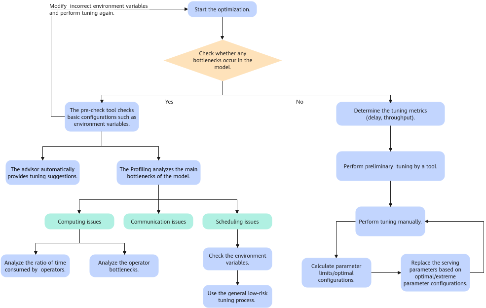

## Model-Only Performance Tuning

For common models and usage scenarios, if the same weights, image, and deployment policy are used, similar performance can theoretically be reproduced.

Therefore, after a performance issue occurs, you can check environment variables and performance-related switches first, because the issue is most likely here (for example, no core binding, a low kernel version, or a log level issue).

For model-only performance tests, see [ATB Models model-only usage](https://www.hiascend.com/document/detail/en/mindie/latest/mindiellm/llmdev/mindie_llm/user_guide/user_manual/offline_inference.md) for evaluation.

If the model-only test result already shows performance degradation, you can perform a detailed Profiling performance analysis. For the analysis method, see [In-Depth Analysis for Model Tuning (MindStudio Insight)](performance_tool_usage.md#in-depth-analysis-for-model-tuning-mindstudio-insight).

### Preliminary Model-Only Test

A model-only test determines the size of test requests based on the `--batch_size` parameter that you enter, and determines the combination of request input length and output length based on `--case_pair`. During inference, it first processes the Prefill of all requests, and then groups all requests into the same Decode Batch to complete Decode inference. For test scenarios not covered by the baseline, especially scenarios with TTFT or TPOT latency requirements, you can perform a model-only test as follows.

1. Set `--case_pair [[input length,1]]` to simulate a model-only test of a single Prefill Batch. In this case, the specified `--batch_size` parameter is recorded as `prefill_batchsize`, and `Total Time(s)` in the test result is recorded as `prefill_time`.

2. Set the `--case_pair` parameter according to the actual input and output lengths and run the test normally. In this case, the specified `--batch_size` parameter is recorded as `decode_batchsize`, and `Non-first token time(ms)` in the test result is recorded as `decode_token_time`.

3. Adjust `decode_batchsize` and `prefill_batchsize` to find a configuration that meets the requirements, as shown in [Table 1](#ZH-CN_TOPIC_0000002504087066__table1511926121511).

   **Table 1** Configuration description

   | Scenario                                                     | Configuration Method                                         |
   | ------------------------------------------------------------ | ------------------------------------------------------------ |
   | Baseline throughput without a latency limit                  | Increase `decode_batchsize` until OOM. (Alternatively, select the `decode_batchsize` at which the growth rate slows down.) |
   | Limit TPOT, do not limit TTFT                                | Adjust `decode_batchsize` until `decode_token_time` just meets the TPOT limit. |
   | Limit TPOT and TTFT, ramp-up test (limit Request Rate)       | Adjust `decode_batchsize` until `decode_token_time` just meets the TPOT limit, and adjust `prefill_batchsize` so that `prefill_time` approaches the TTFT limit. |
   | Limit TPOT and TTFT, fixed concurrency (do not limit Request Rate) | Adjust `decode_batchsize` until `decode_token_time` just meets the TPOT limit, set `prefill_batchsize=dp`, and reduce `decode_batchsize` until  approaches the average TTFT limit. |

4. If model-only performance tuning is required (parallel strategy, environment variables, and so on), repeat step 1 for different configurations until you select the optimal configuration.

5. Convert the model-only Decode Batchsize and Prefill Batchsize into the service-oriented parameters `maxBatchsize` and `maxPrefillBatchSize`.

6. Set other service-oriented and test parameters, and adjust the maximum concurrency, `RequestRate`, `maxBatchSize`, and `maxPrefillBatchsize` according to the actual test result.

## Service-Oriented Performance Tuning Methodology

### Defining the Optimization Objective

You usually focus on performance metrics such as first token latency and throughput. Concurrency and input and output lengths during the test have a great impact on performance. Therefore, you can provide guidance when necessary.

- Low-latency scenario: real-time interaction (for example, a dialog system), which focuses on the first token generation speed (Prefill phase optimization).

- High-throughput scenario: offline batch processing (for example, document generation), which focuses on tokens per second (Decode phase optimization).

  > [!NOTE]
  >
  > Sometimes the performance objective differs greatly from the actual performance. You can evaluate the performance upper limit based on model-only performance to determine the latency or throughput limit, and therefore determine whether the objective is achievable.

#### Service-Oriented Performance Upper Limit Evaluation

Based on the estimation scenario and objective, and on the model-only test result, the following methods provide (optimistic) estimates of the service-oriented performance upper limit:

- Single concurrency: close to the model-only performance at single concurrency.

- Average first token latency at high concurrency.

  - Prefill phase inference is compute-intensive. When Prefill Batchsize increases, a computing power bottleneck occurs. After the bottleneck occurs, Prefill latency grows almost linearly as Batchsize increases.
  - Use the model-only test to find the Prefill Batchsize at which the computing power bottleneck occurs, and divide the concurrent request count of the service-oriented system by this Prefill Batchsize, that is, calculate the first token latency upper limit based on the model-only result. Assume that the Prefill Batchsize at the bottleneck found by the model-only test is , the model-only computing time of a single Prefill Batch at this point is , and the actual service-oriented concurrency to be estimated is . Then the total Prefill time of the concurrent requests in this round in the service-oriented system is estimated as , and under the first-come, first-served (FCFS) scheduling policy, the average first token latency is approximately .

- Throughput and non-first token latency at high concurrency.

  - Decode has a bandwidth bottleneck rather than a computing power bottleneck. Theoretically, the larger the Batchsize of a single Decode, the higher the total throughput, until the device memory limit is reached.
  - For the output throughput and non-first token latency of the service-oriented system, you can use the model-only result at the same concurrency (that is, Decode Batchsize) as the theoretical upper limit of the estimate. Because service-oriented inference incurs extra time overhead such as framework-side scheduling, an optimistic estimate of service-oriented throughput can be converted to 0.8 to 0.9 times the model-only throughput.

- Theoretical upper limit of the maximum concurrency/`maxBatchsize` under a device memory bottleneck: In the Decode phase, `maxBatchSize` is mainly limited by device memory and can be calculated from the number of KV Cache Blocks and the sequence length.

  - The KV Cache pool is allocated in units of Blocks. The Block size is set by `cacheBlockSize` in the MindIE service-oriented parameter configuration and usually uses the default value 128, that is, each Block can store 128 tokens. Calculate the number of KV Cache Blocks that each request needs to occupy based on the context length of the usage scenario:

    - Maximum number of Blocks = Ceil(number of input tokens/cacheBlockSize) + Ceil(maximum number of output tokens/cacheBlockSize)
    - Average number of Blocks = Ceil(average number of input tokens/cacheBlockSize) + Ceil(average number of output tokens/cacheBlockSize).

  - The Total Block Num, that is, the total number of available KV Cache Blocks on the NPU of the MindIE server, can be obtained through an actual test.

    - Clear all old log files in the `/root/mindie/log` directory, and enable the `MINDIE_LLM_PYTHON_LOG_LEVEL` and `MINDIE_LLM_PYTHON_LOG_TO_FILE` environment variables so that the Python program in MindIE LLM generates INFO-level logs and writes them to a file during running.

    - After you determine the other service-oriented configurations except `maxBatchSize`, start the service with the default value. After the service is started successfully on the server, run the `grep` command to search for the `npuBlockNum` keyword in the MindIE LLM Python program log. Multiple results are returned depending on the number of devices used, and the minimum value is the total number of available KV Cache Blocks on the NPU of the MindIE server. Take [Figure 1](#ZH-CN_TOPIC_0000002535887093__fig19500185613447) as an example. The total available number is 817.

      **Figure 1** Example of obtaining the total number of available KV Cache Blocks on the NPU of the MindIE server

      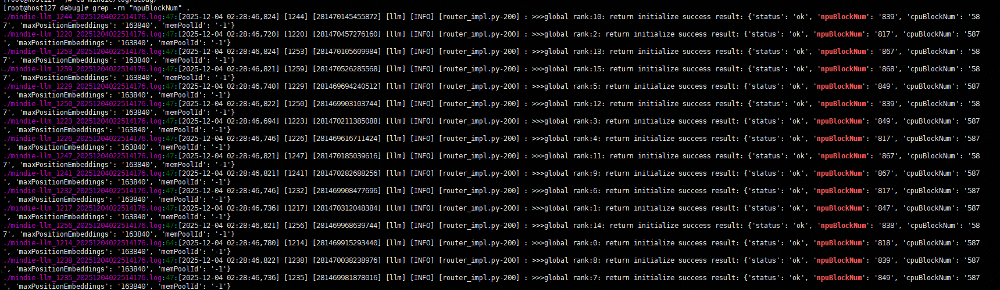

  - To maintain the best performance, `maxBatchSize` should generally not exceed Floor[Total Block Num/maximum number of Blocks]. If the context lengths of requests differ greatly, you can appropriately increase the upper limit to Floor[Total Block Num/average number of Blocks].

### Tuning for the Objective

After you define the optimization objective, adjust the service-oriented parameters to improve service-oriented performance.

**Introduction to Core Parameters**

For the core parameters, see [Table 1](#ZH-CN_TOPIC_0000002535807049__table3617mcpsimp). For details, see the *MindIE LLM Development Guide*.

**Table 1** Core parameters

| Optimization Direction     | Key Parameter                        | Recommended Value/Strategy|
| -------------------------- | ------------------------------------ | ------------------------------------------------------------ |
| **Low latency**            | `maxPrefillBatchSize`                  | Use a small batch (4 to 16) to reduce the first token computation amount. |
|                            | `supportSelectBatch`                   | false, which forcibly gives Prefill scheduling priority.     |
|                            | `maxQueueDelayMicroseconds`            | ≤50 ms (reduces the waiting latency).                        |
| **High throughput**        | `maxBatchSize` (Decode phase)          | Maximize it (limited by device memory).                      |
|                            | `maxPrefillBatchSize`/`maxPrefillTokens` | Increase it relatively and convert it according to the actual average input so that `maxPrefilltokens` is around 10000. |
|                            | `supportSelectBatch`                   | Enable throughput-first scheduling.                          |
|                            | `maxQueueDelayMicroseconds`            | Increase the waiting time so that a large Batch is formed as much as possible at the start of the test. |
|                            | `RequestRate` (set through the test tool) | Increase the dispatch frequency up to the hardware upper limit. |
|                            | `Concurrency` (set through the test tool) | Increase the concurrency step by step in sync until the throughput saturation point. |
|                            | Sequence length trio                 | Configure `maxInputTokenLen`, `maxIterTimes`, and `maxSeqLen` properly based on the actual scenario and requirements. |

**Manual Tuning**

Tune the parameters that do not meet the objective, for example, when the latency or throughput does not meet the objective.

Before tuning, you can first confirm the theoretical upper limit and theoretical optimal configuration of each parameter, for example, calculate the theoretical optimal value of `maxBatchSize`. For the specific calculation method, see [Service-Oriented Performance Upper Limit Evaluation](#service-oriented-performance-upper-limit-evaluation).

**Tool-based Tuning**

Manual tuning requires some service-oriented background. For more convenient tuning, you can use the expert advice function of the **service-oriented tuning tool** (`msServiceProfiler`). For details, see [Service-Oriented Advisor Tool](https://atomgit.com/Ascend/msserviceprofiler/blob/master/docs/en/user_guide/service_profiling_advisor_instruct.md). To use the advisor tool, first use MindIE Benchmark to perform a service-oriented performance test. The advisor tool provides tuning suggestions based on the files written to drive from the MindIE Benchmark test result.

**Challenging Issues**

The service-oriented tuning described in the preceding sections is all black-box tuning. You do not know the specific scheduling process of requests, for example, which requests form a Batch, how large a Batch is, when Prefill is executed, and when Decode is executed.

Some issues cannot be resolved by black-box tuning alone and require further analysis. As with model-only performance optimization, you need to use `msServiceProfiler` for the analysis.

## Service-Oriented Performance Tuning Localization Cases

### Performance Degradation Caused by Framework Scheduling Time

**Symptom**

In the same environment with all other configurations identical, the service-oriented performance of MindIE 2.0.RC1 is much worse than that of MindIE 2.0.T3, and you need to determine whether this is a version issue.

As shown in [Figure 1](#ZH-CN_TOPIC_0000002504087096__fig31731419193712), the upper screenshot shows the model-only test result, in which the average latency of the model-only Decode phase at 300 concurrency is 36 ms. The lower screenshot shows the service-oriented test result, in which the average latency of the Decode phase at 300 concurrency is about 66 ms.

**Figure 1** MindIE 2.0.T3 performance test result

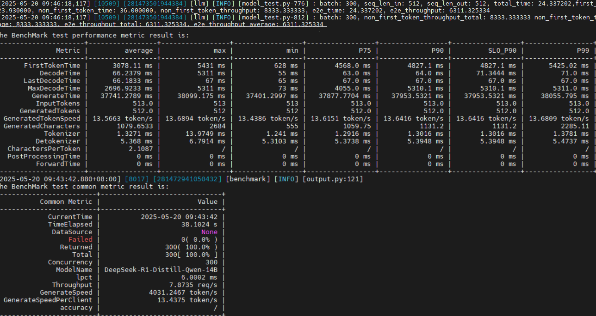

As shown in [Figure 2](#ZH-CN_TOPIC_0000002504087096__fig145925476375), the upper screenshot shows the model-only test result, in which the average latency of the model-only Decode phase at 300 concurrency is 35.44 ms, which is very close to the performance of 2.0.T3. The lower screenshot shows the service-oriented test result, in which the average latency of the Decode phase at 300 concurrency is about 95 ms, which is 50% worse than the performance of 2.0.T3.

**Figure 2** MindIE 2.0.RC1 performance test result

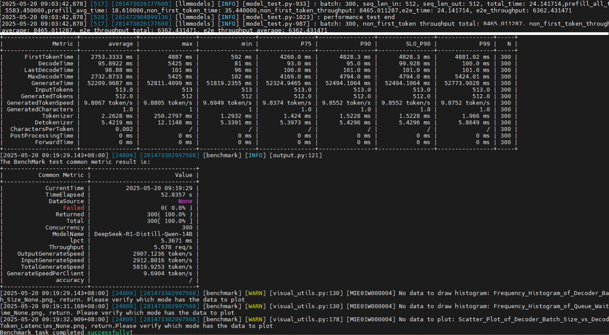

**Solution**

1. Use the pre-check tool to dump and compare the configurations, as shown in [Figure 3](#ZH-CN_TOPIC_0000002504087096__fig2425144244017). `ms_performance_prechecker_dump_20250520_152124.json` is the file written to drive in the MindIE 2.0.T3 environment, and `ms_performance_prechecker_dump_20250520_152138.json` is the file written to drive in the MindIE 2.0.RC1 environment. Except for environment variables that do not affect performance, such as log settings, no obvious configuration difference is found.

   **Figure 3** Configuration comparison

   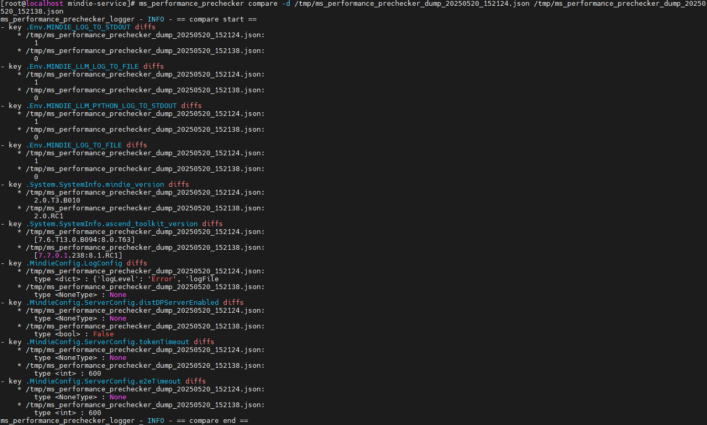

2. Collect the service-oriented performance data of MindIE 2.0.RC1 for comparison. The gap between forwards in the Decode phase of MindIE 2.0.RC1 is too large, which indicates that the pre-processing and post-processing on the CPU side take a long time, as shown in [Figure 4](#ZH-CN_TOPIC_0000002504087096__fig8393010422).

   **Figure 4** Viewing forward

   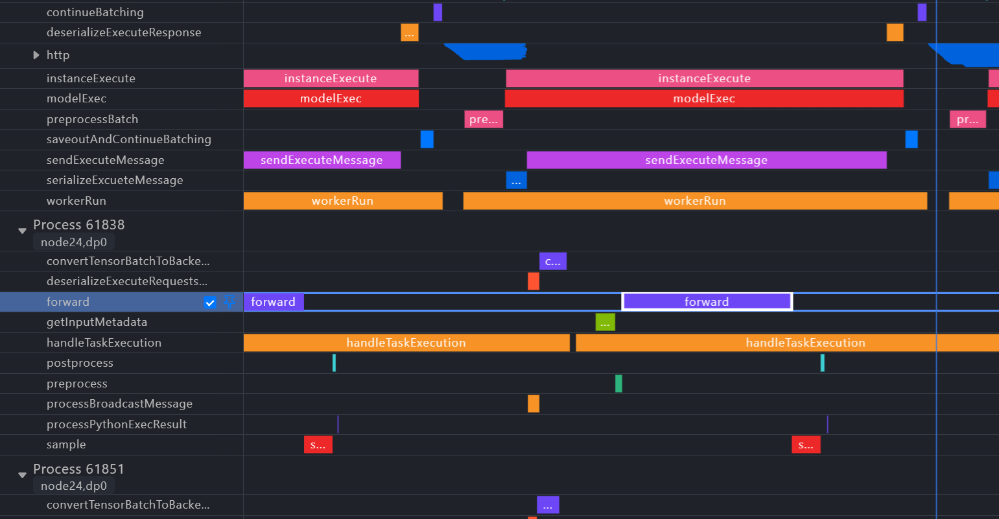

3. After asynchronous scheduling is enabled to shorten the forward gap, the E2E output throughput of MindIE 2.0.RC1 increases from 2900 to 4500, which is 500 token/s higher than that of T3. For how to enable asynchronous scheduling, see the asynchronous scheduling chapter of the *MindIE LLM Development Guide*.

   **Figure 5** Enabling asynchronous scheduling

   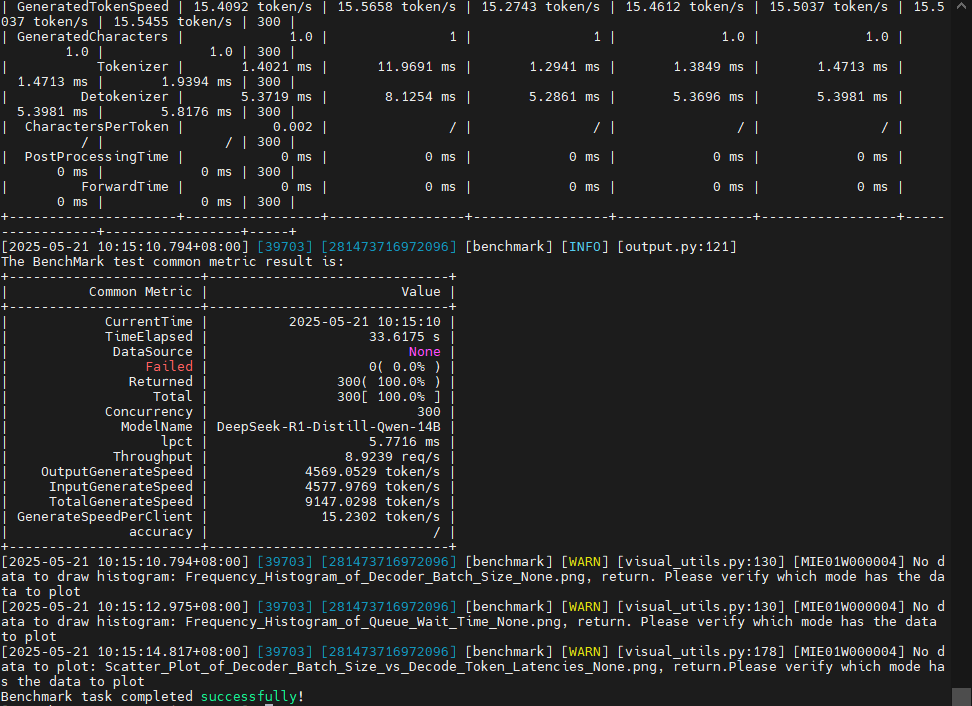

### Model Execution Time Optimization Case

**Symptom**

In the DeepSeek PD-separated large-scale expert parallelism scenario, model performance is significantly degraded.

**Solution**

1. Use `msServiceProfiler` to collect service-oriented performance data of the D node.

2. Analyze the collected performance data and you can find a fast and slow device issue in the Decode phase between two different servers in the same D node. Specifically, the single Decode execution time of the two devices on the two servers is 260 ms and 170 ms respectively, which is a large gap. A very long `MIX_AIC` field appears in the operator swimlane of one device, which indicates that this device is executing an MC2 operator and the synchronization wait time is long. Therefore, this device can be considered a fast device. The `MIX_AIC` field of the other device is shorter. Therefore, that device is a slow device.

   **Figure 1** Screenshot of fast device performance data

   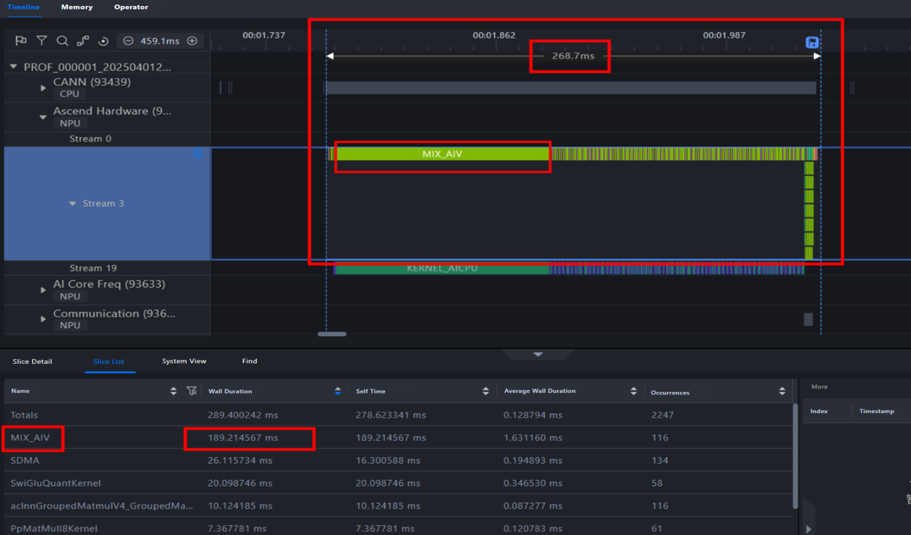

   **Figure 2** Screenshot of slow device performance data

   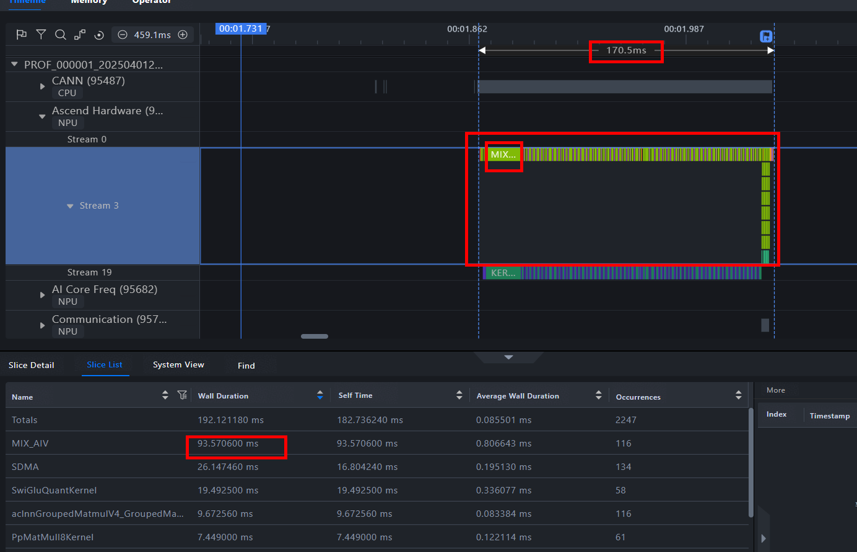

3. The CANN CPU-side swimlane (collapsed and grayed out in [Figure 1](#ZH-CN_TOPIC_0000002535807061__fig193870541031) and [Figure 2](#ZH-CN_TOPIC_0000002535807061__fig179374817410)) shows that the time at which each device starts a task differs, which causes the time of the first MC2 operator (moedispatch) of forward to differ, and a synchronization wait of more than 90 ms is observed. After the first moedispatch is excluded, the remaining computing time is about 140 ms, and the operator performance of the two devices is close. Based on the preceding two points, you can determine that the fast and slow device issue is caused by a time difference in model dispatch rather than operator dispatch.

4. After the distributed scheduling feature is enabled on the D node (enable the `MINDIE_ENABLE_DP_DISTRIBUTED` environment variable, and the large-scale expert parallelism solution after inference solution 25.0.RC1 has this feature enabled by default), performance returns to normal.

### Device Memory Bottleneck Analysis Case

**Symptom**

During DeepSeek two-server service-oriented inference, the actual Batchsize cannot reach 192.

**Analysis**

1. Collect service-oriented performance data.

2. When the Batchsize reaches 192, as Decode increases, at the 185th Decode inference you can see that the KV Block is about to run out, with 36 remaining (initial value 1747). Subsequently, the remaining KV Block decreases to 0, and the Batchsize drops to 72. Before the drop, the last 192 Batchsize inference reaches a length of 253.

   **Figure 1** Viewing data

   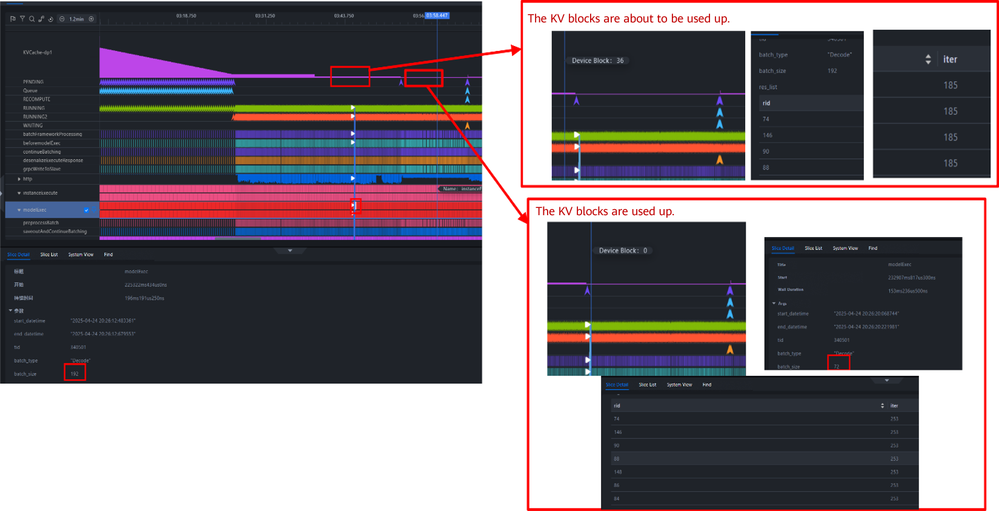

3. In actual execution, when Batchsize=150, Decode can run close to 1000.

   **Figure 2** Actual execution

   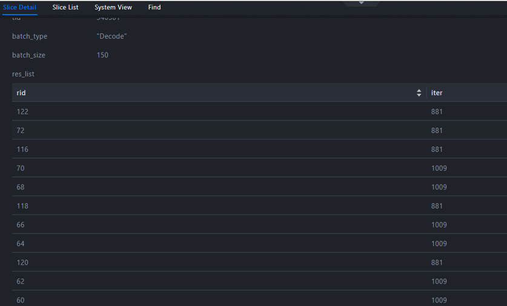

4. Estimate the concurrency upper limit under the device memory bottleneck. Profiling shows that the number of available KV Cache blocks is 1747, and under the default configuration each Block is 128 tokens in size. For the context requirement of 1024 input and 2048 output, the average context is 1536, and the KV Cache can hold an average of 1747/[(1024+2048)/2/128]≈145.

   **Figure 3** Number of Blocks

   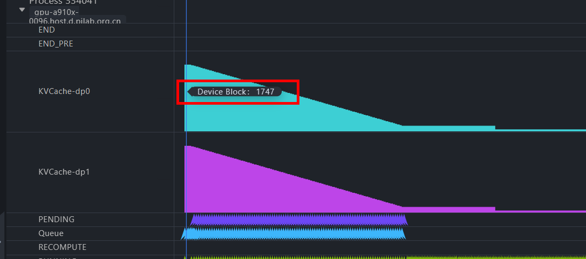

5. Adjust the service-oriented parameters: run `export NPU_MEMORY_FRACTION=0.96` and reduce `maxSeqLen` to 3K to achieve the optimal effect.

### Service-Oriented Parameter Optimization Case

**Symptom**

For a single-server 4-device service-oriented deployment of Qwen3-32B, the concurrency in your usage scenario is small and the requests arrive slowly (the maximum concurrency is 40, and the actual usage is close to a request rate of 9.4). With the default service-oriented configuration of PD colocation, the performance was tested with an input length of 128 and an output length of 100. The average non-first token latency is 48 ms, but the request-level P99 quantile of the non-first token latency (TPOT SLO P99) is 157 ms, which causes stuttering in the streaming output of individual requests and cannot meet your non-first token latency requirement of 50 ms.

**Solution**

1. Observe the preliminary performance test result under the default service-oriented configuration, as shown in [Figure 1](#ZH-CN_TOPIC_0000002504087058__fig57131966516). You can find that (1) under the default Prefill-priority scheduling, the maximum first token latency is only 158 ms, which indicates that Prefill performance is normal and the computing power bottleneck is not reached. (2) The P75 first token latency is less than 50 ms, which indicates that most non-first token latencies are normal and the actual Decode performance meets expectations. (3) The P90/P99/maximum latency of non-first tokens is relatively high. It is inferred that because requests arrive slowly, the Prefill of a new request interrupts the Decode of an in-progress request. Therefore, some non-first tokens must wait for the Prefill of the new request to complete, and the non-first token latency increases sharply.

   **Figure 1** Preliminary performance test result

   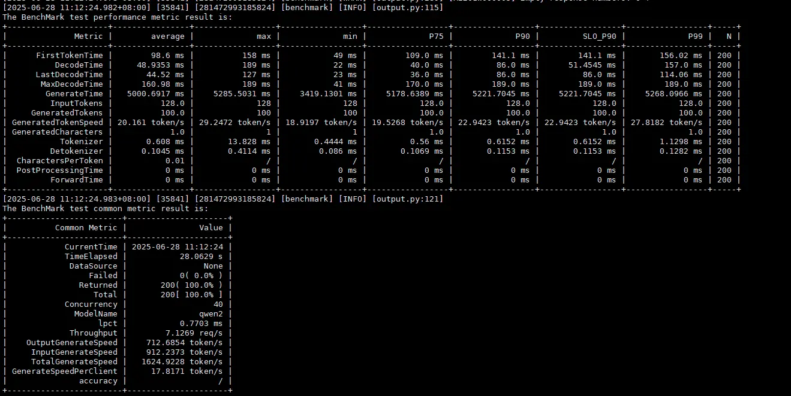

2. In this scenario, you can enable `supportSelectBatch` and adjust the priority of Prefill and Decode by setting `prefillTimeMsPerReq` and `decodeTimeMsPerReq` so that the scheduler allows Decode to take priority in certain situations. This policy reduces the occurrence of "the Prefill of a new request interrupting the Decode of an in-progress request", thereby increasing the proportion of consecutive Decode and reducing the non-first token latency, as shown in [Figure 2](#ZH-CN_TOPIC_0000002504087058__fig99048387485). Although this policy causes some requests to wait for Prefill, the model Prefill performance in this case is already good enough. Even if the first token latency increases slightly, you can still control the first token latency within a range acceptable to you by adjusting the priority parameters.

   **Figure 2** Schematic diagram of the cause of non-first token latency degradation

   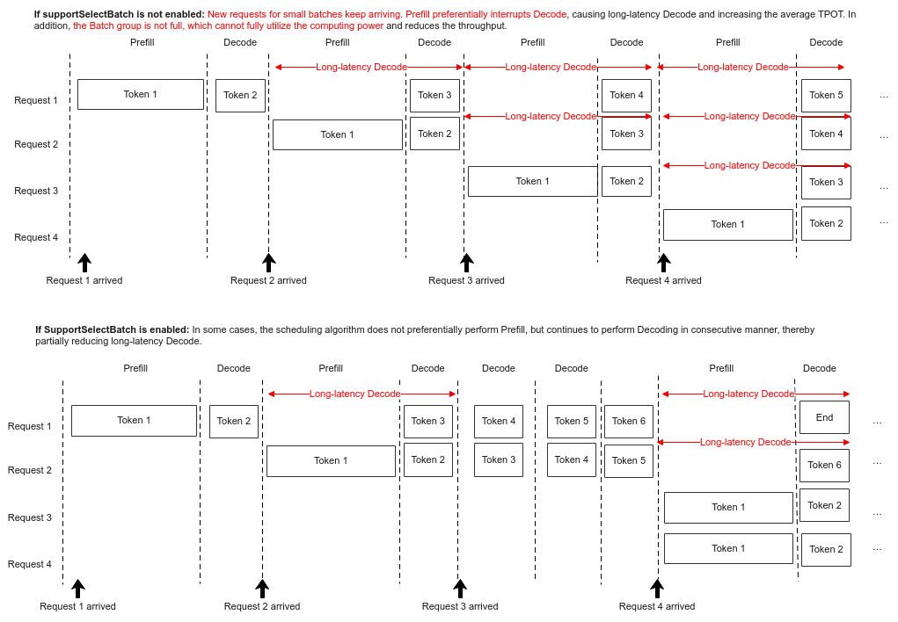

3. Adjust the priority parameters. The higher `prefillTimeMsPerReq` is and the lower `decodeTimeMsPerReq` is, the higher the Decode priority is. Conversely, the lower `prefillTimeMsPerReq` is and the higher `decodeTimeMsPerReq` is, the higher the Prefill priority is. Set `supportSelectBatch` to true, `prefillTimeMsPerReq` to 1000, and `decodeTimeMsPerReq` to 1. The performance test result is shown in [Figure 3](#ZH-CN_TOPIC_0000002504087058__fig17560946184820). The first token latency increases to 1562 ms, the average non-first token latency decreases to 31.7 ms, and the P99 non-first token latency decreases to 36 ms. The overall streaming output is smooth and meets your requirements.

   **Figure 3** Performance test result after tuning

   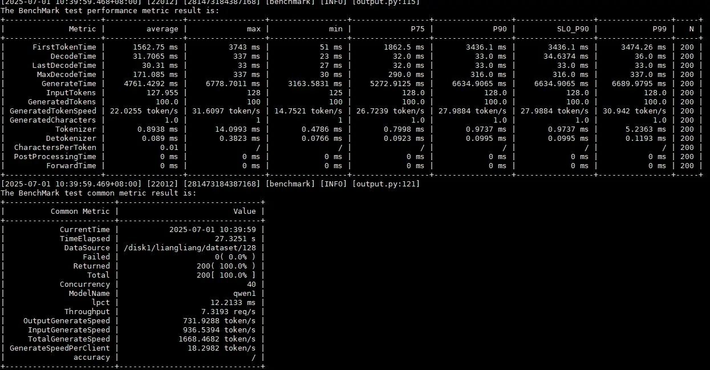

## DeepSeek Advanced Tuning

Advanced tuning benefits both service-oriented and model-only scenarios. Therefore, it is not distinguished here. Some advanced tuning methods may require support from related components.

### Device Memory Analysis

After optimization reaches a bottleneck, an intuitive method is to optimize device memory to use a better configuration (for example, the concurrency and parallel strategy). You can consider using quantization to reduce the computation amount and device memory usage. Currently, the best-adapted solution is W8A8.

### Parallel Strategy Tuning

In the current 16-device inference scenario, the optimal configuration is generally TP=8, DP=2, MOE_TP=4, and MOE_EP=4. However, you may have different host platforms (arm/x86) and input and output requirements, which change the optimal parallel strategy. Therefore, you need to adjust the parallel strategy.

### Communication Strategy Optimization

Different communication strategies produce different communication volumes, which you need to evaluate based on the parallel strategy.

Tuning suggestions:

- Minimize the TP of Attention and increase DP to avoid KV Cache replication and avoid repeated access and storage.
- Pure DP communication saves KV Cache, but model weights occupy more space.
- Expert communication (EP) is configured through the `ep_level` keyword in the `config.json` configuration file in the ATB-Models installation directory. The theoretical communication volume of AlltoAll is somewhat smaller.
- Communication can use LCCL or HCCL. LCCL usually has better performance, but adaptation issues may occur under some parallel strategies.

### Other Optimization Methods

- Weight format conversion: convert weights to the NZ format to reduce the time consumed by inline format conversion.
- Total request setting: Because the Decode phase performance ramps up (limited by the Request Rate, the Batch is small in the early stage and does not reach the bottleneck, and the Batch in the Decode phase increases gradually), you are advised to set the total number of requests to concurrency x 10.
